# Envelope Follower with Skew Limiter — Final Design Specification

> **Base reference:** [`EnvelopeFollower.md`](EnvelopeFollower.md) (extracted from [`EnvelopeFollower.webp`](EnvelopeFollower.webp))
>
> **Engineering review:** [`EnvelopeFollowerImprovements.md`](EnvelopeFollowerImprovements.md) (all Tier 1–3 items `1.1`–`3.4` resolved below)
>
> **Status:** Locked-in architecture & pin-level build specification ready for SKiDL / KiCad schematic capture and 6 HP Eurorack PCB + panel layout.

---

## 1. Design Constraints & Musical Goals

- **Format:** 3U Eurorack, **6 HP** (`30.0 mm × 128.5 mm` panel; `~105.5 mm` usable vertical span between mounting rails).
- **Panel ergonomics:** Single-column **4-knob** layout for comfortable finger clearance (`~13–14 mm` knobs), centered middle toggle/LED row (`SMOOTH` + `LED1` + `FAST / SLOW`), and a symmetric **`2 × 2` bottom jack grid** (`IN` / `SLEW IN` above `OUT` / `INV_OUT`).
- **IC budget:** Strictly **`2× TL074HIDR`** (SOIC-14) — **8 / 8 op-amp sections utilized**, `0` unused sections, `0` calibration trimmers.
- **Sourcing strategy:**
  - **JLCPCB PCBA (SMD):** `50` SMD parts total across `0603`/`0805`/`1206`, `SOD-123`, `SOT-23`, and `SOIC-14`. Uses **only 3 Extended SKUs** (`TL074HIDR`, `BAT54S`, and `10 kΩ ±0.1%` thin-film); all remaining resistors, C0G/X7R capacitors, and `1N4148W` / `B5819W` diodes are **JLCPCB Basic** parts.
  - **Tayda / Panel Hardware (Through-Hole):** `18` TH parts (`4×` Alpha `9 mm` vertical pots, `4×` switched Thonkiconn jacks, `2×` sub-mini toggles, `1×` 2-pin bi-color LED `A-1076`, `1×` shrouded 10-pin Eurorack power header, `2×` radial bulk electrolytics, and `4×` `5 mm` pitch box film capacitors).
  - **DNP Test Points (Through-Hole, Optional):** `12` unpopulated test points (`TP1`–`TP12`, Ronghe `RH-5001` / LCSC `C5199801`, KiCad symbol `Connector:TestPoint`, footprint `TestPoint:TestPoint_Keystone_5000-5004_Miniature`, `1.0 mm` drill / `2.0 mm` pad, `B.Cu`-mounted). Marked `dnp=True` and `exclude_from_bom=True` for **`$0` JLCPCB assembly fee** (`3` Extended SMD SKUs unchanged); holes remain directly probeable or selectively hand-soldered during bring-up.
- **Signal levels & musical focus:**
  - Dedicated **Eurorack `10 Vpp` (`±5 V` peak)** input staging (switchless `×2` non-inverting preamp reaches `±10.0 V` cleanly without clipping).
  - Optimized for **techno kick-drum sidechain ducking** (`INV_OUT` + zero-gain-drop `SMOOTH` filter + post-offset bi-color LED zero-crossing visual tuning), **snappy percussion / 303-style portamento glides** (`FAST` `470 nF` mode via `SLEW IN`), and **multi-second ambient swells** (`SLOW` `4.87 µF` mode up to `~3.0 s`).

---

## 2. Locked-In Decision Matrix

| Review Item | Topic | Final Choice | Key Design Rationale |
| :--- | :--- | :--- | :--- |
| **1.1** | Detector Core | **Active 2-op-amp Skew Limiter** (`U1D` + `U2A`) | `100%` independent `ATK` and `Release` (`0 dB` divider collapse); fits `2× TL074H` with `0` spare sections. |
| **1.2** | Loop Comp & Min Floor | `R18 = 10 kΩ`, `C10 = 2.2 nF` C0G; **symmetric `1 kΩ / 1 kΩ`** (`R19`, `R20`) | Eliminates `~0.65 V` diode drop & thermal drift; `~90°` phase margin; keeps `U1D` strictly linear (`≤ 16 mA` peak) and reuses `1 kΩ` Basic BOM value. |
| **1.3** | Output & `OFFSET` Bias | **Virtual-ground summer** (`U2B` → `INV_OUT`) + inverter (`U2C` → `OUT`); **split-resistor local RC filter** | `0.00%` gain shift; `49.6%` linear travel at `75%`; CW-positive on `OUT`; `1 kΩ → 10 µF → 5.1 kΩ` (`16.7 Hz` LPF, `±4.98 V` span). |
| **1.4** | Input & Preamp | `J1` normaled to `GND`, `R3 = 1 MΩ` at jack, `C7 = 470 nF`, **switchless `×2` preamp** (`U1A`) | `Z_in = 90.9 kΩ`; `f_c = 3.72 Hz`; tailored for `10 Vpp` Eurorack (saves 1 panel switch); `R13 + R14 = 20 kΩ` sets exact `1.000×` FWR gain. |
| **1.5** | LED Driver | **Post-offset active $V$-to-$I$ driver** (`U2D`) with **Tayda `A-1076`** 2-pin bi-color LED (`R33 = 2.2 kΩ`) | Anti-parallel LED dies clamp each other (no `1N4148` needed); `0.00 mA` @ `0 V`; Red/Green zero-crossing lets user dial kick ducking by eye. |
| **2.1** | Op-Amp Selection | **`2× TL074HIDR`** (SOIC-14, single Extended SKU) | No phase reversal, input CM includes `V+`, near-rail output swing (`~115 mV` dropout), `1 mV` typ $V_{os}$, `~1–10 pA` bias current. |
| **2.2** | Precision & Diodes | **`10 kΩ ±0.1%`** thin-film + **`BAT54S`** (`U1B`) + **`1N4148W`** (`D4`, `D5`) | Minimizes `1f` rectifier ripple; `BAT54S` dual-series SOT-23 fits `U1B`; low-leakage silicon (`1N4148W`) protects slow ambient hold curves. |
| **2.3** | `2f` Ripple Filter | Front-panel **`SMOOTH` toggle** (`SW1`) using split-`R_env` T-filter (`2× 49.9 kΩ` + `220 nF`) | `f_c = 29.0 Hz` (`−11.1 dB` @ `100 Hz` kick ripple) with **`0.00%` DC amplitude loss** when engaged. |
| **2.4** | Power & I/O | Shrouded 10-pin header, **`B5819W`** series Schottkys, `10 Ω` RC resistors, **Tayda `47 µF / 35 V` TH caps**, `4× 100 nF` bypasses | `0 mA` reverse-polarity fault current; `339 Hz` rail LPF (`±11.54 V` internal); zero extra JLCPCB fee for bulk caps. |
| **2.5** | Timing & Pots | Tayda Alpha `9 mm` pots (`A100K`, `2× A1M`, `B10K` center-detent) + **`FAST / SLOW` toggle** (`SW2`: `470 nF` + `2× 2.2 µF` box film) | Musical log timing control (`0.29 ms–289 ms` in `FAST`; `3.0 ms–3.00 s` rise / `1.84 s` fall in `SLOW`) with fail-safe rheostat wiring. |
| **3.1** | Normaled `SLEW IN` | Switched jack `J2` (`1 kΩ` / `1 MΩ` / `10 kΩ`) ahead of `U1D.+` | Fills `2 × 2` bottom jack grid; unpatched = Envelope Follower, patched = DC-coupled bipolar asymmetric skew limiter. |
| **3.2–3.4** | Extra Mod Cons | Skipped (`GATE OUT`, `PRE OUT`, `AC / DC`, `CLIP`, `LM13700`) | Preserves `2× TL074H` budget, zero trimmers, and uncrowded single-column 6 HP big-finger ergonomics. |

---

## 3. Signal Flow & Op-Amp Allocation

```mermaid
flowchart LR
    IN["J1 IN (1M bleed, C7 470nF)"] --> ATT["RV1 100k A Atten (90.9k Zin)"]
    ATT --> PRE["U1A Non-Inv x2 Preamp (10k 0.1%, C9 10uF)"]
    PRE --> HWR["U1B HWR (BAT54S, 10k 0.1%)"]
    PRE --> FF["Feedforward (R11+R12 20k)"]
    HWR --> SUM["U1C FWR Summer (R13+R14 20k = 1.000x)"]
    FF --> SUM
    SUM -->|"1k R15 to normal"| SLEWJ["J2 SLEW IN (Normaled Jack)"]
    SLEWJ -->|"10k R17, 1M R16"| DRV["U1D Skew Driver (R18 10k, C10 2.2nF C0G, D4/D5 1N4148W)"]
    DRV -->|"R19/R20 1k + RV2/RV3 A1M"| CAP["C11 470nF + SW2 FAST/SLOW (C12+C13 4.4uF)"]
    CAP --> BUF["U2A Hold Buffer"]
    BUF -->|"R18 10k feedback"| DRV
    BUF --> SMOOTH["R21/R22 49.9k + SW1 SMOOTH (C14 220nF)"]
    SMOOTH --> INV["U2B Inverting Unity Summer (100k, RV4 B10K OFFSET)"]
    INV -->|"R25 1k"| INVOUT["J4 INV_OUT"]
    INV --> OUTAMP["U2C Unity Inverter (10k 0.1%)"]
    OUTAMP -->|"R32 1k"| OUTJ["J3 OUT"]
    OUTAMP -->|"pre-R32 tap"| LEDDRV["U2D V-to-I Driver (LED1 A-1076, R33 2.2k)"]
```



### Op-Amp Section Allocation (`2× TL074HIDR`, SOIC-14, `0` Unused Sections)

Both `U1` and `U2` share `Pin 4 = +12V` (`+11.54 V` filtered internal) and `Pin 11 = -12V` (`-11.54 V` filtered internal).

| IC | Device | Section | Pins (`+`, `-`, `OUT`) | Functional Role |
| :--- | :--- | :--- | :--- | :--- |
| `U1` | `TL074HIDR` | `U1A` | `3`, `2`, `1` | Non-inverting `×2.00` Eurorack preamp (`C9 = 10 µF` keeps DC gain `1.00×`, `C8 = 33 pF`) |
| `U1` | `TL074HIDR` | `U1B` | `5`, `6`, `7` | Precision half-wave rectifier (`10 kΩ ±0.1%` `R8`–`R9`, `BAT54S` `D3`) |
| `U1` | `TL074HIDR` | `U1C` | `10`, `9`, `8` | Full-wave rectifier summing amplifier (`10 kΩ ±0.1%` `R10`–`R14` = exact `1.000×`) |
| `U1` | `TL074HIDR` | `U1D` | `12`, `13`, `14` | Active skew-limiter driver (`R18 = 10 kΩ`, `C10 = 2.2 nF` C0G, `D4`/`D5` `1N4148W`) |
| `U2` | `TL074HIDR` | `U2A` | `3`, `2`, `1` | Hold-capacitor (`C11`–`C13`) unity-gain buffer (`V_env`; feeds `U1D` feedback & `SMOOTH` T-filter) |
| `U2` | `TL074HIDR` | `U2B` | `5`, `6`, `7` | Virtual-ground inverting unity summer (`100 kΩ` `R23`–`R24`, `RV4` `OFFSET`) $\rightarrow$ `INV_OUT` |
| `U2` | `TL074HIDR` | `U2C` | `10`, `9`, `8` | Unity-gain inverter (`10 kΩ ±0.1%` `R30`–`R31`) $\rightarrow$ `OUT` (`+(V_env + V_off)`) |
| `U2` | `TL074HIDR` | `U2D` | `12`, `13`, `14` | Post-offset active $V$-to-$I$ bi-color LED driver (`LED1` `A-1076`, `R33 = 2.2 kΩ`) |

---

## 4. Complete Bill of Materials (80 Components Total — 68 Populated + 12 DNP)

**Summary:** `2` ICs + `6` Diodes/LED + `33` Resistors + `16` Capacitors + `4` Potentiometers + `2` Switches + `5` Jacks/Header + `12` DNP Test Points = **`80` footprints total** (`50` JLCPCB SMD + `18` Tayda / Panel Through-Hole + `12` DNP Through-Hole Test Points).

### 4.1 Integrated Circuits (2 — JLCPCB Extended)

| RefDes | Part / MPN | Package | Sourcing | Qty | Function |
| :--- | :--- | :--- | :--- | :--- | :--- |
| `U1`, `U2` | `TL074HIDR` | SOIC-14 | JLCPCB Extended (1 SKU) | 2 | Quad CMOS/FET-input op-amps (`U1A`–`U1D`, `U2A`–`U2D`) |

### 4.2 Diodes & LED (6 — 5 SMD + 1 Through-Hole)

| RefDes | Part / Value | Package | Sourcing | Qty | Function |
| :--- | :--- | :--- | :--- | :--- | :--- |
| `D1`, `D2` | `B5819W` (`40 V / 1 A` Schottky) | SOD-123 | JLCPCB Basic (`C8598`) | 2 | Series reverse-polarity protection on `+12V` (`D1`) and `-12V` (`D2`) |
| `D3` | `BAT54S` (dual series Schottky) | SOT-23 | JLCPCB Extended | 1 | `U1B` precision HWR pair (`Pin 1 = A1`, `Pin 2 = K2`, `Pin 3 = K1/A2`) |
| `D4`, `D5` | `1N4148W` (low-leakage silicon) | SOD-123 | JLCPCB Basic (`C81598`) | 2 | Active skew limiter `D_atk` (`D4`) & `D_rel` (`D5`) — **silicon only, never Schottky** |
| `LED1` | `3 mm` 2-pin anti-parallel Red/Green | TH (`3 mm`) | Tayda `A-1076` | 1 | Post-offset `OUT` polarity & amplitude indicator |

### 4.3 Resistors (33 — All SMD `0603`/`0805`)

Value breakdown: **`14× 10 kΩ ±0.1%`** (Extended), **`7× 1 kΩ 1%`**, **`3× 1 MΩ 1%`**, **`2× 10 Ω 1%`**, **`2× 5.1 kΩ 1%`**, **`2× 49.9 kΩ 1%`**, **`2× 100 kΩ 1%`**, **`1× 2.2 kΩ 1%`** (`19` Basic + `14` single-SKU Extended = `33`).

| RefDes | Value & Tol | Sourcing | Qty | Function |
| :--- | :--- | :--- | :--- | :--- |
| `R1`, `R2` | `10 Ω 1%` | JLCPCB Basic | 2 | `+12V` (`R1`) and `-12V` (`R2`) rail RC filter resistors (after `D1`/`D2`) |
| `R3`, `R5`, `R16` | `1 MΩ 1%` | JLCPCB Basic | 3 | `J1` jack bleed (`R3`), `U1A.+` wiper-lift (`R5`), `J2 SLEW IN` ground ref (`R16`) |
| `R4`, `R6`, `R7`, `R8`, `R9`, `R10`, `R11`, `R12`, `R13`, `R14`, `R17`, `R18`, `R30`, `R31` | `10 kΩ ±0.1%` thin-film | JLCPCB Extended (1 SKU) | 14 | `U1A` prot/feedback/gain (`R4`, `R6`, `R7`); `U1B`/`U1C` FWR (`R8`–`R14`); `U1D` prot/feedback (`R17`, `R18`); `U2C` unity inverter (`R30`, `R31`) |
| `R15`, `R19`, `R20`, `R25`, `R26`, `R28`, `R32` | `1 kΩ 1%` | JLCPCB Basic | 7 | `SLEW IN` normal prot (`R15`), `R_atk_min` (`R19`), `R_rel_min` (`R20`), `INV_OUT` prot (`R25`), `OFFSET` RC inputs (`R26`, `R28`), `OUT` prot (`R32`) |
| `R21`, `R22` | `49.9 kΩ 1%` | JLCPCB Basic | 2 | Zero-gain-drop split-`R_env` `SMOOTH` T-filter (`R21 + R22 = 99.8 kΩ`) |
| `R23`, `R24` | `100 kΩ 1%` | JLCPCB Basic | 2 | `U2B` offset summing resistor (`R23`) & virtual-ground feedback (`R24`) |
| `R27`, `R29` | `5.1 kΩ 1%` | JLCPCB Basic | 2 | `OFFSET` divider range resistors after `C15`/`C16` (`±4.98 V` span) |
| `R33` | `2.2 kΩ 1%` | JLCPCB Basic | 1 | `U2D` LED current-sense resistor (`2.3 mA @ 5 V`, `4.5 mA @ 10 V`, `45 mW` max) |

### 4.4 Capacitors (16 — 10 SMD Basic + 6 Tayda Through-Hole)

| RefDes | Value & Rating | Dielectric / Package | Sourcing | Qty | Function |
| :--- | :--- | :--- | :--- | :--- | :--- |
| `C1`, `C2` | `47 µF / 35 V` | Polarized radial electrolytic (TH) | Tayda | 2 | `+12V` (`C1`) and `-12V` (`C2`: **`+` to `GND`, `-` to `-12V`**) bulk rail caps |
| `C3`, `C4`, `C5`, `C6` | `100 nF / 50 V` | X7R MLCC (`0603`/`0805`) | JLCPCB Basic | 4 | Local IC decoupling right at `U1.4`, `U1.11`, `U2.4`, `U2.11` |
| `C7`, `C11` | `470 nF / 63 V` | `5 mm` box polyester/polypropylene film (TH) | Tayda | 2 | `C7` input AC coupling (`3.72 Hz`); `C11` permanent `FAST` skew hold cap |
| `C8` | `33 pF / 50 V` | C0G / NP0 MLCC (`0603`/`0805`) | JLCPCB Basic | 1 | `U1A` feedback stabilization (`482 kHz`) |
| `C9`, `C15`, `C16` | `10 µF / 25 V` | X7R MLCC (`0805`/`1206`) | JLCPCB Basic | 3 | `C9` `U1A` DC-gain block (`1.59 Hz`); `C15`/`C16` `OFFSET` RC filter caps (`16.7 Hz`) |
| `C10` | `2.2 nF / 50 V` | C0G / NP0 MLCC (`0603`/`0805`) | JLCPCB Basic | 1 | `U1D` local feedback compensation (`f_z = 7.23 kHz`, `~90°` phase margin) |
| `C12`, `C13` | `2.2 µF / 50 V` | `5 mm` box film (e.g., WIMA MKS2, TH) | Tayda | 2 | Switched in parallel across `C11` via `SW2` for `SLOW` mode (`4.87 µF` total) |
| `C14` | `220 nF / 50 V` | X7R MLCC (`0805`/`1206`) | JLCPCB Basic | 1 | `SMOOTH` T-filter shunt cap (`f_c = 29.0 Hz`, `−11.1 dB @ 100 Hz`) |

### 4.5 Potentiometers, Switches, Jacks & Power Header (11 — All Through-Hole)

| RefDes | Type / Part | Sourcing | Qty | Function & Terminal Convention |
| :--- | :--- | :--- | :--- | :--- |
| `RV1` (`GAIN`) | `A100K` Alpha `9 mm` vertical (`RD901F-40-15R1-A100K`) | Tayda `A-1855` | 1 | Audio-taper input attenuator (`.1` CCW=`GND`, `.2` wiper, `.3` CW=in) |
| `RV2` (`ATK`) | `A1M` Alpha `9 mm` vertical (`RD901F-40-15R1-A1M`) | Tayda `A-1672` | 1 | Fail-safe attack rheostat (`.1` CCW=`R19.2`, `.2+.3` Wiper+CW=`NET_ENV_CAP`) |
| `RV3` (`REL`) | `A1M` Alpha `9 mm` vertical (`RD901F-40-15R1-A1M`) | Tayda `A-1672` | 1 | Fail-safe release rheostat (`.1` CCW=`R20.2`, `.2+.3` Wiper+CW=`NET_ENV_CAP`) |
| `RV4` (`OFFSET`) | `B10K` center-detent Alpha `9 mm` (`RD901F-40-15R1-B10K-0CD`) | Tayda `A-8401` | 1 | Linear bipolar offset divider (`.1` CCW=`-V_off`, `.2` wiper, `.3` CW=`+V_off`) |
| `SW1` (`SMOOTH`) | Sub-miniature vertical PCB toggle (SPST or SPDT `.2`/`.3`) | Tayda | 1 | Connects `C14` to `NET_SMOOTH_MID` to attenuate `100 Hz` kick ripple |
| `SW2` (`FAST/SLOW`) | Sub-miniature vertical PCB toggle (SPST or SPDT `.2`/`.3`) | Tayda | 1 | Parallels `C12 + C13` (`4.4 µF`) across `C11` (`470 nF` $\rightarrow$ `4.87 µF`) |
| `J1`–`J4` | `3.5 mm` switched mono jack (Thonkiconn `WQP-PJ398SM`) | Thonk / Tayda | 4 | `J1` `IN` (`.Switch` $\rightarrow$ `GND`), `J2` `SLEW IN` (`.Switch` normal), `J3` `OUT`, `J4` `INV_OUT` |
| `J_PWR` | Shrouded 10-pin (`2×5`) `2.54 mm` box header | Tayda | 1 | Eurorack power (`1–2` = `-12V`, `3–8` = `GND`, `9–10` = `+12V`) |

### 4.6 Test Points (12 — All Through-Hole, DNP)

All `12` test points share the same specification: **Ronghe `RH-5001`** (`2.5 mm` black through-board pin/loop), LCSC **`C5199801`**, KiCad symbol `Connector:TestPoint`, footprint `TestPoint:TestPoint_Keystone_5000-5004_Miniature` (`1.0 mm` drill, `2.0 mm` pad, `3.3 mm` courtyard), mounted on **`B.Cu`**, and marked **`DNP`** (`dnp=True`, `exclude_from_bom=True`).

| RefDes | Silkscreen Label | Net | Verification Role |
| :--- | :--- | :--- | :--- |
| `TP1` | `GND` | `GND` | Lower/power-section scope ground clip reference |
| `TP2` | `+12V` | `+12V` | Filtered `+11.54 V` internal rail (post-`D1`/`R1`) |
| `TP3` | `-12V` | `-12V` | Filtered `-11.54 V` internal rail (post-`D2`/`R2`, `C2` polarity check) |
| `TP4` | `PRE` | `NET_PREAMP_OUT` | `U1A.1` `×2` preamp output (`±10 V` headroom, `RV1` check) |
| `TP5` | `RECT` | `NET_RECT_OUT` | `U1C.8` FWR output (`1.000×` gain, half-cycle symmetry) |
| `TP6` | `ENV` | `NET_ENV_BUF` | `U2A.1` buffered `V_env` (zero loading on high-Z `NET_ENV_CAP`) |
| `TP7` | `INV` | `NET_INV_AMP` | `U2B.7` inverted summer output (`SMOOTH` + `OFFSET` check) |
| `TP8` | `OUT` | `NET_OUT_AMP` | `U2C.8` unity inverter output & `U2D` LED driver input |
| `TP9` | `HWR` | `NET_RECT_HALF` | `D3.1`/`R9.2`/`R10.1` `U1B` half-wave rectifier isolation check |
| `TP10` | `DRV` | `NET_U1D_OUT` | `U1D.14` active skew driver swing (`±11.5 V`) & `C10` loop stability |
| `TP11` | `OFF` | `NET_OFF_WIPER` | `RV4.2` RC-filtered `±4.98 V` offset voltage & center-detent check |
| `TP12` | `GND2` | `GND` | Upper-board scope ground clip reference for short dual-probe leads |

---

## 5. Stage-by-Stage Electrical Analysis & Timing Tables

### 5.1 Power Rails & Protection (`J_PWR`, `D1`–`D2`, `R1`–`R2`, `C1`–`C6`)
- **Quiescent & operating current:** `2× TL074HIDR` draw `~937.5 µA`/channel typ (`~7.5 mA` total across 8 sections; `9.0 mA` max), plus `~1.0 mA` in the `OFFSET` string and up to `~4.5 mA` peak for `LED1` + output loads $\implies$ **`~13–18 mA` peak** on `+12V` and **`~9–13 mA`** on `-12V`.
- **Internal rail voltage:** At `~18 mA`, `B5819W` (`V_f ≈ 0.28 V`) plus `10 Ω` (`0.18 V`) drops `~0.46 V` total $\implies$ internal rails sit at **`±11.54 V`**.
- **Rail noise filtering:** `R1`/`R2` (`10 Ω`) + `C1`/`C2` (`47 µF`) form a damped **`f_c = 339 Hz`** low-pass filter on both rails, reinforced by `C3`–`C6` (`100 nF`) directly at each IC supply pin.

### 5.2 Input Stage & `×2` Preamp (`J1`, `R3`–`R7`, `C7`–`C9`, `RV1`, `U1A`)
- **Input impedance & HPF:** `J1.Switch` grounds unpatched inputs. With `RV1 = 100 kΩ` and `R3 = 1 MΩ`, $Z_{\text{in}} = 1\,\text{M}\Omega \parallel 100\,\text{k}\Omega = \mathbf{90.9\,\text{k}\Omega}$ (`−0.09 dB` / `1.1%` loss from a `1 kΩ` Eurorack driver). `C7 = 470 nF` film sets $f_c = \mathbf{3.72\,\text{Hz}}$ (`< 0.04 dB` drop at `40 Hz`).
- **Preamp transfer (`U1A`):**
  - AC gain ($f \gg 1.59\,\text{Hz}$): $1 + \frac{R_6}{R_7} = \mathbf{+2.00\times}$ (`+6.02 dB`). A standard `10 Vpp` (`±5 V` peak) Eurorack input reaches **`±10.0 V` at `100%` CW** on `RV1` (`1.5 V` clear of `TL074H`'s `±11.4 V` swing limit).
  - DC gain (`0 Hz`): `C9 = 10 µF` (`f_c = 1.59 Hz`) blocks DC through `R7`, forcing **DC gain = `1.00×`** (keeping `U1A`'s `1 mV` $V_{os}$ unamplified). `C8 = 33 pF` rolls off above `482 kHz`.

### 5.3 Precision Full-Wave Rectifier (`R8`–`R14`, `D3`, `U1B`, `U1C`)
- Uses `10 kΩ ±0.1%` thin-film resistors throughout (`R8`–`R14`) and `BAT54S` (`D3`, `V_f ≈ 0.3 V`) inside `U1B`'s loop:
  - $V_{\text{pre}} > 0$: `D3` Pin 1→3 (`A1→K1`) conducts, Pin 3→2 (`A2→K2`) is off; `U1B` sets $V_{\text{half}} = -V_{\text{pre}}$. `U1C` sums `R10` (`10 kΩ`) and `R11 + R12` (`20 kΩ`) through `R13 + R14` (`20 kΩ`) $\implies V_{\text{rect}} = -20\,\text{k}\Omega \left(\frac{-V_{\text{pre}}}{10\,\text{k}\Omega} + \frac{V_{\text{pre}}}{20\,\text{k}\Omega}\right) = \mathbf{+1.000\,V_{\text{pre}}}$.
  - $V_{\text{pre}} < 0$: `D3` Pin 3→2 (`A2→K2`) clamps `U1B.OUT` at `+0.3 V`; `R10` sees `0 V` at both ends $\implies V_{\text{rect}} = -20\,\text{k}\Omega \left(\frac{V_{\text{pre}}}{20\,\text{k}\Omega}\right) = \mathbf{+1.000\,|V_{\text{pre}}|}$.

### 5.4 Normaled `SLEW IN` Jack (`J2`, `R15`–`R17`)
- **Unpatched:** `U1C.OUT` passes through `R15` (`1 kΩ`) $\rightarrow$ `J2.Switch` $\rightarrow$ `J2.Tip` $\rightarrow$ `R17` (`10 kΩ`) into `U1D.+` (`R16 = 1 MΩ` drops `0.1%` against `1 kΩ`).
- **Patched:** Inserting a cable breaks `J2.Switch`, feeding DC-coupled bipolar CV (`Z_in = 1.00 MΩ`) into the active skew limiter.

### 5.5 Active Asymmetric Skew Limiter (`U1D`, `U2A`, `R18`–`R20`, `C10`–`C13`, `D4`–`D5`, `RV2`–`RV3`, `SW2`)
- **Loop stabilization:** `R18 = 10 kΩ` (`U2A.OUT` $\rightarrow$ `U1D.-`) and `C10 = 2.2 nF` C0G (`U1D.OUT` $\rightarrow$ `U1D.-`) place a zero/handoff at $f_z = \frac{1}{2\pi \cdot 10\,\text{k}\Omega \cdot 2.2\,\text{nF}} = \mathbf{7.23\,\text{kHz}}$, preserving **`~90°` phase margin** across `1 kΩ–1 MΩ` and both `470 nF` (`FAST`) and `4.87 µF` (`SLOW`) capacitor loads.
- **Ramp equations (`±11.54 V` rail $\rightarrow$ `±10.89 V` effective drive after `D4`/`D5` `~0.65 V` drop):**
  - `0 V → +5 V` rise: $t_{\text{rise}} = R_{\text{atk}} C_2 \ln\!\left(\frac{10.89}{10.89 - 5.00}\right) = \mathbf{0.6146\,R_{\text{atk}} C_2}$
  - `+5 V → 0 V` fall: $t_{\text{fall}} = R_{\text{rel}} C_2 \ln\!\left(\frac{10.89 + 5.00}{10.89}\right) = \mathbf{0.3778\,R_{\text{rel}} C_2}$

| `RV2`/`RV3` (`A1M`) Position | Total Branch $R$ | `FAST` (`470 nF`) Rise `0→5 V` | `FAST` (`470 nF`) Fall `5→0 V` | `SLOW` (`4.87 µF`) Rise `0→5 V` | `SLOW` (`4.87 µF`) Fall `5→0 V` |
| :--- | :--- | :--- | :--- | :--- | :--- |
| **0% (CCW Min)** | `1 kΩ` | `0.29 ms` | `0.18 ms` | `2.99 ms` | `1.84 ms` |
| **25% (9 o'clock)** | `~41 kΩ` | `11.8 ms` | `7.28 ms` | `123 ms` | `75.4 ms` |
| **50% (Noon)** | `~151 kΩ` | `43.6 ms` | `26.8 ms` | `452 ms` | `278 ms` |
| **100% (CW Max)** | `1.001 MΩ` | `289 ms` | `178 ms` | **`3.00 s`** | **`1.84 s`** |

### 5.6 `SMOOTH` Split-`R_env` T-Filter (`R21`–`R22`, `C14`, `SW1`)
- `R21` (`49.9 kΩ`) and `R22` (`49.9 kΩ`) sum `V_env` into `U2B.-` virtual ground. At DC, total input resistance is `99.8 kΩ` (`1.002×` nominal unity) whether `SW1` is open or closed $\implies$ **`0.00%` DC amplitude drop** when engaging `SMOOTH`.
- Closing `SW1` connects `C14` (`220 nF`) across $R_{\text{th}} = 49.9\,\text{k}\Omega \parallel 49.9\,\text{k}\Omega = 24.95\,\text{k}\Omega$:
  - $f_c = \mathbf{29.0\,\text{Hz}}$ ($\tau = 5.49\,\text{ms}$), attenuating `100 Hz` full-wave kick ripple by **`−11.1 dB`** without hurting `30+ ms` release curves.

### 5.7 Virtual-Ground Output Summer, Filtered `OFFSET` & Unity Inverter (`U2B`, `U2C`, `R23`–`R32`, `C15`–`C16`, `RV4`, `J3`, `J4`)
- **`OFFSET` rail filtering & span:** `R26`/`R28` (`1 kΩ`) + `C15`/`C16` (`10 µF`) filter `±11.54 V` rails with $f_c = \mathbf{16.7\,\text{Hz}}$ (`−55.6 dB` rejection at `10 kHz`). Feeding `RV4` (`B10K`) through `R27`/`R29` (`5.1 kΩ`) and `R23` (`100 kΩ`) into `U2B.-` yields:
  - Full-scale offset span: **`±4.98 V`** (`CW = +4.98 V` on `OUT`, `CCW = −4.98 V` on `OUT`).
  - Linearity at `75%` travel: **`49.6%`** (`±2.47 V`).
  - Gain modulation across `OFFSET`: **`0.00%`** (`U2B.-` held at `0 V` virtual ground).
- **Outputs:**
  - `J4` (`INV_OUT` via `R25 = 1 kΩ`): $V_{\text{INV\_OUT}} = -(V_{\text{env}} + V_{\text{off}})$ (`100 kΩ` `R24` / `99.8 kΩ` `R21+R22`).
  - `J3` (`OUT` via `R32 = 1 kΩ`): $V_{\text{OUT}} = +(V_{\text{env}} + V_{\text{off}})$ (`U2C` unity inverter, `10 kΩ ±0.1%` `R30`–`R31`).

### 5.8 Post-Offset Active Bi-Color LED Driver (`U2D`, `LED1`, `R33`)
- `U2D.+` taps `NET_OUT_AMP` before `R32`, driving `LED1` (`A-1076`) across `R33 = 2.2 kΩ` to `GND`:
  - $I_{\text{LED}} = \frac{V_{\text{OUT}}}{2.2\,\text{k}\Omega}$ (`0.00 mA` at `0 V`, **`2.27 mA` at `±5 V`**, **`4.55 mA` at `±10 V`**; independent of Red vs. Green $V_f$).
  - **Kick-ducking workflow:** Set `OFFSET` CCW (`−5 V`, `LED1` glows steady Red, `INV_OUT` rests at `+5 V`). Turn `GAIN` up until each kick dips `LED1` cleanly down to dark (`0 V`) without flashing Green.

---

## 6. Complete Pin-Level Netlist (48 Nets)

All **80 components** (`68` populated + `12` DNP test points `TP1`–`TP12`) and every pin of `U1` (`1`–`14`), `U2` (`1`–`14`), `D3` (`1`–`3`), and `J_PWR` (`1`–`10`) are accounted for below with zero unconnected active pins. *(Output jack normal contacts `J3.Switch` and `J4.Switch` are intentionally left no-connect `NC`.)*

| # | Net Name | Connected Component Pins |
| :- | :--- | :--- |
| 1 | `NET_PWR_POS_RAW` | `J_PWR.9`, `J_PWR.10`, `D1.A` |
| 2 | `NET_PWR_NEG_RAW` | `J_PWR.1`, `J_PWR.2`, `D2.K` |
| 3 | `NET_POS_PROT` | `D1.K`, `R1.1` |
| 4 | `NET_NEG_PROT` | `D2.A`, `R2.1` |
| 5 | `+12V` | `R1.2`, `C1.+`, `C3.1`, `C5.1`, `U1.4 (V+)`, `U2.4 (V+)`, `R26.1`, `TP2.1` |
| 6 | `-12V` | `R2.2`, `C2.-`, `C4.1`, `C6.1`, `U1.11 (V-)`, `U2.11 (V-)`, `R28.1`, `TP3.1` |
| 7 | `GND` | `J_PWR.3`–`J_PWR.8`, `C1.-`, `C2.+`, `C3.2`, `C4.2`, `C5.2`, `C6.2`, `J1.Sleeve`, `J1.Switch`, `R3.2`, `RV1.1`, `R5.2`, `C9.2`, `U1B.+ (U1.5)`, `U1C.+ (U1.10)`, `J2.Sleeve`, `R16.2`, `C11.2`, `C12.2`, `C13.2`, `C14.2`, `U2B.+ (U2.5)`, `C15.2`, `C16.2`, `J4.Sleeve`, `U2C.+ (U2.10)`, `J3.Sleeve`, `R33.2`, `TP1.1`, `TP12.1` |
| 8 | `NET_IN_JACK` | `J1.Tip`, `R3.1`, `C7.1` |
| 9 | `NET_IN_AC` | `C7.2`, `RV1.3` |
| 10 | `NET_GAIN_WIPER` | `RV1.2`, `R4.1` |
| 11 | `NET_U1A_POS` | `R4.2`, `R5.1`, `U1A.+ (U1.3)` |
| 12 | `NET_U1A_INV` | `U1A.- (U1.2)`, `R6.1`, `C8.1`, `R7.1` |
| 13 | `NET_U1A_CG` | `R7.2`, `C9.1` |
| 14 | `NET_PREAMP_OUT` | `U1A.OUT (U1.1)`, `R6.2`, `C8.2`, `R8.1`, `R11.1`, `TP4.1` |
| 15 | `NET_FF_MID` | `R11.2`, `R12.1` |
| 16 | `NET_U1B_INV` | `R8.2`, `U1B.- (U1.6)`, `R9.1`, `D3.2 (K2)` |
| 17 | `NET_U1B_OUT` | `U1B.OUT (U1.7)`, `D3.3 (K1/A2)` |
| 18 | `NET_RECT_HALF` | `D3.1 (A1)`, `R9.2`, `R10.1`, `TP9.1` |
| 19 | `NET_RECT_SUM` | `R10.2`, `R12.2`, `U1C.- (U1.9)`, `R13.1` |
| 20 | `NET_FWR_FB_MID` | `R13.2`, `R14.1` |
| 21 | `NET_RECT_OUT` | `U1C.OUT (U1.8)`, `R14.2`, `R15.1`, `TP5.1` |
| 22 | `NET_SLEW_NORM` | `R15.2`, `J2.Switch` |
| 23 | `NET_SLEW_JACK` | `J2.Tip`, `R16.1`, `R17.1` |
| 24 | `NET_U1D_POS` | `R17.2`, `U1D.+ (U1.12)` |
| 25 | `NET_U1D_INV` | `R18.2`, `C10.1`, `U1D.- (U1.13)` |
| 26 | `NET_U1D_OUT` | `U1D.OUT (U1.14)`, `C10.2`, `D4.A`, `D5.K`, `TP10.1` |
| 27 | `NET_ATK_DIODE` | `D4.K`, `R19.1` |
| 28 | `NET_ATK_MIN` | `R19.2`, `RV2.1` |
| 29 | `NET_REL_DIODE` | `D5.A`, `R20.1` |
| 30 | `NET_REL_MIN` | `R20.2`, `RV3.1` |
| 31 | `NET_ENV_CAP` | `RV2.2`, `RV2.3`, `RV3.2`, `RV3.3`, `C11.1`, `SW2.1`, `U2A.+ (U2.3)` |
| 32 | `NET_SLOW_CAPS` | `SW2.2`, `C12.1`, `C13.1` |
| 33 | `NET_ENV_BUF` | `U2A.OUT (U2.1)`, `U2A.- (U2.2)`, `R18.1`, `R21.1`, `TP6.1` |
| 34 | `NET_SMOOTH_MID` | `R21.2`, `R22.1`, `SW1.1` |
| 35 | `NET_SMOOTH_SW` | `SW1.2`, `C14.1` |
| 36 | `NET_OFF_POS_FILT` | `R26.2`, `C15.1`, `R27.1` |
| 37 | `NET_OFF_TOP` | `R27.2`, `RV4.3` |
| 38 | `NET_OFF_NEG_FILT` | `R28.2`, `C16.1`, `R29.1` |
| 39 | `NET_OFF_BOT` | `R29.2`, `RV4.1` |
| 40 | `NET_OFF_WIPER` | `RV4.2`, `R23.1`, `TP11.1` |
| 41 | `NET_U2B_INV` | `R22.2`, `R23.2`, `R24.1`, `U2B.- (U2.6)` |
| 42 | `NET_INV_AMP` | `U2B.OUT (U2.7)`, `R24.2`, `R25.1`, `R30.1`, `TP7.1` |
| 43 | `NET_INV_OUT_JACK` | `R25.2`, `J4.Tip` |
| 44 | `NET_U2C_INV` | `R30.2`, `R31.1`, `U2C.- (U2.9)` |
| 45 | `NET_OUT_AMP` | `U2C.OUT (U2.8)`, `R31.2`, `R32.1`, `U2D.+ (U2.12)`, `TP8.1` |
| 46 | `NET_OUT_JACK` | `R32.2`, `J3.Tip` |
| 47 | `NET_LED_DRV` | `U2D.OUT (U2.14)`, `LED1.1` |
| 48 | `NET_LED_SENSE` | `U2D.- (U2.13)`, `LED1.2`, `R33.1` |

*(48 nets total; all 48 nets and 80 components — 68 populated + 12 DNP test points — accounted for.)*

---

## 7. 6 HP Mechanical Front-Panel Layout & PCB Assembly Notes

### 7.1 6 HP Front-Panel Layout (`30.0 mm × 128.5 mm`)

Single-column knob alignment provides generous vertical and horizontal finger room for `~13–14 mm` Davies/Rogan-style knobs (`~17.5 mm` center-to-center vertical pitch):

```text
┌────────────┐  30.0 mm (6 HP) × 128.5 mm (3U)
│     ○      │  M3 mounting slot (Y ≈ 3.0 mm from top)
│    ( )     │  RV1: GAIN     (A100K, X = 15.0 mm)
│    ( )     │  RV2: ATK      (A1M,   X = 15.0 mm)
│    ( )     │  RV3: REL      (A1M,   X = 15.0 mm)
│    ( )     │  RV4: OFFSET   (B10K center-detent, X = 15.0 mm)
│  ●  ◦   ●  │  SW1 SMOOTH (X=7mm) | LED1 (X=15mm) | SW2 FAST/SLOW (X=23mm)
│  ◎     ◎   │  J1: IN        |  J2: SLEW IN   (~13.5–14 mm pitch)
│  ◎     ◎   │  J3: OUT       |  J4: INV_OUT   (~13.5–14 mm pitch)
│     ○      │  M3 mounting slot (Y ≈ 3.0 mm from bottom)
└────────────┘
```

### 7.2 PCB Layout & Assembly Callouts

1. **`C2` (`-12V` electrolytic) polarity:** Connect `C2.+` to `GND` and `C2.-` to `-12V`. Installing `C2` backward will reverse-bias and damage the capacitor.
2. **`BAT54S` (`D3`) footprint check:** Verify the selected LCSC part's datasheet matches standard SOT-23 `Pin 1 = A1`, `Pin 2 = K2`, `Pin 3 = K1/A2` before generating Pick-and-Place / BOM files.
3. **Local supply decoupling:** Keep `C3`–`C6` (`100 nF`) directly adjacent to `U1` and `U2` Pins 4 and 11 with short, wide vias to the `GND` plane.
4. **High-impedance hold node (`NET_ENV_CAP`):** Keep `C11`, `C12`, `C13`, `U2A.3`, `RV2`, and `RV3` traces compact (avoid running noisy rail traces or `U1D.14` across `NET_ENV_CAP`) to preserve clean `SLOW` releases.
5. **Toggle switch routing:** `SW1` switches `NET_SMOOTH_MID` to `GND` (never directly touching the `U2B.6` virtual-ground summing pin), keeping the summing node shielded from switch lead capacitance.
6. **`LED1` (`A-1076`) color orientation:** Bench-check `LED1` polarity with a `5 V` + `1 kΩ` test lead before soldering so `+V` on `OUT` lights **Green** (`LED1.1` = Green anode / Red cathode) and `−V` on `OUT` lights **Red** (`LED1.2` = Green cathode / Red anode).
7. **Toggle switch pins (`SW1`, `SW2`):** If using 3-pin sub-mini SPDT (`ON-ON`) toggles instead of 2-pin SPST, wire `Pin 2` (common) and `Pin 1` or `Pin 3` (matching lever-up = `SMOOTH` / `SLOW`) and leave the unused outer pin floating (`NC`).
8. **DNP test points (`TP1`–`TP12`, Ronghe `RH-5001` / LCSC `C5199801`):**
   - Mount on `B.Cu` along the left/right margins flanking `RV1`–`RV4`, keeping THT pads/courtyards (`2.0 mm` pad / `3.3 mm` courtyard) clear of `F.Cu` pot casings, toggles, and jacks.
   - Place `TP1` (`GND`) near the lower power/output zone and `TP12` (`GND2`) near the upper preamp/rectifier zone for short dual-probe ground leads.
   - Set `dnp=True` and `exclude_from_bom=True` while preserving `LCSC="C5199801"` and `MPN="RH-5001"` fields.
   - Keep the `TP10` (`NET_U1D_OUT`) stub short and well away from `NET_ENV_CAP`, and never place test points on `NET_ENV_CAP` or op-amp inverting/virtual-ground inputs.
   - Verify `RH-5001` lead clearance in the `C5199801` datasheet against the `1.0 mm` finished drill before fab; `B.SilkS` labels (`GND`, `+12V`, `-12V`, `PRE`, `RECT`, `ENV`, `INV`, `OUT`, `HWR`, `DRV`, `OFF`, `GND2`) will be hand-optimized for tight 6 HP clearance.
