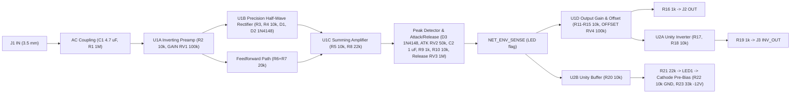

# Envelope Follower Circuit Specification

> **Source schematic:** [`EnvelopeFollower.webp`](EnvelopeFollower.webp) (titled *Envelope Follower*, dated `2022年1月18日 22:58`).
>
> **Original schematic annotations:**
> - Bottom-right note (blue): `All op-amp: TL074 or TL072`, `Vcc+ is +12V.`, `Vcc- is -12V.`
> - Diode callout (cyan): `1N4148` (pointing to all three signal diodes)
>
> **Reference designator convention:** Reference designators (`R1`–`R23`, `RV1`–`RV4`, `C1`–`C4`, `D1`–`D3`, `LED1`, `U1`–`U2`, `J1`–`J3`, `J_PWR`) are assigned here for unambiguous schematic capture, BOM tracking, and netlisting. All original labels from `EnvelopeFollower.webp` (`IN`, `GAIN`, `ATK`, `Release`, `OFFSET`, `OUT`, `INV_OUT`, `LED`, `+12V in`, `GND`, `-12V in`) are preserved verbatim.

---

## 1. Overview & Signal Flow

This circuit is a 6-op-amp, dual-rail (±12 V) Eurorack envelope follower. It AC-couples and amplifies an incoming audio or modulation signal, performs precision full-wave rectification, extracts an adjustable attack/release envelope onto a hold capacitor, and provides a buffered indicator LED alongside non-inverted (`OUT`) and inverted (`INV_OUT`) envelope outputs with bipolar DC offset control.

---

## 2. Power Supply & Op-Amp Allocation

- **Supply Rails:** `+12V`, `GND`, `-12V` (standard Eurorack ±12 V bipolar supply).
- **Op-Amp Type:** `TL074` (quad) or `TL072` (dual) JFET-input operational amplifiers.
- **Total Op-Amp Sections Required:** **6**.

### Recommended IC Partitioning (0 Unused Sections)

Using one `TL074` (`U1`) and one `TL072` (`U2`) utilizes every op-amp section with no spare gates to terminate:

| IC | Device | Package Option | `V+` (`+12V`) | `V-` (`-12V`) | Section | Pins (`+`, `-`, `OUT`) | Functional Role |
| :--- | :--- | :--- | :--- | :--- | :--- | :--- | :--- |
| `U1` | `TL074` | DIP-14 / SOIC-14 | Pin 4 | Pin 11 | `U1A` | `3`, `2`, `1` | Input inverting variable-gain preamp (`GAIN`) |
| `U1` | `TL074` | DIP-14 / SOIC-14 | Pin 4 | Pin 11 | `U1B` | `5`, `6`, `7` | Precision half-wave rectifier |
| `U1` | `TL074` | DIP-14 / SOIC-14 | Pin 4 | Pin 11 | `U1C` | `10`, `9`, `8` | Precision full-wave rectifier summing amplifier |
| `U1` | `TL074` | DIP-14 / SOIC-14 | Pin 4 | Pin 11 | `U1D` | `12`, `13`, `14` | Main envelope output & DC offset amplifier (`OUT`) |
| `U2` | `TL072` | DIP-8 / SOIC-8 | Pin 8 | Pin 4 | `U2A` | `3`, `2`, `1` | Unity-gain inverting output stage (`INV_OUT`) |
| `U2` | `TL072` | DIP-8 / SOIC-8 | Pin 8 | Pin 4 | `U2B` | `5`, `6`, `7` | Unity-gain LED buffer (`LED`) |

### Alternative IC Configurations

- **3 × `TL072`** (6 sections total, 0 unused).
- **2 × `TL074`** (8 sections total; terminate the 2 unused op-amp sections as unity-gain voltage followers with each non-inverting input `+` tied to `GND` and each inverting input `-` tied to its own `OUT`).

---

## 3. Complete Bill of Materials (BOM)

**Component totals (recommended `U1` + `U2` partitioning):** 2 ICs, 3 signal diodes, 1 LED, 23 resistors (`16× 10k`, `3× 1k`, `2× 22k`, `1× 33k`, `1× 1M`), 4 potentiometers, 4 capacitors, 3 jacks, 1 power header (**41 components total**).

### 3.1 Integrated Circuits (2)

| RefDes | Part / Value | Qty | Function |
| :--- | :--- | :--- | :--- |
| `U1` | `TL074` | 1 | Quad JFET op-amp (`U1A`–`U1D`: preamp, FWR, main output) |
| `U2` | `TL072` | 1 | Dual JFET op-amp (`U2A`–`U2B`: inverted output, LED buffer) |

### 3.2 Diodes & LEDs (4)

| RefDes | Schematic Label | Part / Value | Qty | Function |
| :--- | :--- | :--- | :--- | :--- |
| `D1` | *(cyan `1N4148`)* | `1N4148` | 1 | Precision half-wave rectifier feedback clamp diode (`U1B`) |
| `D2` | *(cyan `1N4148`)* | `1N4148` | 1 | Precision half-wave rectifier series diode (`U1B`) |
| `D3` | *(cyan `1N4148`)* | `1N4148` | 1 | Envelope peak-detector charging diode |
| `LED1` | `LED` | Indicator LED *(color unspecified)* | 1 | Envelope level indicator LED |

### 3.3 Resistors (23)

Value summary: **`16× 10k`**, **`3× 1k`**, **`2× 22k`**, **`1× 33k`**, **`1× 1M`**.

| RefDes | Value | Qty | Function |
| :--- | :--- | :--- | :--- |
| `R1` | `1M` | 1 | Input AC-coupling DC bias / pull-down to `GND` |
| `R2` | `10k` | 1 | `U1A` preamp inverting input resistor |
| `R3` | `10k` | 1 | `U1B` half-wave rectifier inverting input resistor |
| `R4` | `10k` | 1 | `U1B` half-wave rectifier feedback resistor |
| `R5` | `10k` | 1 | Half-wave rectifier output to `U1C` summing input |
| `R6` | `10k` | 1 | Rectifier feedforward series resistor 1 (`R6 + R7 = 20k`) |
| `R7` | `10k` | 1 | Rectifier feedforward series resistor 2 (`R6 + R7 = 20k`) |
| `R8` | `22k` | 1 | `U1C` summing amplifier feedback resistor |
| `R9` | `1k` | 1 | Series resistor between `C2` (`1 µF`) and envelope sense / release node |
| `R10` | `10k` | 1 | Minimum release resistance in series with `RV3` (`Release`) |
| `R11` | `10k` | 1 | Upper range-limiting resistor on `OFFSET` divider (`+12V` side) |
| `R12` | `10k` | 1 | Lower range-limiting resistor on `OFFSET` divider (`-12V` side) |
| `R13` | `10k` | 1 | `OFFSET` wiper summing resistor into `U1D -` |
| `R14` | `10k` | 1 | `U1D` inverting gain-setting resistor to `GND` |
| `R15` | `10k` | 1 | `U1D` feedback resistor |
| `R16` | `1k` | 1 | `OUT` jack series output protection resistor |
| `R17` | `10k` | 1 | `U2A` inverter input resistor |
| `R18` | `10k` | 1 | `U2A` inverter feedback resistor |
| `R19` | `1k` | 1 | `INV_OUT` jack series output protection resistor |
| `R20` | `10k` | 1 | `U2B` LED buffer input series resistor |
| `R21` | `22k` | 1 | `LED1` series current-limiting resistor |
| `R22` | `10k` | 1 | `LED1` cathode pre-bias divider resistor to `GND` |
| `R23` | `33k` | 1 | `LED1` cathode pre-bias divider resistor to `-12V` |

### 3.4 Potentiometers (4)

| RefDes | Schematic Label | Value | Wiring | Function |
| :--- | :--- | :--- | :--- | :--- |
| `RV1` | `GAIN` | `100k` | Rheostat (wiper tied to output end) | Preamp inverting gain control (`0×` to `-10×`) |
| `RV2` | `ATK` | `50k` | Rheostat (wiper tied to `C2` end) | Envelope attack time constant control |
| `RV3` | `Release` | `1M` | Rheostat (wiper tied to `GND` end) | Envelope release time constant control |
| `RV4` | `OFFSET` | `100k` | Voltage divider between `R11` and `R12` | Bipolar output DC offset control |

### 3.5 Capacitors (4)

| RefDes | Value | Polarity on Schematic | Function |
| :--- | :--- | :--- | :--- |
| `C1` | `4.7 µF` | Non-polarized | Input AC-coupling capacitor |
| `C2` | `1 µF` | Non-polarized | Envelope hold / attack-release timing capacitor |
| `C3` | `4.7 µF` | Polarized electrolytic (`+` to `+12V`, `-` to `GND`) | `+12V` rail bulk decoupling capacitor |
| `C4` | `4.7 µF` | Polarized electrolytic (`+` to `GND`, `-` to `-12V`) | `-12V` rail bulk decoupling capacitor |

### 3.6 Jacks & Power Connector (4)

| RefDes | Schematic Label | Type | Function |
| :--- | :--- | :--- | :--- |
| `J1` | `IN` | 3.5 mm mono jack | Audio / AC signal input |
| `J2` | `OUT` | 3.5 mm mono jack | Positive envelope follower output (with offset) |
| `J3` | `INV_OUT` | 3.5 mm mono jack | Inverted envelope follower output (with inverted offset) |
| `J_PWR` | `+12V in`, `GND`, `-12V in` | Eurorack ±12 V power header | Bipolar DC supply input |

---

## 4. Pin Conventions & Stage-by-Stage Functional Description

### Pin Naming Conventions Used in This Document

- **Two-terminal passives (`R*`, `C1`, `C2`):** Terminals are numbered `.1` (input / left / top) and `.2` (output / right / bottom).
- **Polarized capacitors (`C3`, `C4`):** Terminals are `.+` (anode) and `.-` (cathode).
- **Diodes & LED (`D1`–`D3`, `LED1`):** Terminals are `.A` (anode) and `.K` (cathode).
- **Potentiometers (`RV1`–`RV4`):** Standard front-panel rotary convention:
  - `.1` = Counter-clockwise end (`CCW`)
  - `.2` = Wiper
  - `.3` = Clockwise end (`CW`)
- **3.5 mm mono jacks (`J1`–`J3`):** `.Tip` (signal) and `.Sleeve` (`GND`).

---

### 4.1 Power Distribution (`J_PWR`, `C3`, `C4`)

- `+12V in` connects directly to the `+12V` rail, bypassed to `GND` by polarized electrolytic `C3` (`4.7 µF`, `+` to `+12V`, `-` to `GND`).
- `GND` establishes the `0 V` circuit reference.
- `-12V in` connects directly to the `-12V` rail, bypassed to `GND` by polarized electrolytic `C4` (`4.7 µF`).
  > **CRITICAL POLARITY (`C4`):** Because `-12V` is negative relative to `GND`, the **`+` terminal of `C4` must connect to `GND` (`0 V`)** and the **`-` terminal of `C4` must connect to `-12V`**. Installing `C4` backward will reverse-bias the electrolytic capacitor.

### 4.2 Input AC Coupling & Variable-Gain Inverting Preamp (`J1`, `C1`, `R1`, `R2`, `RV1`, `U1A`)

- Signal enters `J1` (`IN`, sleeve grounded) and passes through AC-coupling capacitor `C1` (`4.7 µF`) into `NET_IN_AC`, which is referenced to `GND` via `R1` (`1M`).
- `U1A` is configured as an inverting amplifier (`+` input grounded) with input resistor `R2` (`10k`) and feedback rheostat `RV1` (`GAIN`, `100k`).
- **Input impedance & high-pass corner:**
  - $Z_{\text{in}} \approx R_1 \parallel R_2 = 1\,\text{M}\Omega \parallel 10\,\text{k}\Omega \approx 9.90\,\text{k}\Omega$
  - $f_c = \frac{1}{2\pi \cdot Z_{\text{in}} \cdot C_1} = \frac{1}{2\pi \cdot 9.90\,\text{k}\Omega \cdot 4.7\,\mu\text{F}} \approx 3.42\,\text{Hz}$
- **Transfer function:**
  - $V_{\text{pre}} = -\frac{R_{\text{GAIN}}}{10\,\text{k}\Omega}\,V_{\text{in,AC}}$
  - Adjustable from **`0×`** (`RV1 = 0 Ω`) to **`-10×`** (`+20 dB`, `RV1 = 100k`).
- **Rheostat wiring (`RV1`):** For clockwise rotation to increase gain, connect `RV1.1` (`CCW`) to `NET_U1A_INV` (`U1A.-`) and tie `RV1.2` + `RV1.3` (`Wiper + CW`) to `NET_PREAMP_OUT` (`U1A.OUT`).

### 4.3 Precision Full-Wave Rectifier (`R3`–`R8`, `D1`, `D2`, `U1B`, `U1C`)

This stage implements a classic two-op-amp inverting precision half-wave rectifier (`U1B`) followed by a weighted inverting summing amplifier (`U1C`). Because `U1C` inverts the sum, the output is a **positive** full-wave rectified waveform ($V_{\text{rect}} \ge 0$).

- **CRITICAL DIODE ORIENTATIONS (verified directly from `EnvelopeFollower.webp`):**
  - **`D1` (`1N4148`, feedback clamp):** **Anode (`.A`) $\rightarrow$ `U1B.OUT` (`NET_U1B_OUT`)**, **Cathode (`.K`) $\rightarrow$ `U1B.-` (`NET_U1B_INV`)** (triangle points left toward `U1B.-`).
  - **`D2` (`1N4148`, series rectifier):** **Anode (`.A`) $\rightarrow$ `NET_RECT_HALF` (junction of `R4` and `R5`)**, **Cathode (`.K`) $\rightarrow$ `U1B.OUT` (`NET_U1B_OUT`)** (triangle points left toward `U1B.OUT`).
- **Two-state operation:**
  - **When $V_{\text{pre}} > 0$:** `U1B` drives negative, reverse-biasing `D1` (OFF) and forward-biasing `D2` (ON). `U1B` closes feedback through `D2` and `R4` (`10k`), setting $V_{\text{half}} = -\frac{R_4}{R_3} V_{\text{pre}} = -V_{\text{pre}}$. `U1C` sums `NET_PREAMP_OUT` through `R6 + R7` (`20k`) and `NET_RECT_HALF` through `R5` (`10k`):
    $$V_{\text{rect}} = -R_8 \left(\frac{V_{\text{pre}}}{R_6 + R_7} + \frac{V_{\text{half}}}{R_5}\right) = -22\,\text{k}\Omega \left(\frac{V_{\text{pre}}}{20\,\text{k}\Omega} + \frac{-V_{\text{pre}}}{10\,\text{k}\Omega}\right) = +1.1\,V_{\text{pre}}$$
  - **When $V_{\text{pre}} < 0$:** `U1B` drives positive ($\approx +0.6\,\text{V}$), forward-biasing `D1` (ON, clamping `U1B` out of positive saturation) and reverse-biasing `D2` (OFF). The virtual ground at `U1C.-` holds `NET_RECT_HALF` at $0\,\text{V}$ via `R4` and `R5` (with zero current through `R5`), so `U1C` amplifies only the feedforward path:
    $$V_{\text{rect}} = -22\,\text{k}\Omega \left(\frac{V_{\text{pre}}}{20\,\text{k}\Omega}\right) = -1.1\,V_{\text{pre}} = +1.1\,|V_{\text{pre}}|$$
- **Overall transfer function:** $V_{\text{rect}} = +1.1\,|V_{\text{pre}}| \ge 0$.
- **Design rationale:** Using two `10k` resistors in series (`R6 + R7 = 20k`) produces the exact `2:1` input weighting ratio relative to `R5` (`10k`) using the common `10k` BOM value; `R8 = 22k` (closest E12 value above `20k`) gives a mild `1.1×` gain ahead of `D3`.

### 4.4 Attack / Release Envelope Detector (`D3`, `RV2`, `C2`, `R9`, `R10`, `RV3`)

- **CRITICAL DIODE ORIENTATION (`D3`, `1N4148`):** **Anode (`.A`) $\rightarrow$ `NET_RECT_OUT` (`U1C.OUT`)**, **Cathode (`.K`) $\rightarrow$ `NET_ATK_IN` (`RV2` left terminal)** (triangle points left on the middle wire, flowing from right to left from `U1C.OUT` into `RV2`).
  - When $V_{\text{rect}} > V_{C2} + V_{f,D3}$ ($\approx V_{C2} + 0.6\,\text{V}$), `D3` conducts and charges `C2` (`1 µF`) positively through `RV2` (`ATK`).
  - When $V_{\text{rect}}$ falls below $V_{C2}$, `D3` reverse-biases and blocks `C2` from discharging back into `U1C`.
- **Attack time constant:**
  - $\tau_{\text{atk}} = R_{\text{ATK}} \cdot C_2 = (0\text{ to }50\,\text{k}\Omega) \cdot 1\,\mu\text{F} = \mathbf{0\text{ ms to }50\text{ ms}}$
  - **Rheostat wiring (`RV2`, `ATK`, `50k`):** For clockwise rotation to produce a slower attack, connect `RV2.1` (`CCW`) to `NET_ATK_IN` (`D3.K`) and tie `RV2.2` + `RV2.3` (`Wiper + CW`) to `NET_ENV_CAP` (`C2.1`).
- **Release time constant:**
  - `C2` discharges to `GND` through `R9` (`1k`), `R10` (`10k`), and `RV3` (`Release`, `1M`):
  - $\tau_{\text{rel}} = (R_9 + R_{10} + R_{\text{Release}}) \cdot C_2 = (11\,\text{k}\Omega\text{ to }1.011\,\text{M}\Omega) \cdot 1\,\mu\text{F} \approx \mathbf{11\text{ ms to }1.01\text{ s}}$
  - **Rheostat wiring (`RV3`, `Release`, `1M`):** For clockwise rotation to produce a slower release, connect `RV3.1` (`CCW`) to `NET_REL_POT` (`R10.2`) and tie `RV3.2` + `RV3.3` (`Wiper + CW`) to `GND`.
- **Envelope sense node (`NET_ENV_SENSE`, labeled `LED`):** `R9` (`1k`) sits between `C2` and the sense node (`NET_ENV_SENSE`), which feeds `U1D.+`, `R10`, and `R20` (via the `LED` net flag). Because `U1D` and `U2B` present JFET high-impedance inputs, `R9` and `R10 + RV3` form a gentle divider with attenuation factor $\frac{R_{10} + R_{\text{Release}}}{R_9 + R_{10} + R_{\text{Release}}} = 0.909$ (minimum release) to $0.999$ (maximum release):
  $$V_{\text{env}} = V_{C2} \cdot \frac{10\,\text{k}\Omega + R_{\text{Release}}}{11\,\text{k}\Omega + R_{\text{Release}}}$$

### 4.5 Main Output Gain & Bipolar DC Offset Stage (`R11`–`R16`, `RV4`, `U1D`, `J2`)

- **Offset bias divider (`R11`, `RV4`, `R12`):** `R11` (`10k`), `RV4` (`OFFSET`, `100k`), and `R12` (`10k`) form a voltage divider from `+12V` to `-12V` ($I_{\text{div}} = \frac{24\,\text{V}}{120\,\text{k}\Omega} = 0.2\,\text{mA}$).
  - Open-circuit wiper span: **$-10\,\text{V}$ to $+10\,\text{V}$**.
  - Thévenin source resistance at `RV4` wiper: $R_{\text{th,off}} = 9.17\,\text{k}\Omega$ at either extreme (10k || 110k) and $30\,\text{k}\Omega$ at center (60k || 60k).
- **Differential / summing topology (`U1D`):**
  - Non-inverting input (`U1D.+`) receives `NET_ENV_SENSE` ($V_{\text{env}}$).
  - Inverting input (`U1D.-`) sums feedback resistor `R15` (`10k`), ground resistor `R14` (`10k`), and offset resistor `R13` (`10k`) from `RV4` wiper.
  - Because `RV4`'s Thévenin resistance $R_{\text{th,off}}$ is in series with `R13`, let $R_{\text{eff}} = R_{13} + R_{\text{th,off}}$ (`19.17 kΩ` at extremes, `40 kΩ` at center):
    $$V_{\text{OUT,amp}} = V_{\text{env}}\left(1 + \frac{R_{15}}{R_{14} \parallel R_{\text{eff}}}\right) - V_{\text{th,off}}\left(\frac{R_{15}}{R_{\text{eff}}}\right)$$
  - **Calculated output behavior:**
    - **Offset centered (`0 V` wiper, $R_{\text{eff}} = 40\,\text{k}\Omega$):** $V_{\text{OUT,amp}} = \mathbf{2.25\,V_{\text{env}}}$ (`0 V` offset)
    - **Offset at `+12V` end (`+10 V` wiper, $R_{\text{eff}} = 19.17\,\text{k}\Omega$):** $V_{\text{OUT,amp}} = \mathbf{2.52\,V_{\text{env}} - 5.22\,\text{V}}$
    - **Offset at `-12V` end (`-10 V` wiper, $R_{\text{eff}} = 19.17\,\text{k}\Omega$):** $V_{\text{OUT,amp}} = \mathbf{2.52\,V_{\text{env}} + 5.22\,\text{V}}$
- **Offset control sense & pin mapping:** Because `RV4` feeds `U1D.-` (inverting), moving the wiper toward `+12V` shifts `OUT` **negative**, while moving it toward `-12V` shifts `OUT` **positive**. The netlist assigns `RV4.3` (`CW`) $\rightarrow$ `R11` (`+12V` side) and `RV4.1` (`CCW`) $\rightarrow$ `R12` (`-12V` side) matching top-to-bottom on the schematic; swap `RV4.1` and `RV4.3` if you prefer clockwise rotation to shift `OUT` positively.
- **Output protection (`R16`, `J2`):** `R16` (`1k`) isolates `U1D.OUT` from capacitive loads and short circuits at `J2` (`OUT`, sleeve grounded).

### 4.6 Inverted Output Stage (`R17`–`R19`, `U2A`, `J3`)

- `U2A` (`+` tied to `GND`) is a unity-gain inverting amplifier (`R17 = 10k`, `R18 = 10k`, gain $= -1\times$).
- Its input taps `NET_OUT_AMP` **before** `R16`, ensuring that plugging into or loading `J2` (`OUT`) does not alter `INV_OUT`.
- **Transfer function:** $V_{\text{INV,amp}} = -V_{\text{OUT,amp}}$ (inverts both the envelope signal and the applied DC offset).
- **Output protection (`R19`, `J3`):** `R19` (`1k`) isolates `U2A.OUT` before `J3` (`INV_OUT`, sleeve grounded).

### 4.7 Envelope Level LED Driver (`R20`–`R23`, `U2B`, `LED1`)

- **Buffer (`R20`, `U2B`):** Connects to `NET_ENV_SENSE` via the schematic's `LED` net flag through `R20` (`10k`) into `U2B.+`. `U2B.-` is tied directly to `U2B.OUT` as a unity-gain voltage follower ($V_{\text{U2B}} = V_{\text{env}}$), isolating `C2` from LED current draw.
- **LED drive & negative cathode pre-bias (`R21`, `LED1`, `R22`, `R23`):**
  - `U2B.OUT` drives `R21` (`22k`) $\rightarrow$ `LED1` (Anode `.A` left, Cathode `.K` right) $\rightarrow$ `NET_LED_K`.
  - `NET_LED_K` is biased by `R22` (`10k` to `GND`) and `R23` (`33k` to `-12V`):
    - Thévenin voltage: $V_{\text{th,K}} = -12\,\text{V} \cdot \frac{10\,\text{k}\Omega}{10\,\text{k}\Omega + 33\,\text{k}\Omega} \approx \mathbf{-2.79\,\text{V}}$
    - Thévenin resistance: $R_{\text{th,K}} = 10\,\text{k}\Omega \parallel 33\,\text{k}\Omega \approx \mathbf{7.67\,\text{k}\Omega}$
  - **Purpose:** Pre-biasing the cathode at `-2.79 V` compensates for the LED forward drop $V_f$ so the LED responds near $V_{\text{env}} \ge 0\,\text{V}$ without a `~2–3 V` dead zone.
  - **Current estimate:** $I_{\text{LED}} \approx \frac{V_{\text{env}} - V_{\text{th,K}} - V_f}{R_{21} + R_{\text{th,K}}} = \frac{V_{\text{env}} + 2.79\,\text{V} - V_f}{29.67\,\text{k}\Omega}$.
    - At $V_{\text{env}} = 0\,\text{V}$, a `2.7–3.0 V` green/blue/white LED sits right at threshold (off), whereas a `1.8 V` red LED sees $\approx 33\,\mu\text{A}$ trickle.
    - At $V_{\text{env}} = +5\,\text{V}$ to $+10\,\text{V}$, $I_{\text{LED}} \approx 0.20\text{–}0.36\,\text{mA}$ (bright with modern high-efficiency LEDs).

---

## 5. Complete Pin-Level Netlist (30 Nets)

All 41 BOM components and every IC supply/signal pin are accounted for below with zero unconnected pins.

| # | Net Name | Connected Component Pins |
| :- | :--- | :--- |
| 1 | `+12V` | `J_PWR.+12V`, `C3.+`, `R11.1`, `U1.4 (V+)`, `U2.8 (V+)` |
| 2 | `-12V` | `J_PWR.-12V`, `C4.-`, `R12.2`, `R23.2`, `U1.11 (V-)`, `U2.4 (V-)` |
| 3 | `GND` | `J_PWR.GND`, `C3.-`, `C4.+`, `J1.Sleeve`, `R1.2`, `U1A.+ (U1.3)`, `U1B.+ (U1.5)`, `U1C.+ (U1.10)`, `C2.2`, `RV3.2`, `RV3.3`, `R14.2`, `J2.Sleeve`, `U2A.+ (U2.3)`, `J3.Sleeve`, `R22.1` |
| 4 | `NET_IN_JACK` | `J1.Tip`, `C1.1` |
| 5 | `NET_IN_AC` | `C1.2`, `R1.1`, `R2.1` |
| 6 | `NET_U1A_INV` | `R2.2`, `RV1.1`, `U1A.- (U1.2)` |
| 7 | `NET_PREAMP_OUT` | `U1A.OUT (U1.1)`, `RV1.2`, `RV1.3`, `R3.1`, `R6.1` |
| 8 | `NET_FF_MID` | `R6.2`, `R7.1` |
| 9 | `NET_U1B_INV` | `R3.2`, `U1B.- (U1.6)`, `D1.K`, `R4.1` |
| 10 | `NET_U1B_OUT` | `U1B.OUT (U1.7)`, `D1.A`, `D2.K` |
| 11 | `NET_RECT_HALF` | `D2.A`, `R4.2`, `R5.1` |
| 12 | `NET_RECT_SUM` | `R7.2`, `R5.2`, `U1C.- (U1.9)`, `R8.1` |
| 13 | `NET_RECT_OUT` | `U1C.OUT (U1.8)`, `R8.2`, `D3.A` |
| 14 | `NET_ATK_IN` | `D3.K`, `RV2.1` |
| 15 | `NET_ENV_CAP` | `RV2.2`, `RV2.3`, `C2.1`, `R9.1` |
| 16 | `NET_ENV_SENSE` *(flag: `LED`)* | `R9.2`, `R10.1`, `U1D.+ (U1.12)`, `R20.1` |
| 17 | `NET_REL_POT` | `R10.2`, `RV3.1` |
| 18 | `NET_OFF_TOP` | `R11.2`, `RV4.3` |
| 19 | `NET_OFF_BOT` | `R12.1`, `RV4.1` |
| 20 | `NET_OFF_WIPER` | `RV4.2`, `R13.1` |
| 21 | `NET_U1D_INV` | `R13.2`, `R14.1`, `R15.1`, `U1D.- (U1.13)` |
| 22 | `NET_OUT_AMP` | `U1D.OUT (U1.14)`, `R15.2`, `R16.1`, `R17.1` |
| 23 | `NET_OUT_JACK` | `R16.2`, `J2.Tip` |
| 24 | `NET_U2A_INV` | `R17.2`, `R18.1`, `U2A.- (U2.2)` |
| 25 | `NET_INV_AMP` | `U2A.OUT (U2.1)`, `R18.2`, `R19.1` |
| 26 | `NET_INV_OUT_JACK` | `R19.2`, `J3.Tip` |
| 27 | `NET_U2B_POS` | `R20.2`, `U2B.+ (U2.5)` |
| 28 | `NET_U2B_OUT` | `U2B.OUT (U2.7)`, `U2B.- (U2.6)`, `R21.1` |
| 29 | `NET_LED_A` | `R21.2`, `LED1.A` |
| 30 | `NET_LED_K` | `LED1.K`, `R22.2`, `R23.1` |

---

## 6. Practical Build & PCB Implementation Notes

The items below are **not drawn** on [`EnvelopeFollower.webp`](EnvelopeFollower.webp) and are recommended when turning this specification into a Eurorack schematic, PCB, or physical build:

1. **Local IC Decoupling:** Place `100 nF` ceramic capacitors (`4×` total for `U1` and `U2`) directly between each IC's `V+` and `V-` pins and `GND` to prevent rail ringing and op-amp oscillation.
2. **Eurorack Power Header & Reverse-Polarity Protection:** Use a shrouded 10-pin Eurorack power header (pins 1–2 `-12V`, pins 3–8 `GND`, pins 9–10 `+12V`) with series Schottky diodes (e.g., `1N5819`) or `10 Ω` current-limiting resistors / resettable PTC fuses on both `+12V in` and `-12V in` ahead of `C3`/`C4`.
3. **Capacitor Voltage Ratings & Dielectrics:**
   - `C3`, `C4` (`4.7 µF` electrolytics): rate at $\ge 25\,\text{V}$ (minimum `16 V` for `12 V` rails).
   - `C1` (`4.7 µF` input coupling): use a non-polarized film capacitor, bipolar (NP) electrolytic, or $\ge 25\,\text{V}$ X7R MLCC because audio/CV inputs can swing symmetrically around `0 V`.
   - `C2` (`1 µF` envelope hold): use a low-leakage film capacitor (polyester/polypropylene) or C0G/X7R ceramic rather than a standard electrolytic so dielectric leakage does not shorten long `Release` times.
4. **Resistor Tolerance:** Use `1%` metal-film resistors throughout—especially `R3`–`R7` (for symmetric positive/negative half-cycle rectification) and `R17`–`R18` (for accurate `-1.00×` inversion at `INV_OUT`).
5. **Switched Input Jack (`J1`):** When using a switched 3.5 mm Eurorack jack (such as a Thonkiconn `WQP-PJ398SM`), normal the tip-switch contact to `GND` so an unpatched input does not float and inject 50/60 Hz hum.
6. **Potentiometer Tapers & Offset Polarity:**
   - `RV1` (`GAIN`) and `RV4` (`OFFSET`): Linear (`B`) taper. (Optionally swap `RV4.1` and `RV4.3` so clockwise `OFFSET` shifts `OUT` positively.)
   - `RV2` (`ATK`) and `RV3` (`Release`): Audio/logarithmic (`A`) or linear (`B`) taper; logarithmic gives finer control over short, snappy attack and release settings.
7. **LED Brightness & Threshold Tuning:** `R21` (`22k`) yields `~0.20–0.36 mA`, suited to high-efficiency modern LEDs. If using a standard-brightness LED, lower `R21` (e.g., `2.2k`–`4.7k`). Choose an LED with $V_f \approx 2.8\text{–}3.2\,\text{V}$ (green, blue, or white) or adjust `R22`/`R23` if using a `~1.8 V` red LED to eliminate faint glow at `0 V`.
8. **Optional Attack Current Limiter:** Adding a `100 Ω` resistor in series between `D3.K` and `RV2.1` limits peak charging current into `C2` when `ATK` is at `0 Ω`; the `TL07x` output current limit makes the drawn circuit work safely without it.
