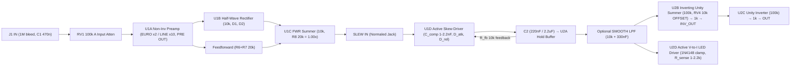

# Envelope Follower Circuit Review & Improvement Recommendations

> **Reviewed specification:** [`EnvelopeFollower.md`](EnvelopeFollower.md) (extracted from [`EnvelopeFollower.webp`](EnvelopeFollower.webp)).
>
> **Scope:** This document captures an electrical engineering review of the base 6-op-amp circuit and outlines prioritized fixes and architectural upgrades toward a modern Eurorack **Envelope Follower with Skew Limiter**. Reference designators (`R1`–`R23`, `RV1`–`RV4`, `C1`–`C4`, `D1`–`D3`, `LED1`, `U1`–`U2`, `J1`–`J3`, `J_PWR`) match [`EnvelopeFollower.md`](EnvelopeFollower.md) verbatim.

---

## Executive Summary

The base circuit in [`EnvelopeFollower.md`](EnvelopeFollower.md) is buildable and functionally coherent: its precision full-wave rectifier (`U1B`, `U1C`, `D1`, `D2`) uses correct diode polarities and feedforward weighting, `U2A` properly taps `OUT` before `R16` (`1 kΩ`), and `C4` is correctly polarized for `-12V`.

However, circuit analysis reveals **five Tier-1 electrical and ergonomic flaws** in the drawn schematic—most notably an `ATK`/`Release` resistive divider that collapses envelope amplitude by `-15.7 dB` at slow attack / fast release, an uncompensated `D3` diode drop, severe `OFFSET` pot loading (`+12.1%` gain modulation and nonlinear taper), a `9.9 kΩ` input impedance with misplaced `R1` and excessive `24.75×` total gain, and a negative pre-biased LED driver that leaks idle current on red/green LEDs while staying dim at `5 V`.

In addition, [`EnvelopeFollower.md` Section 6](EnvelopeFollower.md#6-practical-build--pcb-implementation-notes) already identifies eight foundational build practices:
1. Local `100 nF` ceramic decoupling per IC rail pin (`4×` total).
2. Shrouded 10-pin Eurorack header (`J_PWR`) with reverse-polarity diodes (`1N5819`) or `10 Ω` / PTC protection.
3. Voltage ratings (`≥ 25 V` for `C3`/`C4`) and non-polarized/low-leakage dielectrics (`C1` film/NP/X7R, `C2` film or C0G/X7R).
4. `1%` metal-film resistors (especially `R3`–`R7` and `R17`–`R18`).
5. Switched input jack (`J1`) normaled to `GND`.
6. Appropriate pot tapers (`B` for `RV1`/`RV4`, `A` or `B` for `RV2`/`RV3`, optional `RV4.1`/`RV4.3` swap).
7. Lowering `R21` or matching LED $V_f$ (`2.8–3.2 V`) to prevent `0 V` glow.
8. Optional `100 Ω` series attack current-limiting resistor ahead of `RV2`.

Section 1 below covers new circuit-level findings and topological fixes; Section 2 expands and quantifies the Section 6 practical build items; Section 3 details Eurorack "mod cons" and the **Active Skew Limiter** core; and Section 4 compares drop-in vs. redesigned architectures.

### Priority Summary

| # | Tier | Stage / RefDes | Issue in Base Circuit | Recommended Fix | Key Benefit |
| :- | :--- | :--- | :--- | :--- | :--- |
| **1.1** | **Tier 1** | Detector (`RV2`, `C2`, `R9`, `R10`, `RV3`) | `ATK`/`Release` voltage divider collapses signal to `16.4%` (`-15.7 dB`); `R9` shifts gain by `9.0%` | Minimal: remove `R9` from `C2` tap; Complete: **dual-diode Active Skew Limiter** | `100%` independent `ATK` & `Release`; zero amplitude collapse |
| **1.2** | **Tier 1** | Peak Detector (`U1C`, `D3`, `RV2`, `C2`) | `D3` outside feedback adds `~0.65 V` dead zone (`1.35–1.75 V` output deficit); `0 Ω` `ATK` shorts `U1C` into `C2` | Minimal: `R_atk_min` (`100–220 Ω`); Complete: **`U_DRV` + `U_BUF` loop with `R_fb`/`C_comp`** | Zero diode dead zone, no thermal drift, stable slew limiting |
| **1.3** | **Tier 1** | Offset & Output (`R11`–`R15`, `RV4`, `U1D`) | `RV4` (`100 kΩ`) loading modulates gain by `+12.1%`, compresses `72.5%` of range into outer `25%`, CW=negative, raw rail noise | Option B: **inverting unity summer** (`100 kΩ` legs, `RV4 = 10 kΩ`); Minimal: `100 kΩ` feedback, drop `R14` | `0.00%` gain shift (`0.49%` passive), linear taper, CW-positive |
| **1.4** | **Tier 1** | Input & Gain (`J1`, `C1`, `R1`, `R2`, `RV1`, `U1A`, `R8`) | `Z_in = 9.9 kΩ`; `R1` on wrong side of `C1`; `24.75×` max gain clips `OUT` at `10%` `GAIN` while `LED1` tracks up to `10 V` | `100 kΩ` `A`-taper input attenuator + non-inv `EURO/LINE` preamp; `R1` at jack; `R8 = 20 kΩ`; unity out | Standard `100 kΩ` `Z_in`, `470 nF` film `C1`, full `GAIN` sweep, accurate LED |
| **1.5** | **Tier 1** | LED Driver (`R20`–`R23`, `U2B`, `LED1`) | `-2.79 V` pre-bias leaks `23–33 µA` on red/green LEDs at `0 V`; `0.16–0.20 mA` dim at `5 V` | **Active $V$-to-$I$ loop** (`LED1` + antiparallel `1N4148` in `U2B` feedback, `R_sense = 1–2.2 kΩ`) | `0 mA` at `0 V`, `2.3–5 mA` linear drive independent of LED color |
| **2.1** | **Tier 2** | Op-Amps (`U1`, `U2`) | Legacy `TL074`/`TL072` phase-reversal risk, `±10.5 V` swing, `3 mV` typ $V_{os}$ | Upgrade to pin-compatible **`TL074H`/`TL072H`** (avoid BJT op-amps like `NE5532`) | `+2.5 Vpp` headroom, `1 mV` $V_{os}$, `1 pA` $I_b$, no phase reversal |
| **2.2** | **Tier 2** | Rectifier & Diodes (`R3`–`R8`, `D1`–`D3`) | Half-cycle asymmetry from resistor tolerance; `D3` leakage sensitivity | `1%` (or `0.1%`) `R3`–`R7`; optional `BAT54S` for `D1`/`D2`; keep **silicon** (`1N4148`/`BAV199`) for hold diodes | Minimal `1f` ripple feedthrough; negligible hold-cap droop |
| **2.3** | **Tier 2** | Ripple Filter | `50 Hz` audio droops `59.7%` per half-cycle at `11 ms` `Release` | Switchable **`SMOOTH`** post-detector LPF (e.g., `10 kΩ + 330 nF`, $f_c \approx 48.2\,\text{Hz}$) | Clean bass-tracking CV without sacrificing fast-mode snap |
| **2.4** | **Tier 2** | Power & I/O (`J_PWR`, `C3`, `C4`) | Small `4.7 µF` bulk caps; no rail noise filtering beyond Section 6 notes | `22–47 µF` (`25–35 V`) after series `1N5819` + `10 Ω`/ferrite RC/LC filter + `100 nF` bypasses | Clean `±12V` rails, safe reverse-polarity protection |
| **2.5** | **Tier 2** | Timing & Pot Tapers (`RV1`–`RV4`, `C2`) | Short `50 ms` max `ATK`; linear pots crowd fast times at CCW | `A`-taper `RV1`–`RV3` (`Pin 1` in, `Pin 2+3` out); `B`-taper center-detent `RV4`; `FAST/SLOW` cap switch | Musical control resolution across ms-to-multi-second ranges |
| **3.1–3.4** | **Tier 3** | Eurorack "Mod Cons" | Envelope-only module; no gate/trigger, preamp tap, or external slew access | Normaled **`SLEW IN`**, Schmitt-trigger **`GATE OUT`**, **`PRE OUT`**, `CLIP` LED, optional `LM13700` CV core | Complete Envelope Follower + Precision Skew Limiter module |

---

## 1. Tier 1: Critical Circuit Fixes (Electrical Bugs, Interactions & Ergonomics)

### 1.1 Severe `ATK` / `Release` Voltage-Divider Attenuation & `R9` Gain Shift (`RV2`, `C2`, `R9`, `R10`, `RV3`)

#### Problem
In the base schematic, hold capacitor `C2` (`1 µF`) is permanently connected to `GND` through the release path `R9` (`1 kΩ`) + `R10` (`10 kΩ`) + `RV3` (`0–1 MΩ`). Because `D3` conducts directly into `RV2` (`ATK`, `0–50 kΩ`) with no switching or steering isolating the release path during charging, **`RV2` and `(R9 + R10 + RV3)` form a loaded resistive voltage divider during attack**.

At slow attack (`RV2 = 50 kΩ`) and minimum release (`RV3 = 0 Ω`, total release resistance $R_{\text{rel,min}} = 11\,\text{k}\Omega$):
- **Capacitor voltage collapse:** Even under continuous DC excitation, `C2` can never charge higher than:
  $$\frac{V_{C2,\text{max}}}{V_{\text{rect}} - V_{f,D3}} = \frac{11\,\text{k}\Omega}{50\,\text{k}\Omega + 11\,\text{k}\Omega} = \mathbf{18.0\%} \quad (\mathbf{-14.9\,\text{dB}})$$
- **Sense node collapse:** Tapping `NET_ENV_SENSE` between `R9` (`1 kΩ`) and `R10` (`10 kΩ`) drops the steady-state signal further to:
  $$\frac{V_{\text{env,max}}}{V_{\text{rect}} - V_{f,D3}} = \frac{10\,\text{k}\Omega}{50\,\text{k}\Omega + 1\,\text{k}\Omega + 10\,\text{k}\Omega} = \mathbf{16.4\%} \quad (\mathbf{-15.7\,\text{dB}})$$
- **Time-constant collapse:** Because the Thévenin charging resistance is $R_{\text{ATK}} \parallel R_{\text{rel}}$, the effective attack time constant drops from the nominal `50 ms` down to:
  $$\tau_{\text{atk,eff}} = (50\,\text{k}\Omega \parallel 11\,\text{k}\Omega) \cdot 1\,\mu\text{F} = 9.02\,\text{k}\Omega \cdot 1\,\mu\text{F} = \mathbf{9.02\,\text{ms}}$$

Independently of attack, placing **`R9` (`1 kΩ`) between `C2` and `NET_ENV_SENSE`** forms a voltage divider with `R10 + RV3` that shifts overall envelope amplitude as `Release` is turned:
- Minimum `Release` (`RV3 = 0 Ω`): attenuation $= \frac{10\,\text{k}\Omega}{11\,\text{k}\Omega} = \mathbf{0.9091}$
- Maximum `Release` (`RV3 = 1 MΩ`): attenuation $= \frac{1.01\,\text{M}\Omega}{1.011\,\text{M}\Omega} = \mathbf{0.9990}$
- This creates an unintended **`9.0%` amplitude shift** purely from adjusting `Release`. (Because `U1D.+` and `U2B.+` are high-impedance JFET inputs, `R9` provides no needed isolation there.)

#### Recommended Fixes
1. **Immediate minimal fix (passive topology):** Remove `R9` from the `C2` $\rightarrow$ `U1D.+` sense path—wire `C2.1` directly to `U1D.+` (and `R20`), and connect `R10` directly from `C2.1` to `RV3.1`. This eliminates the `9.0%` Release-dependent gain shift immediately, though the passive `ATK`/`Release` divider collapse remains whenever `RV2` is large and `RV3` is small.
2. **Complete fix (Active Precision Skew/Slew Limiter):** Replace the passive peak detector with a dual-diode active slew limiter (Section 1.2). Because `D_atk` and `D_rel` are driven in opposite directions inside an op-amp feedback loop, `D_rel` is completely reverse-biased during rising transitions and `D_atk` is completely reverse-biased during falling transitions—yielding **100% independent `ATK` and `Release` controls with zero attenuation collapse**.

---

### 1.2 Uncompensated Peak-Detector Diode Drop (`D3`) & Zero-Ohm Capacitive Charging Spikes (`U1C`, `D3`, `RV2`, `C2`)

#### Problems
1. **Uncompensated `D3` forward drop:** Although `U1B` and `U1C` form an accurate precision full-wave rectifier, `D3` (`1N4148`) sits **outside** any feedback loop. Every signal loses $V_{f,D3} \approx 0.60\text{–}0.70\,\text{V}$ before reaching `C2`:
   - **Dead zone:** Any preamp signal with $|V_{\text{pre}}| < 0.55\,\text{V}$ produces $V_{\text{rect}} < 0.60\,\text{V}$, yielding **zero envelope output** and cutting off quiet audio tails abruptly.
   - **Output DC deficit & thermal drift:** Multiplied by `U1D`'s `2.25×`–`2.52×` gain, `D3` introduces a **`1.35–1.75 V` DC tracking error** at `OUT` and roughly **`-4.5 mV/°C` to `-5.0 mV/°C`** thermal drift (`-2 mV/°C × 2.25–2.52`).
2. **Zero-ohm capacitive surge when `ATK = 0 Ω`:** When `RV2` is turned fully counter-clockwise (`0 Ω`), `U1C.OUT` charges `C2` (`1 µF`) through `D3` with zero series current-limiting impedance. On fast transients, `U1C` hits its short-circuit current limit (`~20–40 mA`), injecting supply-rail current spikes into the shared `U1` die (`U1A`–`U1D`).

#### Recommended Fixes
1. **Minimal fix (expanding [`EnvelopeFollower.md` Section 6 note #8](EnvelopeFollower.md#6-practical-build--pcb-implementation-notes)):** Add a fixed series resistor `R_atk_min = 100 Ω–220 Ω` between `D3.K` and `RV2.1` to keep `U1C` within linear output current limits at `ATK = 0%`.
2. **Complete fix (Active Precision Asymmetric Skew/Slew Limiter):** Replace `D3`, `RV2`, `R9`, `R10`, `RV3` with a two-op-amp feedback slew limiter (`U_DRV` + unity hold-capacitor buffer `U_BUF`):

```
                    +--- C_comp (1-2.2 nF C0G) ---+
                    |                             |
V_in ---> (+)       |   +--- D_atk ---> [220R] ---[RV_ATK]---+
          U_DRV ----+---+                                    +---> C2 ---> (+)
V_fb --[R_fb 10k]-- (-) +--- D_rel <--- [1k]   <--[RV_REL]---+     |        U_BUF ---> V_env
                    ^   (A<-K)                               |    GND         |
                    |                                        +----------------+ (direct unity FB)
                    +------------------ V_env = V_C2 -------------------------+
```

- **Polarity & connections:**
  - `U_DRV.+` receives `V_rect` (or external `SLEW IN`).
  - `U_BUF` is a unity-gain voltage follower (`U_BUF.+` $\leftarrow$ `C2`, `U_BUF.-` tied to `U_BUF.OUT`) producing low-impedance `V_env = V_C2`.
  - **Attack branch:** `D_atk` (**Anode** $\rightarrow$ `U_DRV.OUT`, **Cathode** $\rightarrow$ `R_atk_min = 220 Ω` $\rightarrow$ `RV_ATK` $\rightarrow$ `C2`).
  - **Release branch:** `D_rel` (**Cathode** $\rightarrow$ `U_DRV.OUT`, **Anode** $\leftarrow$ `R_rel_min = 1 kΩ` $\leftarrow$ `RV_REL` $\leftarrow$ `C2`).
  - Because `V_C2` is fed back to `U_DRV.-`, `U_DRV` automatically adds $+V_f$ (rising) or $-V_f$ (falling) ahead of the diodes—**completely eliminating the `0.65 V` dead zone and thermal drift**.
- **Critical frequency compensation (mandatory to prevent oscillation):**
  - **Do not** wire `U_BUF.OUT` directly to `U_DRV.-` with no local compensation. Modeling `TL074` (`A_0 = 2×10^5`, `GBW = 3 MHz`) driving `R_s · C2` shows that direct feedback has only **`0.3°–1.3°` phase margin** across $R_s = 100\,\Omega\text{–}1\,\text{M}\Omega$ and will ring or oscillate across the pot sweep.
  - Adding **`R_fb = 10 kΩ`** between `U_BUF.OUT` and `U_DRV.-`, plus local high-frequency compensation **`C_comp = 1 nF` to `2.2 nF` (C0G/NP0)** directly from `U_DRV.OUT` to `U_DRV.-`, creates a clean lead-lag handoff: above $f = \frac{1}{2\pi R_{\text{fb}} C_{\text{comp}}}$ (`7.2–15.9 kHz`), feedback returns locally through `C_comp` instead of the `R_s · C2` lag. Loop analysis across $R_s = 100\,\Omega\text{–}1\,\text{M}\Omega$ with `C2 = 1 µF` and `C_comp = 1–2.2 nF` yields a single gain crossover at `~3.0 MHz` with **`~90°` phase margin** (`90.1°–90.3°`) and remains unconditionally stable even in the deadband when both diodes are off.
- **Rail-driven ramp shape & timing (`C2 = 1 µF`, `TL074H` $V_{\text{sat}} \approx \pm 11.5\,\text{V}$, $V_f \approx 0.65\,\text{V}$):**
  - Because `U_DRV` saturates to $\pm 11.5\,\text{V}$ whenever $|V_{\text{in}} - V_{C2}| > 1\,\text{mV}$, the capacitor charges toward $\pm V_{\text{eff}} \approx \pm 10.85\,\text{V}$, making `0–5 V` transitions **nearly linear** rather than asymptotic exponential tails, and stopping sharply at `0.00 V`:

| Total Branch Resistance $R$ | `0 V → +5 V` Rise Time ($C_2 = 1\,\mu\text{F}$) | `+5 V → 0 V` Fall Time ($C_2 = 1\,\mu\text{F}$) |
| :--- | :--- | :--- |
| `220 Ω` (`ATK` min) | `0.14 ms` | `0.08 ms` |
| `1 kΩ` (`Release` min) | `0.62 ms` | `0.38 ms` |
| `50 kΩ` | `30.9 ms` | `19.0 ms` |
| `100 kΩ` | `61.8 ms` | `37.9 ms` |
| `1 MΩ` (`Release` max) | `618 ms` | `379 ms` |

  - Note that because `U_DRV` pulls down toward `-10.85 V` rather than `0 V`, the `+5 V → 0 V` fall time (`379 ms` at `1 MΩ`) is faster than a passive `0 V`-referenced `1 MΩ · 1 µF` RC decay (`1.0 s` to `37%`). Increasing `C2` to **`2.2 µF`** (or adding a `FAST / SLOW` switch selecting `220 nF` vs. `2.2 µF`) restores multi-second maximum releases (`~834 ms` linear fall to `0 V` at `1 MΩ`, or `~1.36 s` rise from `0→5 V`).

---

### 1.3 `OFFSET` (`RV4`) Gain Modulation (`+12.1%`), Pot-Loading Non-Linearity, Inverted Polarity & Rail Noise (`R11`–`R15`, `RV4`, `U1D`)

#### Problems
1. **Gain modulation (`+12.1%`):** In the base circuit, `RV4` (`100 kΩ`) drives `R13` (`10 kΩ`) directly into `U1D.-` without a buffer. `RV4`'s Thévenin source resistance $R_{\text{th,off}}$ changes from **`9.17 kΩ`** at either end (`10k || 110k`) to **`30.0 kΩ`** at center (`60k || 60k`), changing $R_{\text{eff}} = R_{13} + R_{\text{th,off}}$ between `19.17 kΩ` and `40.0 kΩ` and modulating the envelope gain $G_{\text{env}} = 1 + \frac{R_{15}}{R_{14} \parallel R_{\text{eff}}}$:
   - Center (`50%`): $G_{\text{env}} = \mathbf{2.250\times}$, $V_{\text{off}} = 0.00\,\text{V}$
   - Extreme (`0%` or `100%`): $G_{\text{env}} = \mathbf{2.522\times}$, $V_{\text{off}} = \pm 5.22\,\text{V}$
   - Turning `OFFSET` from center to either extreme boosts envelope amplitude by **`+12.1%` (`+1.0 dB`)**.
2. **Severe pot-loading non-linearity:** Because `R13` (`10 kΩ`) is 10× smaller than `RV4` (`100 kΩ`), loading heavily warps the linear pot into an S-curve. At **75% rotation** (halfway between center and max), $V_{\text{off}}$ is only `-1.44 V` out of `-5.22 V` (**`27.5%`** of full scale instead of `50.0%`), cramming **`72.5%`** of the offset voltage change into the outer `25%` of knob rotation.
3. **Inverted control sense:** As noted in [`EnvelopeFollower.md` Section 4.5](EnvelopeFollower.md#45-main-output-gain--bipolar-dc-offset-stage-r11r16-rv4-u1d-j2), wiring `CW` (`RV4.3`) to `+12V` causes clockwise rotation to shift `OUT` **negative** because `RV4` sums into `U1D.-`.
4. **Power-rail noise feedthrough:** `R11` and `R12` connect directly to raw `±12V` Eurorack busboard rails, injecting switching/digital supply ripple directly into `OUT` and `INV_OUT` (`-5.2 dB` PSRR from each rail at max offset).

#### Comparison of Base Circuit vs. Recommended Fixes

| `RV4` Rotation ($\alpha$) | Base Circuit (`RV4=100k, R13=10k`) | Minimal 6-Op-Amp Passive Fix (`RV4=10k, R13=R15=100k`, drop `R14`, swap `1/3`) | Option B Virtual-Ground Summer (`RV4=10k, R11=R12=6.8k, R_env=R_off=R_fb=100k`) |
| :--- | :--- | :--- | :--- |
| `0%` (CCW) | `G = 2.522×`, `V_off = +5.22 V` | `G = 1.954×`, `V_off = -4.85 V` | `G = 1.0000×`, `V_off = -4.85 V` |
| `25%` | `G = 2.287×`, `V_off = +1.44 V` | `G = 1.947×`, `V_off = -2.41 V` | `G = 1.0000×`, `V_off = -2.41 V` |
| `50%` (Center) | `G = 2.250×`, `V_off = 0.00 V` | `G = 1.944×`, `V_off = 0.00 V` | `G = 1.0000×`, `V_off = 0.00 V` |
| `75%` | `G = 2.287×`, `V_off = -1.44 V` (`27.5%`) | `G = 1.947×`, `V_off = +2.41 V` (`49.6%`) | `G = 1.0000×`, `V_off = +2.41 V` (`49.6%`) |
| `100%` (CW) | `G = 2.522×`, `V_off = -5.22 V` | `G = 1.954×`, `V_off = +4.85 V` | `G = 1.0000×`, `V_off = +4.85 V` |
| **Gain Modulation** | **`+12.1%` (`+1.0 dB`)** | **`+0.49%` (`+0.04 dB`)** | **`0.00%` (exact `1.000×`)** |

#### Recommended Fixes
1. **Best fix (in the 8-op-amp Option B architecture — `0.00%` gain shift):** Swap the output stage order so `U2B` acts as a virtual-ground **inverting unity summer** producing `INV_OUT = -(V_env + V_off)` (`R_env = R_off = R_fb = 100 kΩ`), followed by `U2C` as a unity inverter producing `OUT = +(V_env + V_off)`:
   - Use **`RV4 = 10 kΩ`** (linear `B`, ideally center-detent) with **`R11 = R12 = 6.8 kΩ`** for **`±4.85 V`** span (or `6.2 kΩ` for **`±5.13 V`**).
   - Because `U2B.-` is held at `0 V` virtual ground, `R_env` sees zero source impedance from `U2A`, locking `G_env` to **strictly `1.0000×`** across the full offset sweep.
   - `RV4` sees a `100 kΩ` summing resistor (`R_th,max = 5.90 kΩ`), yielding `49.6%` offset at `75%` travel (virtually dead-linear), and wiring `CW → +12V` naturally produces **CW = positive shift on `OUT`**!
2. **Minimal 6-op-amp passive fix (no extra op-amps):** Keep the non-inverting `U1D` stage, change `RV4` to `10 kΩ`, `R11 = R12 = 6.8 kΩ`, `R13 = R15 = 100 kΩ`, **omit `R14`** (`G_env ≈ 1.95×` instead of `2.25×`—or keep `R14` omitted for lower gain), and swap `RV4.1`/`RV4.3` so CW shifts `OUT` positively. This cuts gain modulation by 25× (to `0.49%`) and restores `49.6%` half-travel linearity.
3. **Rail filtering:** Add local RC filtering ahead of `R11`/`R12` (e.g., `100 Ω` series resistors + `10 µF` / `100 nF` bypass caps to `GND` on the `±12V` divider nodes) or derive the offset bias from a precision `±5 V` reference (`TL431`/LDO).

---

### 1.4 Low Input Impedance (`9.9 kΩ`), Misplaced `R1`, Excessive Total Gain (`24.75×`) & Premature Output Clipping (`J1`, `C1`, `R1`, `R2`, `RV1`, `U1A`, `U1C`, `U1D`)

#### Problems
1. **Low input impedance (`9.9 kΩ`):** Because `U1A` is inverting with `R2 = 10 kΩ` into virtual ground, $Z_{\text{in}} = R_1 \parallel R_2 = \mathbf{9.90\,\text{k}\Omega}$. Modern Eurorack modules expect **`100 kΩ`** input impedance (`1 kΩ` output drivers lose **`-0.84 dB` / `9.1%`** into `9.9 kΩ`, and passive mults sag noticeably when patched alongside other modules).
2. **Misplaced `R1` (`1 MΩ`):** `R1` sits on the *right* side of `C1` (`NET_IN_AC`), where `R2` (`10 kΩ`) already holds the node to `0 V` virtual ground 100× more strongly than `R1`. Meanwhile, the *jack* side of `C1` (`NET_IN_JACK`) has no DC bleed path when unpatched, allowing charge on `C1` to cause hot-plug DC pops.
3. **Excessive gain & collapsed knob range:** Total maximum voltage gain at center offset is $10\times (\text{U1A}) \times 1.1\times (\text{U1C}) \times 2.25\times (\text{U1D}) = \mathbf{24.75\times}$ (`+27.9 dB`). For a standard Eurorack **`10 Vpp` (`±5 V` peak)** signal:
   - `OUT` reaches `+5.0 V` at `RV1 = 5.3%`.
   - `OUT` reaches `+8.0 V` at `RV1 = 7.7%`.
   - **`U1D` hard-clips at `+10.5 V` by just `RV1 = 9.8%`** (`V_env = 4.67 V`, `V_pre = 4.88 V`), leaving **90% of `GAIN` knob rotation clipped** (`U1A` itself clips by `RV1 = 21%`).
   - Worse, because `LED1` (`U2B`) senses `NET_ENV_SENSE` *before* `U1D`'s `2.25×` gain, `LED1` keeps brightening from `V_env = 4.67 V` up to `9.75 V` while `OUT` is flat-topped at the `+10.5 V` rail—misleading the user about clipping.

#### Recommended Fixes
1. **Constant `100 kΩ` input attenuator + non-inverting preamp (`U1A`):**
   - Move `R1` (`1 MΩ` anti-pop bleed resistor) to the **jack side (`NET_IN_JACK` to `GND`)** alongside a switched `J1` normaled to `GND`.
   - Wire `C1` (`470 nF` to `1 µF` polypropylene/polyester film) into the top (`Pin 3 CW`) of **`RV1` (`100 kΩ`, Audio/Log `A` taper)** grounded at `Pin 1` (`CCW`). Input impedance is a constant **`90.9 kΩ`** (`1 MΩ || 100 kΩ`), causing only `-0.10 dB` (`1.1%`) attenuation from a `1 kΩ` Eurorack source, while allowing `C1` to shrink from `4.7 µF` to **`470 nF` film** ($f_c = \mathbf{3.72\,\text{Hz}}$)—avoiding bulky film caps or piezoelectric/DC-derated ceramic capacitors.
   - Feed `RV1` wiper through a `10 kΩ` series protection resistor into `U1A.+` (with `100 kΩ` to `GND` for wiper-lift safety) and configure `U1A` as a non-inverting preamp with **`EURO (×1 or ×2) / LINE (×10, +20 dB)` gain-range switch**:
     - Keep feedback resistors around `10 kΩ` (e.g., `R_f = 10 kΩ`, `R_g = 1.1 kΩ` switched in for `LINE ×10.1`, or `10 kΩ` for `EURO ×2`), placing a **`4.7–10 µF` bipolar/film capacitor in series with `R_g`** to `GND` so DC gain remains **`1×`** (preventing `10×` amplification of `U1A` input offset $V_{os}$). Add **`C_f = 22–47 pF`** across `R_f` for ultrasonic stability.
2. **Unity-gain downstream staging (`R8 = 20 kΩ`, unity output):**
   - Change `R8` from `22 kΩ` (`1.1×`) to **`20 kΩ` (`1%`)** (or `2× 10 kΩ` in series for BOM consolidation) for exact **`1.00×`** full-wave rectification.
   - Run the active slew limiter and output summer at **`1.00×`**. A `10 Vpp` (`±5 V` peak) Eurorack input at full `EURO` (`×2`) gain reaches `+10 V` cleanly with zero internal clipping, and `LED1` tracks the exact pre-offset envelope voltage appearing at `OUT`.

---

### 1.5 Active Voltage-to-Current LED Driver Replacing Negative Pre-Bias (`R20`–`R23`, `U2B`, `LED1`)

#### Problems
- `R21` (`22 kΩ`) + `R_th,K` (`7.67 kΩ`) = `29.67 kΩ` limits `LED1` current to **`0.16–0.20 mA` at `5 V`** (`0.33–0.37 mA` at `10 V`), making standard diffused LEDs quite dim.
- Pre-biasing `NET_LED_K` at `-2.79 V` makes `1.8 V` red (`33.4 µA`) and `2.1 V` green (`23.3 µA`) LEDs glow dimly at `0 V` idle, while `3.0 V` blue/white LEDs still exhibit a dead zone until `V_env > 0.21 V`.

#### Recommended Fix: Active Transconductance ($V$-to-$I$) LED Driver
Place `LED1` inside the LED driver op-amp feedback loop:
- `U_LED.+` $\leftarrow$ `V_env` (direct, eliminating `R20` or keeping `1 kΩ` optional).
- `U_LED.OUT` $\rightarrow$ `LED1.A` (`LED1.K` $\rightarrow$ `U_LED.-`).
- **`R_sense = 1.0 kΩ` to `2.2 kΩ`** from `U_LED.-` to `GND` (`R21`–`R23` removed).
- **Mandatory reverse-voltage protection clamp:** Wire a `1N4148` **anti-parallel across `LED1`** (Anode to `U_LED.-`, Cathode to `U_LED.OUT`). When `V_env = 0 V`, a negative op-amp offset voltage ($V_{os} < 0$) would otherwise drive `U_LED.OUT` to `-10.5 V`, exceeding a typical LED's `5 V` reverse breakdown limit (`V_R`); the anti-parallel `1N4148` safely clamps reverse voltage to `-0.65 V`.
- **Performance:** $I_{\text{LED}} = V_{\text{env}} / R_{\text{sense}}$ (`0.00 mA` at `0 V`, **`2.3–5.0 mA`** at `+5 V`), **100% independent of LED color or $V_f$**, eliminates 3 resistors, and removes negative-rail current injection.
- *Optional post-offset upgrade:* Drive the LED loop from `OUT` (post-offset) using an **antiparallel bi-color (red/green) 2-pin LED** (`R_sense = 2.2 kΩ`); the two LED junctions automatically protect each other from reverse breakdown while showing both envelope amplitude and positive/negative polarity.

---

## 2. Tier 2: Precision, Noise, Robustness & Component Upgrades

These recommendations deepen and quantify the practical implementation notes in [`EnvelopeFollower.md` Section 6](EnvelopeFollower.md#6-practical-build--pcb-implementation-notes).

### 2.1 Op-Amp Upgrade (`TL074H` / `TL072H`) & BJT-Op-Amp Warning
- **Upgrade to `TL074H` / `TL072H`:** Pin-compatible CMOS-input modern drop-in replacements for legacy JFET `TL074`/`TL072` parts:
  - **No phase reversal:** Eliminates output inversion if inputs approach the negative rail (crucial if `U1A` is changed to non-inverting).
  - **Extended headroom:** Near rail-to-rail output (`~±11.5–11.8 V` vs. `±10.5 V`), adding `~2.5 Vpp` headroom and sharper `0 V` slew-limiter tracking.
  - **Tighter DC accuracy:** Lower typical input offset ($V_{os} = 1\,\text{mV}$ typ vs. `3 mV` typ) and `1 pA` typ input bias current (vs. `65 pA`), keeping the zero-input rectified floor below `~5–10 mV` once `D3`'s dead zone is removed.
- **Avoid BJT-input audio op-amps:** **Never** substitute bipolar-input op-amps (`NE5532`, `LM4562`, `RC4558`, `LM358`) for the hold-capacitor buffer or detector—their `0.2–1.0 µA` input bias current drains `C2` (`1 µF` droops at `0.2–1.0 V/s`), distorting long `Release` curves and adding offset error.

### 2.2 Precision Rectifier Matching & Diode Chemistry (`R3`–`R8`, `D1`–`D3`)
- **Resistor matching (`R3`–`R7`):** Use `1%` (same-reel) or `0.1%` thin-film resistors for `R3`–`R7`. Any mismatch between the `+` and `−` half-cycle gains leaks fundamental ($1f$) audio ripple through the full-wave rectifier, which appears as sub-harmonic modulation on fast release settings.
- **Diode chemistry split:**
  - `D1`, `D2` (`U1B` half-wave rectifier): `1N4148` works well, or use a matched dual SOT-23 Schottky (`BAT54S`) to halve `U1B`'s output swing step at zero crossings (`±0.3 V` vs. `±0.65 V`), improving high-frequency rectification accuracy.
  - **`D3` (and active slew `D_atk`/`D_rel`):** **Must remain low-leakage silicon** (`1N4148`, `1N4148W`, or ultra-low-leakage `BAV199` `<5 nA`). **Never use Schottky diodes on the hold capacitor**—Schottky reverse leakage (`1–10+ µA`) causes rapid unintended decay on long `Release` settings.

### 2.3 Audio-Rate (`2f`) Envelope Ripple Filtering
Full-wave rectification doubles the input frequency ($2f_{\text{in}}$). On low-frequency sources (bass guitar, kick drums, sub-oscillators), a fast `Release` tracks the valley between half-cycles:
- At minimum passive release (`τ = 11 ms`, $f_c = 14.5\,\text{Hz}$):
  - A **`50 Hz` sine** (`10 ms` half-cycle) droops by $1 - e^{-10/11} = \mathbf{59.7\%}$ of peak every half-cycle (`-16.9 dB` 1st-order attenuation at `100 Hz`).
  - A **`100 Hz` sine** (`5 ms` half-cycle) droops by **`36.5%`** every half-cycle.
- Modulating a VCA or VCF cutoff with this `100–200 Hz` ripple causes audible intermodulation "zipper/buzz."
- **Recommendation:** Add an optional front-panel **`SMOOTH`** toggle switch inserting a passive `10 kΩ + 330 nF` low-pass filter ($f_c = \mathbf{48.2\,\text{Hz}}$) between `U_BUF.OUT` and the output summer (or convert `U2B` into a 2-pole Sallen-Key filter), giving clean low-end tracking in `SMOOTH` mode while preserving transient speed in `FAST` mode.

### 2.4 Power Filtering, Bulk Capacitance & I/O Protection
Building on [`EnvelopeFollower.md` Section 6 #1–#2](EnvelopeFollower.md#6-practical-build--pcb-implementation-notes):
- **Increase bulk capacitance (`C3`, `C4`):** Upgrade `4.7 µF` to **`22–47 µF` (`≥ 25 V`, or `35 V`)** low-ESR electrolytics.
- **Series vs. shunt reverse-polarity protection:** Prefer **series Schottky diodes (`1N5819`)** on `+12V in` and `-12V in` *ahead* of `C3`/`C4` (only `~0.3 V` drop, zero fault current if the Eurorack ribbon is plugged backward), optionally followed by `10 Ω` fusible resistors or ferrite beads (`FB`) to form an RC/LC low-pass filter that isolates op-amp rails and `OFFSET` reference from busboard switching noise.
- **Keep `R16`, `R19 = 1 kΩ`:** Maintains short-circuit immunity on `OUT` and `INV_OUT` with `<1%` (`-0.09 dB`) attenuation into `100 kΩ` Eurorack inputs (vs. `-9.1%` into `10 kΩ` inputs).

### 2.5 Time-Constant Range & Potentiometer Taper Standardization (`RV1`–`RV4`, `C2`)
- **Attack range:** `50 ms` max attack (`RV2 = 50 kΩ`, `C2 = 1 µF`) is quite short for slow pad swells or slew-limiting applications. Expanding `RV2` to **`500 kΩ–1 MΩ`** (matching `RV3`) or adding a `FAST / SLOW` capacitor range switch (`220 nF` vs. `2.2 µF`) makes the skew limiter far more versatile.
- **Tapers & fail-safe rheostat wiring:**
  - **`RV1` (`GAIN`), `RV2` (`ATK`), `RV3` (`Release`):** Use **Audio/Log (`A`)** taper. Wire rheostats with `Pin 1 (CCW)` to signal input and `Pin 2 (Wiper) + Pin 3 (CW)` tied to signal output—clockwise rotation increases resistance/time smoothly with fine resolution on snappy `0–50 ms` settings between CCW and noon, and fails safe to maximum resistance rather than open-circuit if a wiper lifts.
  - **`RV4` (`OFFSET`):** Use **Linear (`B`)** taper (`10 kΩ`, ideally center-detent).

---

## 3. Tier 3: Eurorack "Mod Cons" & Skew Limiter Architecture

These modular additions turn the cleaned-up circuit into a dedicated **`EnvelopeFollowerWithSkewLimiter`** module:

### 3.1 Normaled `SLEW IN` Jack (Envelope Follower + Bipolar Skew/Slew Limiter)
- Place a switched 3.5 mm jack (`SLEW IN`) between the rectifier output (`U1C.OUT`) and the active skew limiter input (`U_DRV.+`), with the jack's **normal switch** connected to `U1C.OUT`.
- **Unpatched:** Functions as a zero-dead-zone precision envelope follower.
- **Patched:** Disconnects the rectifier and converts the module into a **bipolar precision asymmetric skew/slew limiter** for portamento/glide, LFO wave-shaping (triangle $\leftrightarrow$ sawtooth/ramp), and gate-to-AR conversion.
- Pair with a **`FAST / SLOW`** toggle switch (`220 nF` vs. `2.2 µF` polypropylene/film hold capacitor) for two-decade slew scaling (`~0.1 ms`–`1.4 s` linear ramps).

### 3.2 Schmitt-Trigger `GATE` Extractor (`THRESHOLD` Control + Hysteresis)
- Add a comparator (`1/2 LM393`, or spare op-amp + clamp diode) comparing `V_env` against a **`0–8 V` `THRESHOLD` potentiometer** to derive a crisp **`GATE OUT`** (`0 V` / `+5 V` or `+8 V`, via `1 kΩ`) and a dedicated Gate LED.
- **Mandatory hysteresis:** Add positive feedback (e.g., `10 kΩ` input / `470 kΩ` feedback, yielding `~150–250 mV` hysteresis) so audio-rate `2f` envelope ripple does not chatter or false-retrigger the gate near threshold.

### 3.3 Utility Outputs & Ergonomics (`PRE OUT`, `AC / DC` Switch, `CLIP` LED)
- **`PRE OUT` jack:** Tapping `U1A.OUT` through a `1 kΩ` series resistor turns the `EURO / LINE` preamp into a clean external-instrument / microphone interface (similar to the Doepfer A-119).
- **`AC / DC` input switch:** Optionally bypasses `C1` so the rectifier/slew section can also process slow DC-coupled CV (e.g., full-wave folding/rectifying bipolar LFOs).
- **`CLIP` indicator:** Using the second half of `LM393` (or a simple transistor window detector) to light a `CLIP` LED when $|V_{\text{pre}}| > 9.5\,\text{V}$ lets the user dial in `GAIN` accurately without guessing from `LED1`.

### 3.4 Optional Voltage-Controlled Skew Core (`LM13700` OTA)
- For full voltage control over attack and release times (`ATK CV`, `REL CV`) and selectable linear vs. exponential slope response, replace the `U_DRV` + diode-potentiometer core with an **`LM13700` dual OTA** current-steered slew integrator (`U_DRV` drives the OTA differential input into saturation, steering $\pm I_{abc}$ charging/discharging currents into `C2`).
- *Trade-off:* Adds exponential current-sink circuitry, `I_abc` protection resistors, and offset/symmetry trimming compared to the zero-trimmer, all-`TL074H` resistor-steered active skew limiter recommended in Option B below.

---

## 4. Architecture Comparison & Recommended IC Partitioning

| Metric / Feature | Base Circuit ([`EnvelopeFollower.md`](EnvelopeFollower.md)) | Option A: Minimal Drop-In Fixes | Option B: **Recommended Redesign (Precision Active Skew Limiter)** | Option C: Full "Mod Cons" Module |
| :--- | :--- | :--- | :--- | :--- |
| **IC Count & Types** | `1× TL074 + 1× TL072` (6 sections) | `1× TL074H + 1× TL072H` (6 sections) | **`2× TL074H`** (**8 sections, single IC SKU**) | `2× TL074H + 1× LM393` (+ optional `LM13700`) |
| **Unused Op-Amps** | `0` | `0` | **`0`** | `0` |
| **Input Impedance (`Z_in`)** | `9.9 kΩ` | `90.9 kΩ` (`100 kΩ` nominal) | **`90.9 kΩ` (`100 kΩ` nominal)** | `90.9 kΩ` (`100 kΩ` nominal) |
| **Rectifier Gain (`R8`)** | `1.10×` (`22 kΩ`) | `1.00×` (`20 kΩ`) | **`1.00×` (`20 kΩ`)** | `1.00×` (`20 kΩ`) |
| **`ATK` / `Release` Interaction** | `-15.7 dB` collapse + `9%` `R9` shift | `9%` `R9` shift fixed; divider remains | **`0%` (completely independent)** | `0%` (completely independent + CV option) |
| **`D3` Diode Dead Zone** | `~0.65 V` (`~1.5 V` at `OUT`) | `~0.65 V` (`~1.3 V` at `OUT`) | **Eliminated (`<5 mV` inside loop)** | Eliminated (`<5 mV` inside loop) |
| **`OFFSET` Gain Modulation** | `+12.1%` (`2.25×`–`2.52×`) | `+0.49%` (`1.94×`–`1.95×`) | **`0.00%` (exact `1.000×` summer)** | `0.00%` (exact `1.000×` summer) |
| **`OFFSET` Taper & Polarity** | Non-linear (`27.5%` @ `75%`), CW = neg | Linear (`49.6%` @ `75%`), CW = pos | **Linear (`49.6%` @ `75%`), CW = pos** | Linear (`49.6%` @ `75%`), CW = pos |
| **LED Driver** | `-2.79 V` pre-bias (idle glow / dim) | Active $V$-to-$I$ (`0 mA` idle) | **Active $V$-to-$I$ (`0 mA` idle)** | Active $V$-to-$I$ + `GATE` + `CLIP` LEDs |
| **Normaled `SLEW IN` / `PRE OUT`** | No | Optional `PRE OUT` | **Yes (`SLEW IN` + optional `PRE OUT`)** | Yes + `GATE OUT` + `SMOOTH` switch |

### Recommended Option B (`2× TL074H`) Signal Flow & Section Allocation



#### `U1` (`TL074H`) & `U2` (`TL074H`) Section Allocation (`0` Unused Gates, `1` IC SKU)

| IC | Device | Section | Pins (`+`, `-`, `OUT`) | Functional Role in Option B |
| :--- | :--- | :--- | :--- | :--- |
| `U1` | `TL074H` | `U1A` | `3`, `2`, `1` | Non-inverting `EURO/LINE` preamp (with `10 kΩ` input protection & DC-gain cap) |
| `U1` | `TL074H` | `U1B` | `5`, `6`, `7` | Precision half-wave rectifier (`1%` `R3`–`R4`, `D1`–`D2`) |
| `U1` | `TL074H` | `U1C` | `10`, `9`, `8` | Full-wave summing amplifier (`R8 = 20 kΩ` for exact `1.00×` rectification) |
| `U1` | `TL074H` | `U1D` | `12`, `13`, `14` | Active skew-limiter driver (`C_comp = 1–2.2 nF`, `R_fb = 10 kΩ`, `D_atk`/`D_rel`) |
| `U2` | `TL074H` | `U2A` | `3`, `2`, `1` | Hold-capacitor (`C2`) unity-gain buffer (`V_env`, drives `U1D` feedback & `SMOOTH`) |
| `U2` | `TL074H` | `U2B` | `5`, `6`, `7` | Virtual-ground inverting unity summer (`100 kΩ` legs, `RV4 = 10 kΩ` `OFFSET`) $\rightarrow$ `INV_OUT` |
| `U2` | `TL074H` | `U2C` | `10`, `9`, `8` | Unity-gain inverting stage $\rightarrow$ `OUT` (`+(V_env + V_off)`, CW-positive `OFFSET`) |
| `U2` | `TL074H` | `U2D` | `12`, `13`, `14` | Active current-controlled LED driver (`LED1` + antiparallel `1N4148`, `R_sense = 1–2.2 kΩ`) |
