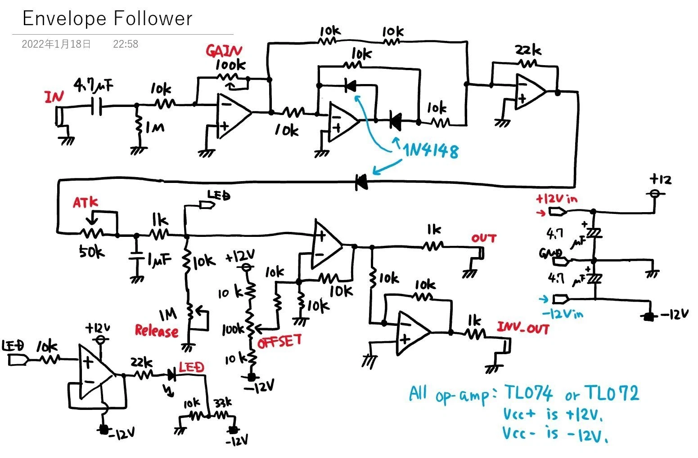
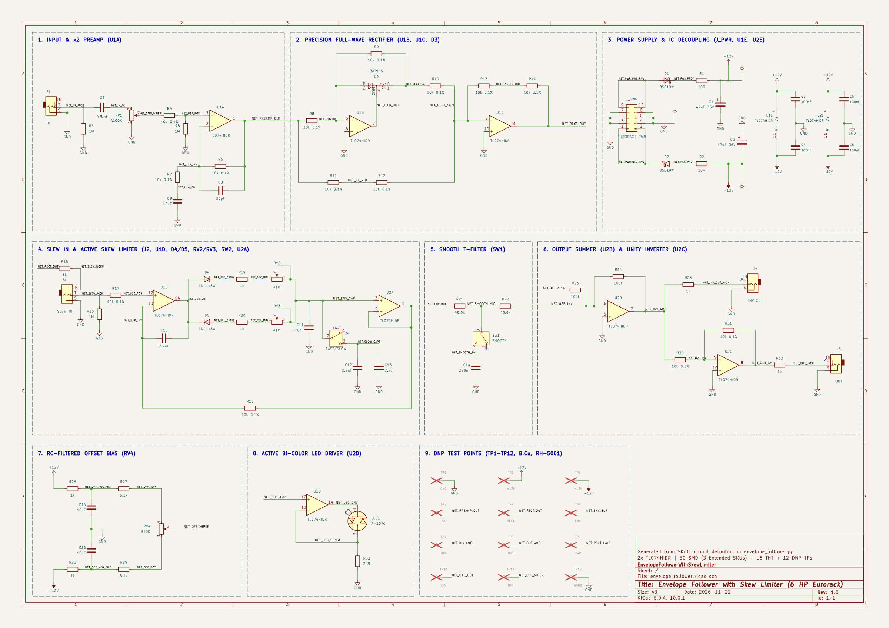
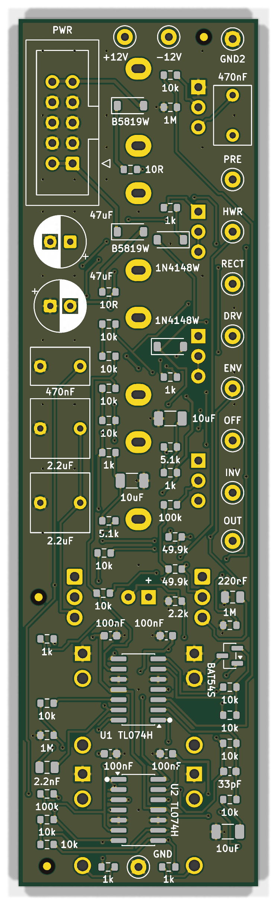
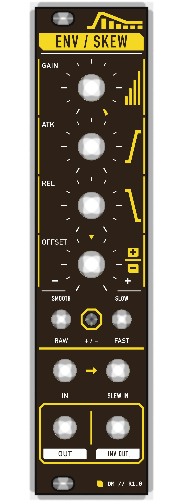
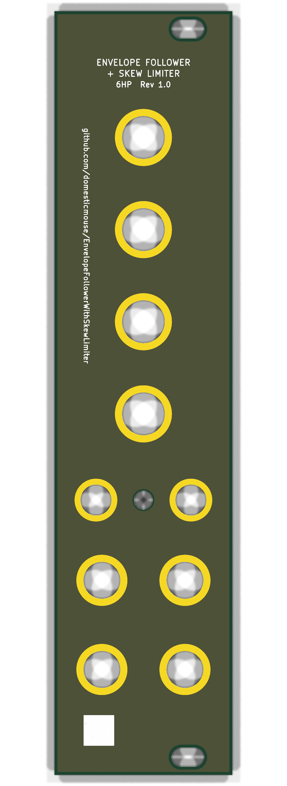

# EnvelopeFollowerWithSkewLimiter

Building on [domesticmouse/EnvelopeFollower](https://github.com/domesticmouse/EnvelopeFollower) with all the mod cons — this module is the result of loosely following the tutorial housed in that GitHub repository.

## Repository Structure

| Path | Description |
| --- | --- |
| [`README.md`](README.md) | Project overview and directory index (kept up to date as design files are added). |
| [`EnvelopeFollower.webp`](EnvelopeFollower.webp) | Hand-drawn reference schematic image for the base Eurorack envelope follower circuit, used as the source for circuit extraction. |
| [`EnvelopeFollower.md`](EnvelopeFollower.md) | Extracted Markdown circuit specification (BOM, stage-by-stage analysis, pin-level netlist, and build notes) derived from `EnvelopeFollower.webp`. |
| [`EnvelopeFollowerImprovements.md`](EnvelopeFollowerImprovements.md) | Engineering review of the base circuit documenting electrical issues, quantitative analysis, prioritized fixes, and Eurorack skew-limiter upgrade architectures. |
| [`DesignSpec.md`](DesignSpec.md) | Finalized 6 HP (`2× TL074H`) build specification, JLCPCB SMD / Tayda TH BOM, stage analysis, pin-level netlist, and front-panel layout. |
| [`checklists/`](checklists/) | Step-by-step markdown checklists for JLCPCB main board/PCBA & front panel ordering, 50-part PCBA alignment (with [`generate_pcba_alignment_images.py`](checklists/generate_pcba_alignment_images.py)), Tayda ordering, hand assembly (with [`generate_hand_assembly_images.py`](checklists/generate_hand_assembly_images.py)), and board bringup (with [`generate_bringup_images.py`](checklists/generate_bringup_images.py)). |
| [`patches/`](patches/) | Patch guides and front-panel reference documenting 8 Eurorack patches across Envelope Follower (`IN`) and Asymmetric Skew Limiter (`SLEW IN`) modes. |
| [`envelope_follower.py`](envelope_follower.py) | SKiDL Python circuit capture script implementing all 80 footprints, 48 nets, ERC assertions, and BOM/netlist exports. |
| [`generate_schematic.py`](generate_schematic.py) | Script that reads `envelope_follower.build_circuit()` and KiCad 10 symbols to generate the 9-section A3 schematic (`envelope_follower.kicad_sch`). |
| [`envelope_follower.kicad_sch`](envelope_follower.kicad_sch) | Clean 9-section A3 KiCad 10 schematic ready to open directly in KiCad 10 Eeschema (`0` ERC errors, 100% netlist parity with `envelope_follower.net`). |
| [`envelope_follower.pdf`](envelope_follower.pdf) | Printable A3 PDF version of the KiCad 10 schematic exported from `envelope_follower.kicad_sch`. |
| [`generate_kicad_pcb.py`](generate_kicad_pcb.py) | Programmatic KiCad 10 PCB generator (`pcbnew`) placing all 80 circuit footprints + 3 `B.Cu` fiducials, routing all 48 nets, pouring `F.Cu`/`B.Cu` `GND` planes, and applying silkscreen/fab markup. |
| [`envelope_follower.kicad_pcb`](envelope_follower.kicad_pcb) | Routed 2-layer `30.0 × 108.0 mm` (6 HP) KiCad 10 PCB (`F.Cu` panel controls + `B.Cu` SMD/power/test points, `0` DRC violations, `0` unconnected items, `0` schematic parity issues). |
| [`envelope_follower.kicad_pro`](envelope_follower.kicad_pro) | KiCad 10 project configuration file for `envelope_follower.kicad_sch` and `envelope_follower.kicad_pcb`. |
| [`silk_layout.json`](silk_layout.json) | Pinned board-local `F.SilkS`/`B.SilkS` layout manifest synced with `generate_kicad_pcb.py` (including `LED1` bi-color/polarity callouts, dual-sided `TP1`–`TP12` labels, and value-only `B.SilkS` passives). |
| [`envelope_follower_panel.kicad_pcb`](envelope_follower_panel.kicad_pcb) | Mated 6 HP × 3U (`30.0 × 128.5 mm`) Eurorack front panel KiCad 10 PCB (Matte Black + ENIG finish + White silkscreen) with integrated VectorCraft `F.SilkS`/`F.Mask` artwork, `F.Cu`/`B.Cu` `GND` shield planes, grounded cutouts, M3 oval mounting slots, and rear `B.SilkS` metadata (`0` DRC errors). |
| [`panel_svg_spec.md`](panel_svg_spec.md) | 1:1 mm Markdown + JSON front-panel mechanical & SVG dimension specification (`F.SilkS` & `F.Mask` canvas, coordinates, keepouts, and KiCad import rules) for downstream graphics generation. |
| [`panel_art/`](panel_art/) | VectorCraft panel artwork generator (`generate_panel_art.py`), source `.vectorcraft`, 1:1 mm Plain SVGs (`front_silkscreen.svg`, `front_soldermask.svg`), mockup/keepout PNGs, and KiCad importer (`import_svgs_to_kicad.py`). |
| [`manufacturing/`](manufacturing/) | Ready-to-upload JLCPCB fabrication outputs: main-board Gerbers + drills (`envelope_follower_gerbers.zip`, `gerbers/`), Bottom-Side PCBA placement (`jlcpcb_cpl.csv`), and front-panel Gerbers + drills (`envelope_follower_panel_gerbers.zip`, `panel_gerbers/`). |
| [`images/`](images/) | Rendered PNG previews embedded in `README.md` (`schematic.png`, `pcb_front.png`, `pcb_back.png`, `panel_front.png`, `panel_back.png`) exported from `envelope_follower.pdf`, `envelope_follower.kicad_pcb`, and `envelope_follower_panel.kicad_pcb`, SMD-only `B.Cu` 3D placement screenshots in [`images/pcba_alignment/`](images/pcba_alignment/) (`board_overview.png` and `50` per-part cards embedded in `checklists/02-pcba-part-alignment.md`), hand-assembly placement screenshots in [`images/hand_assembly/`](images/hand_assembly/) (`3` overview maps and `18` per-part cards embedded in `checklists/04-hand-assembly.md`), and `9` annotated main-PCB bringup diagrams in [`images/board_bringup/`](images/board_bringup/) (embedded in `checklists/05-board-bringup.md`). |
| [`envelope_follower.net`](envelope_follower.net) | Exported KiCad 10 netlist (80 components, 48 active nets, `Power`/`HighImpedance` NetClasses, and DNP test-point properties). |
| [`envelope_follower_bom.xml`](envelope_follower_bom.xml) | Well-formed KiCad XML BOM containing component values, footprints, LCSC/MPN/silkscreen fields, and net nodes. |
| [`jlcpcb_bom.csv`](jlcpcb_bom.csv) | Grouped 4-column JLCPCB SMT PCBA BOM (50 SMD components across 17 rows, 3 Extended SKUs). |
| [`bom/ibom.html`](bom/ibom.html) | Interactive HTML BOM (InteractiveHtmlBom `v2.11.1`) filtered to the `18` hand-soldered non-SMD (`Manual THT`) components across `14` BOM rows (`11` `F.Cu` panel controls, `7` `B.Cu` THT parts) with `MPN` and `Manufacturer` columns. |
| [`envelope_follower.erc`](envelope_follower.erc) | SKiDL Electrical Rules Check report generated by `envelope_follower.py` (`0` errors, `0` warnings). |
| [`envelope_follower.log`](envelope_follower.log) | SKiDL netlist generation log generated by `envelope_follower.py` (`0` errors). |
| [`envelope_follower_sklib.py`](envelope_follower_sklib.py) | Auto-generated SKiDL backup symbol library for offline/reproducible netlist builds. |
| [`footprints/Eurorack_Custom.pretty/`](footprints/Eurorack_Custom.pretty/) | Project-local KiCad footprint library (`SW_Toggle_SPDT_Dailywell_2MS1.kicad_mod` for Tayda `A-6087` / Dailywell `2MS1` SPDT vertical toggles). |
| [`fp-lib-table`](fp-lib-table) | Project-local KiCad footprint library table registering `Eurorack_Custom`. |
| [`.agents/skills/`](.agents/skills/) | Installed hardware design, layout, BOM, and manufacturing skills for agent workflows. |
| [`skills-lock.json`](skills-lock.json) | Lockfile pinning the 9 upstream skills in `.agents/skills/` to their GitHub commits (`aklofas/kicad-happy` and `domesticmouse/skills`); `edit-silkscreen` is maintained locally in this repository. |
| [`LICENSE`](LICENSE) | Apache License 2.0. |

## Reference Circuit

The base envelope follower schematic is stored in [`EnvelopeFollower.webp`](EnvelopeFollower.webp), and its extracted build specification (BOM, stage-by-stage calculations, pin-level netlist, and implementation notes) is documented in [`EnvelopeFollower.md`](EnvelopeFollower.md):



## Circuit Review & Improvements

An engineering review of the base circuit is recorded in [`EnvelopeFollowerImprovements.md`](EnvelopeFollowerImprovements.md). Key findings and upgrades include:

- **Critical electrical & ergonomic fixes:** Eliminating the `ATK`/`Release` voltage-divider collapse (`-15.7 dB` worst-case attenuation) and `R9` gain shift, removing the uncompensated `D3` peak-detector dead zone, eliminating `OFFSET` pot loading (`+12.1%` gain modulation and non-linear taper), raising input impedance from `9.9 kΩ` to `~100 kΩ` with balanced gain staging, and replacing the pre-biased LED network with an active $V$-to-$I$ driver.
- **Recommended `2× TL074H` active skew-limiter architecture:** Consolidates onto a single op-amp SKU (`8` sections, `0` unused) with a frequency-compensated active precision skew limiter (`U1D` + `U2A`), normaled `SLEW IN` jack, unity-gain inverting summer (`0.00%` offset gain modulation), and optional Eurorack utilities (`SMOOTH` filter, `PRE OUT`, Schmitt-trigger `GATE OUT`).

## Finalized Design Specification

The locked-in 6 HP module architecture is documented in [`DesignSpec.md`](DesignSpec.md):

- **6 HP Eurorack (`2× TL074HIDR`, `0` unused sections, `0` trimmers):** Single-column `4`-knob layout (`GAIN` `A100K`, `ATK` `A1M`, `REL` `A1M`, `OFFSET` `B10K` center-detent), dual sub-mini toggles (`SMOOTH` & `FAST / SLOW`), post-offset `3 mm` 2-pin **anti-parallel** Red/Green bi-color LED (`Tayda A-1076` — required by the bipolar `U2D` active $V$-to-$I$ driver so opposing dies clamp each other; do not substitute a standard single-die LED), and a `2 × 2` jack grid (`IN`, normaled `SLEW IN`, `OUT`, `INV_OUT`).
- **JLCPCB PCBA + Tayda TH split:** `50` SMD parts using only `3` JLCPCB Extended SKUs (`TL074HIDR`, `BAT54S`, `10 kΩ ±0.1%`) with all other SMD passives and `1N4148W` / `B5819W` diodes as JLCPCB Basic parts, paired with `18` Tayda/panel through-hole components (`47 µF / 35 V` radial bulk caps, `5 mm` box film timing/coupling caps, Alpha `9 mm` pots, toggles, and Thonkiconn jacks) plus `12` DNP through-hole test points (Ronghe `RH-5001` / LCSC `C5199801`).
- **Tuned for techno & ambient:** Switchless `×2` Eurorack input (`Z_in = 90.9 kΩ`), zero-gain-drop split-resistor `SMOOTH` T-filter (`f_c = 29.0 Hz`, `−11.1 dB` at `100 Hz`), `1 kΩ` linear-safe skew floor, `FAST` (`470 nF`: `0.29–289 ms`) / `SLOW` (`4.87 µF`: `3.0 ms–3.00 s`), and `±4.98 V` RC-filtered `OFFSET` with visual kick-ducking zero-crossing readout.

## Circuit Capture & KiCad Schematic

- **Single source of truth ([`envelope_follower.py`](envelope_follower.py)):** Defines the complete SKiDL circuit (`80` footprints, `48` active nets, BOM/LCSC fields, `Power`/`HighImpedance` NetClasses, and ERC assertions) and exports [`envelope_follower.net`](envelope_follower.net), [`envelope_follower_bom.xml`](envelope_follower_bom.xml), and [`jlcpcb_bom.csv`](jlcpcb_bom.csv).
- **Schematic visualization ([`generate_schematic.py`](generate_schematic.py)):** Reads `envelope_follower.build_circuit()` and KiCad 10 symbol libraries to build [`envelope_follower.kicad_sch`](envelope_follower.kicad_sch) — a 9-section A3 landscape schematic (`128` symbol instances, `236` wires, `4` no-connect markers, `0` ERC errors, 100% netlist parity with [`envelope_follower.net`](envelope_follower.net)) ready to open directly in KiCad 10 Eeschema, alongside a printable A3 PDF export in [`envelope_follower.pdf`](envelope_follower.pdf).

[](envelope_follower.pdf)

```bash
.venv/bin/python envelope_follower.py
.venv/bin/python generate_schematic.py
kicad-cli sch export pdf --output envelope_follower.pdf envelope_follower.kicad_sch
sips -s format png -Z 2400 envelope_follower.pdf --out images/schematic.png
```

## PCB Layout

- **2-layer 6 HP sandwich board ([`envelope_follower.kicad_pcb`](envelope_follower.kicad_pcb)):** `30.0 × 108.0 mm` FR4 layout placing the `11` front-panel controls (`RV1`–`RV4`, `SW1`–`SW2`, `LED1`, `J1`–`J4`) on `F.Cu` and all `50` JLCPCB SMDs, `7` non-panel THT parts (`J_PWR`, `C1`–`C2`, `C7`, `C11`–`C13`), `12` DNP test points (`TP1`–`TP12`), and `3` assembly fiducials (`FID1`–`FID3`) on `B.Cu`, with `F.Cu`/`B.Cu` `GND` planes (`0` DRC violations, `0` unconnected items, and `0` schematic parity issues).
- **Pinned silkscreen & assembly callouts ([`silk_layout.json`](silk_layout.json)):**
  - `F.SilkS`: outer-edge aligned `RV1`–`RV4`, `SW1` (`SMOOTH`), `SW2` (`FAST/SLOW`), and `J1`–`J4` labels; centered `LED1 OUT` / `2-PIN R/G` / `TAYDA A-1076` markings with dual-sided (`F.SilkS` + `B.SilkS`) `+` polarity indicators at square Pad 1 (`+V = Green`); `-12V` power stripe; dual-sided `TP1`–`TP12` labels; board title/GitHub URL; and a top-right `5 × 5 mm` JLCPCB QR placeholder.
  - `B.SilkS` / `B.Fab`: compact value-only SMD/THT passive & diode labels, `U1`/`U2` Pin-1 dots, opposite-polarity `C1`/`C2` markings, and `B.Fab` fabrication notes below the bottom edge.

| Front (`F.Cu` — Panel Controls) | Back (`B.Cu` — 50 SMD PCBA & Power) |
| :---: | :---: |
|  |  |

- **Programmatic layout & silkscreen iteration ([`generate_kicad_pcb.py`](generate_kicad_pcb.py) + [`silk_layout.json`](silk_layout.json)):** Generates the full routed board from [`envelope_follower.net`](envelope_follower.net), restamps/syncs manual KiCad silkscreen refinements in place, or refreshes the README renders:

```bash
python3 generate_kicad_pcb.py
python3 generate_kicad_pcb.py --silk-only
python3 generate_kicad_pcb.py --sync-silk
python3 generate_kicad_pcb.py --show-silk [REF ...]
python3 generate_kicad_pcb.py --check-silk   # strict silkscreen collision/keepout/tether inspection
kicad-cli pcb render --side top --width 900 --height 2400 --background transparent --quality high --output images/pcb_front.png envelope_follower.kicad_pcb
kicad-cli pcb render --side bottom --width 900 --height 2400 --background transparent --quality high --output images/pcb_back.png envelope_follower.kicad_pcb
```

## Front Panel

- **6 HP × 3U Matte Black + ENIG faceplate ([`envelope_follower_panel.kicad_pcb`](envelope_follower_panel.kicad_pcb)):** `30.0 × 128.5 mm` (`1.6 mm` FR4, `Matte Black` solder mask, `ENIG` copper finish, `White` silkscreen) mated directly to [`envelope_follower.kicad_pcb`](envelope_follower.kicad_pcb) (`10.25 mm` top/bottom rail overhang). Features `2` Doepfer M3 oval mounting slots (`3.2 × 5.5 mm` NPTH), `10` grounded `GND` PTH panel cutouts (`RV1`–`RV4` `7.2 mm`, `SW1`–`SW2` `5.2 mm`, `J1`–`J4` `6.2 mm`) with tented front solder mask and exposed rear `B.Mask` grounding rings, `1` `3.2 mm` NPTH aperture for `LED1`, and filled `F.Cu`/`B.Cu` `GND` shield planes (`0` DRC errors, `0` unconnected items).
- **Dark Techno / Brutalist front artwork ([`panel_art/`](panel_art/)):** Generated via `vectorcraft-cli` ([`panel_art/generate_panel_art.py`](panel_art/generate_panel_art.py)) against [`panel_svg_spec.md`](panel_svg_spec.md) and imported into KiCad via [`panel_art/import_svgs_to_kicad.py`](panel_art/import_svgs_to_kicad.py) (`104` `F.SilkS` polygons, `33` `F.Mask` ENIG gold openings over `F.Cu`, `>= 0.60 mm` ink-to-mask separation).
- **Rear `B.SilkS` markings:** Mirrored (`(justify mirror)`) module title/version (`ENVELOPE FOLLOWER / + SKEW LIMITER / 6HP  Rev 1.0`), vertical GitHub URL (`github.com/domesticmouse/EnvelopeFollowerWithSkewLimiter`), and a `5.0 × 5.0 mm` solid JLCPCB QR placeholder square placed clear of all `B.Mask` pads, M3 slots, and panel edges.
- **Upload Gerbers ([`manufacturing/`](manufacturing/)):** Ready-to-upload JLCPCB archive in [`manufacturing/envelope_follower_panel_gerbers.zip`](manufacturing/envelope_follower_panel_gerbers.zip).

| Front (`F.Cu` — Matte Black, ENIG Gold & White Silkscreen) | Back (`B.Cu` — Ground Rings, Metadata & QR) |
| :---: | :---: |
|  |  |

```bash
python3 .agents/skills/eurorack-panel/scripts/generate_eurorack_panel.py \
    --main-pcb envelope_follower.kicad_pcb \
    --output envelope_follower_panel.kicad_pcb \
    --blank-front \
    --title "ENVELOPE FOLLOWER + SKEW LIMITER" \
    --version "Rev 1.0" \
    --url "github.com/domesticmouse/EnvelopeFollowerWithSkewLimiter" \
    --spec-md panel_svg_spec.md \
    --drc
/Applications/KiCad/KiCad.app/Contents/Frameworks/Python.framework/Versions/Current/bin/python3 panel_art/import_svgs_to_kicad.py
kicad-cli pcb render --side top --width 900 --height 2400 --background transparent --quality high --output images/panel_front.png envelope_follower_panel.kicad_pcb
kicad-cli pcb render --side bottom --width 900 --height 2400 --background transparent --quality high --output images/panel_back.png envelope_follower_panel.kicad_pcb
```

## Build & Manufacturing Checklists

Step-by-step checklists are organized in [`checklists/`](checklists/) ([`checklists/README.md`](checklists/README.md)) in build order:

1. [`checklists/01-main-board-ordering.md`](checklists/01-main-board-ordering.md) — Main-board Gerber/CPL export, JLCPCB lead-free fabrication, `F.SilkS` QR code replacement, and Bottom-Side Economic PCBA ordering
1b. [`checklists/01b-front-panel-ordering.md`](checklists/01b-front-panel-ordering.md) — 6 HP front panel Gerber/drill verification and JLCPCB ordering (`Matte Black` + `ENIG-RoHS` + `White` silkscreen, `B.SilkS` QR replacement)
2. [`checklists/02-pcba-part-alignment.md`](checklists/02-pcba-part-alignment.md) — Placement & orientation verification for all `50` `B.Cu` SMD components in the JLCPCB viewer, with an embedded full-board 3D map and `50` per-part SMD-only `B.Cu` 3D verification cards (Pin-1 / cathode / SOT-23 lead callouts and board mini-maps)
3. [`checklists/03-tayda-ordering.md`](checklists/03-tayda-ordering.md) — Tayda ordering list for all `18` THT/panel components, `<= 14.0 mm` knobs, hardware, and spares
4. [`checklists/04-hand-assembly.md`](checklists/04-hand-assembly.md) — Mechanical assembly order (`B.Cu` THT parts, `LED1` polarity bench check, `F.Cu` front-panel dry-fit & soldering, IPA cleaning), with `3` overview maps (`test_points_overview.png`, `back_overview.png`, `front_overview.png`) and `18` per-part placement cards
5. [`checklists/05-board-bringup.md`](checklists/05-board-bringup.md) — Unpowered cold checks, current-limited first power-up, all `12` test points (`TP1`–`TP12`), signal verification, and troubleshooting, illustrated with `9` annotated main-PCB bringup screenshots in [`images/board_bringup/`](images/board_bringup/)

To regenerate the `51` PCBA alignment screenshots ([`board_overview.png`](images/pcba_alignment/board_overview.png) and all `50` part cards in [`images/pcba_alignment/`](images/pcba_alignment/)), the `21` hand-assembly screenshots ([`test_points_overview.png`](images/hand_assembly/test_points_overview.png), [`back_overview.png`](images/hand_assembly/back_overview.png), [`front_overview.png`](images/hand_assembly/front_overview.png), and all `18` THT/panel part cards in [`images/hand_assembly/`](images/hand_assembly/)), or the `9` board-bringup screenshots in [`images/board_bringup/`](images/board_bringup/) after modifying [`envelope_follower.kicad_pcb`](envelope_follower.kicad_pcb) or [`silk_layout.json`](silk_layout.json):

```bash
python3 checklists/generate_pcba_alignment_images.py
python3 checklists/generate_hand_assembly_images.py
python3 checklists/generate_bringup_images.py
```
```

### Interactive Hand-Assembly BOM

An interactive placement map for the non-SMD hand-soldered components is provided in [`bom/ibom.html`](bom/ibom.html) (open locally in a web browser alongside [`checklists/04-hand-assembly.md`](checklists/04-hand-assembly.md)). It contains all `18` `Manual THT` components across `14` BOM rows (`10` rows / `11` parts on `F.Cu`: `J1`–`J4`, `LED1`, `RV1`–`RV4`, `SW1`–`SW2`; `4` rows / `7` parts on `B.Cu`: `C1`–`C2`, `C7`, `C11`–`C13`, `J_PWR`) and excludes the `50` JLCPCB SMD parts, `12` DNP test points (`TP1`–`TP12`), and `3` fiducials (`FID1`–`FID3`).

To re-create [`bom/ibom.html`](bom/ibom.html) after modifying [`envelope_follower.kicad_pcb`](envelope_follower.kicad_pcb):

1. Open [`envelope_follower.kicad_pcb`](envelope_follower.kicad_pcb) in KiCad PCB Editor (`pcbnew`) and launch the [InteractiveHtmlBom](https://github.com/openscopeproject/InteractiveHtmlBom) plugin (`v2.11.1`).
2. **General** tab: keep the output directory `bom` and filename format `ibom` (writes `bom/ibom.html`).
3. **Fields** tab:
   - **Extra fields:** show `Value`, `Footprint`, `MPN`, and `Manufacturer` (omit `LCSC` and `Notes`).
   - **Board variant field:** select `JLCPCB_Class`.
   - **Variants whitelist:** select `Manual THT` only (leave `Basic`, `Extended`, `DNP THT`, and `<empty>` unselected).
4. Click **Generate BOM** and verify the output lists `14` BOM rows / `18` components (`11` Front, `7` Back).

## Patch Guides

Patch guides, front-panel starting settings, and control tips for **`ENV / SKEW`** are collected in [`patches/`](patches/) ([`patches/README.md`](patches/README.md)):

- **Envelope Follower Mode (`IN` patched, `SLEW IN` unpatched):**
  1. [`patches/01-sidechain-ducking.md`](patches/01-sidechain-ducking.md) — Sidechain ducking & pumping (`INV OUT`, `SMOOTH`, `+ / −` LED zero-crossing calibration)
  2. [`patches/02-auto-wah-envelope-filter.md`](patches/02-auto-wah-envelope-filter.md) — Upward (`OUT`) and reverse (`INV OUT`) auto-wah & dynamic envelope filtering
  3. [`patches/03-compression-expansion-gating.md`](patches/03-compression-expansion-gating.md) — Opto-style compression, threshold noise gating, and transient shaping
  4. [`patches/04-ducking-and-blooming-fx.md`](patches/04-ducking-and-blooming-fx.md) — Ducking delay/reverb sends and multi-second ambient swells (`SLOW` `4.87 µF`)
  5. [`patches/05-cross-modulation-push-pull.md`](patches/05-cross-modulation-push-pull.md) — Complementary push-pull stereo panning and dynamic FM/wavefolder modulation
- **Asymmetric Skew Limiter Mode (`SLEW IN` patched):**
  6. [`patches/06-audio-rate-slew-waveshaping.md`](patches/06-audio-rate-slew-waveshaping.md) — Audio-rate slew waveshaping & nonlinear low-pass filtering (`RAW` + `FAST`)
  7. [`patches/07-asymmetric-portamento-slides.md`](patches/07-asymmetric-portamento-slides.md) — Asymmetric portamento, TB-303 acid slides, and contrary-motion VCO tracking
  8. [`patches/08-gate-to-ar-envelope-and-slewed-mod.md`](patches/08-gate-to-ar-envelope-and-slewed-mod.md) — Linear-ramp AR/ASR envelopes, vactrol-style `SMOOTH` rounding, and slewed S&H/LFOs

## Installed Skills

The [`.agents/skills/`](.agents/skills/) directory includes the following hardware workflow skills:

- `skidl` — Python circuit capture (SKiDL) and netlist/BOM export
- `kicad` — KiCad schematic, PCB, Gerber, and DRC/ERC analysis
- `kicad-pcbnew-layout` — Programmatic KiCad 10 PCB placement, routing, and copper pours via `pcbnew`
- `kicad-silkscreen-markup` — Collision-free silkscreen annotation and fabrication notes
- `edit-silkscreen` (project-local) — Interactive per-label silkscreen placement editing and `silk_layout.json` sync
- `eurorack-panel` — Mated 3U Eurorack front panel generation from main PCB coordinates
- `bom` — Unified BOM management and fabrication exports
- `datasheets` — Structured component datasheet extraction and caching
- `lcsc` — LCSC/JLCPCB component search and datasheet sync
- `jlcpcb` — JLCPCB fabrication and PCBA preparation

## License

Licensed under the [Apache License 2.0](LICENSE).

## Disclaimer

This is not an officially supported Google product.
