# PCBA Part Alignment Checklist (50 Bottom-Side SMDs)

Use this checklist inside **JLCPCB's 2D/3D Component Placement Viewer** (and again when approving JLCPCB's post-order placement confirmation) to verify all **`50` SMD parts** on **Bottom (`B.Cu`)**.

---

## Viewing Convention & Board Map

All coordinates below use **board-local millimeters (`30.0 × 108.0 mm`)** with the board **upright** (`Y = 0.0` at TOP, `Y = 108.0` at BOTTOM):

- **`back (X, Y)`** = direct view looking straight at **`B.Cu` (Bottom Side)** with top edge up:
  - `back_X = 30.0 - board_X` (`X = 0` is left edge, `X = 30` is right edge in JLCPCB's Bottom viewer)
- **`board (X, Y)`** = KiCad front-referenced `F.Cu` coordinate (matches CPL `Mid X`, `-Mid Y` relative to top-left origin)
- **`KiCad Rot`** = orientation stored in `envelope_follower.kicad_pcb` / raw CPL

> **CRITICAL JLCPCB ROTATION NOTE:** JLCPCB's parts library often uses a different `0°` convention than KiCad (`SOIC-14`, `SOT-23`, and `SOD-123` frequently differ by `±90°` or `180°`). **Trust the physical Pin-1 dot/bevel, cathode band, and SOT-23 triangle in JLCPCB's 2D/3D viewer** against the board features below — adjust rotations in JLCPCB's placement editor whenever needed!

> **Embedded Reference Screenshots:** All images below are SMD-only Bottom (`B.Cu`) 3D renders exported from `envelope_follower.kicad_pcb` (hiding unpopulated THT bodies to match JLCPCB's 3D PCBA placement viewer). Regenerate after any PCB or silkscreen change with `python3 checklists/generate_pcba_alignment_images.py`.

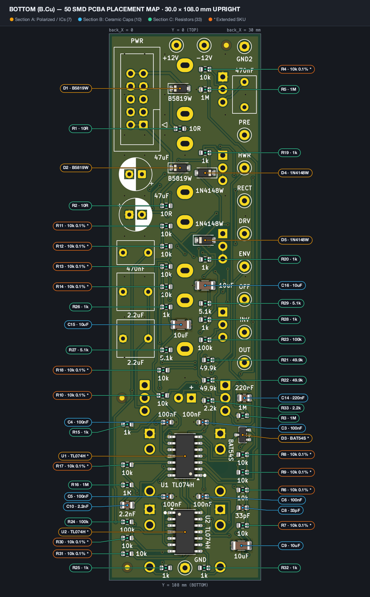

```text
  BACK SIDE (B.Cu) DIRECT VIEW — BOARD UPRIGHT (30.0 x 108.0 mm)
  back_X = 0 (left)                                back_X = 30 (right)
  ┌─────────────────────────────────────────────────────────────────┐ Y = 0
  │ [J_PWR] top-left        R4, D1, R5, R1           [TP12]  [C7]   │
  │ [C1]   (+12V)           R19, D4, D2                             │
  │ [C2]   (-12V)           R2, R11..R14, D5, R20                   │
  │ [C11]  470nF            C16, C15, R26..R29       [TP4..8]       │
  │ [C12]  2.2uF            R23, R18, R21, R22, R33                 │
  │ [C13]  2.2uF            R10                       [C14]  [R3]   │
  │                                                   [D3]  BAT54S  │
  │ [R15] [R17] [R16]       [C4]    [C3]              [R8]   [R9]   │
  │        [C10]                 [U1]                 [R6]   [C8]   │
  │        [R24]            [C5]    [C6]              [R7]   [C9]   │
  │ [R30]  [R31]                 [U2]                               │
  │        [R25]             [TP1 GND]               [R32]          │
  └─────────────────────────────────────────────────────────────────┘ Y = 108
```

---

## Section A — Critical Polarized & Multi-Pin Parts (`7` parts)

Double-check every single part in this section in both **2D** and **3D** views!

### Integrated Circuits (`2× TL074HIDR`, Extended `C2878713`)

- [ ] **`U1`** — `TL074HIDR` (`SOIC-14`, `C2878713`, Extended) — `back=(15.00, 83.50)` | `board=(15.00, 83.50)` | KiCad `Rot=0°`
  - **Package alignment:** Long axis vertical (`7` pins on left edge, `7` pins on right edge).
  - **Pin-1 check (CRITICAL):** Pin 1 dot/bevel MUST be at **BOTTOM-RIGHT** (`back=(17.47, 87.31)`), directly next to the **`B.SilkS` Pin-1 white dot** (`back=(18.93, 87.31)`).
  - **Sanity check:** Pins `1–7` run upward along the right side (`Pin 4 = +12V` near `C3`); Pins `8–14` run downward along the left side (`Pin 11 = -12V` near `C4`).

  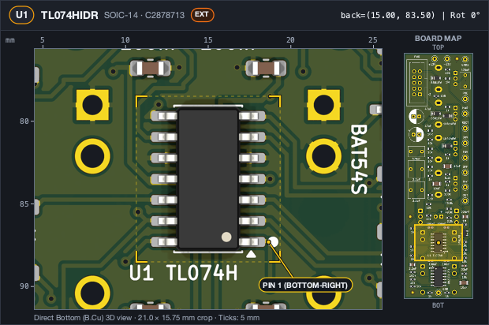

- [ ] **`U2`** — `TL074HIDR` (`SOIC-14`, `C2878713`, Extended) — `back=(15.00, 98.50)` | `board=(15.00, 98.50)` | KiCad `Rot=180°`
  - **Package alignment:** Long axis vertical (`7` pins on left edge, `7` pins on right edge), rotated **180° opposite `U1`**.
  - **Pin-1 check (CRITICAL):** Pin 1 dot/bevel MUST be at **TOP-LEFT** (`back=(12.53, 94.69)`), directly next to the **`B.SilkS` Pin-1 white dot** (`back=(11.08, 94.69)`).
  - **Sanity check:** Pins `1–7` run downward along the left side (`Pin 4 = +12V` near `C5`); Pins `8–14` run upward along the right side (`Pin 11 = -12V` near `C6`).

  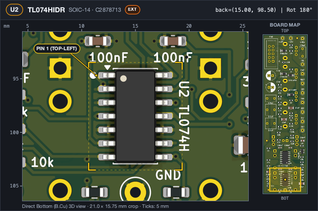

### Dual-Series Schottky Diode (`1× BAT54S`, Extended `C83935`)

- [ ] **`D3`** — `BAT54S` (`SOT-23`, `C83935`, Extended) — `back=(26.45, 79.30)` | `board=(3.55, 79.30)` | KiCad `Rot=0°`
  - **Lead alignment (CRITICAL):** **2-pin side MUST be on the RIGHT** (`back X = 27.39`, facing the right board edge), and **1-pin side MUST be on the LEFT** (`back X = 25.51`, facing inward).
  - **Pin mapping check:** Bottom-right = `Pin 1 (A1, NET_RECT_HALF)`, Top-right = `Pin 2 (K2, NET_U1B_INV)`, Middle-left = `Pin 3 (K1/A2, NET_U1B_OUT)`. Confirm all 3 gull-wing feet sit centered on the 3 copper pads and match the `C83935` datasheet pinout (`1=A1, 2=K2, 3=K1/A2`).

  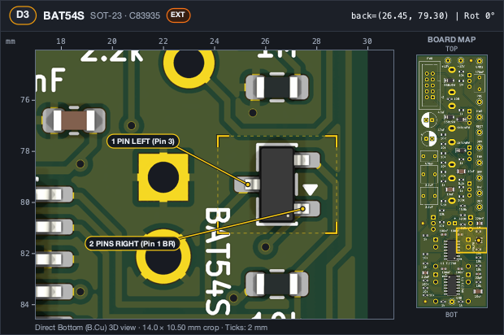

### Polarized SOD-123 Diodes (`2× B5819W`, `2× 1N4148W`, Basic)

> **Rule for all 4 `D_SOD-123` footprints:** The closed white **`B.SilkS` U-bar** marks the **Cathode (`K`, Pin 1)** end!

- [ ] **`D1`** — `B5819W` (`SOD-123`, `C8598`, Basic, `+12V` reverse-polarity protection) — `back=(14.00, 10.80)` | `board=(16.00, 10.80)` | KiCad `Rot=180°`
  - **Orientation:** Horizontal.
  - **Cathode check (CRITICAL):** Diode **cathode band (`K`, Pin 1) MUST face LEFT** (`back X = 12.35`, toward `J_PWR`), aligned with the closed `B.SilkS` cathode U-bar.

  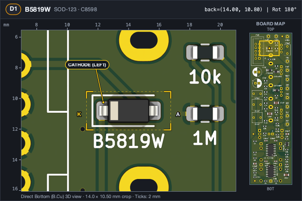

- [ ] **`D2`** — `B5819W` (`SOD-123`, `C8598`, Basic, `-12V` reverse-polarity protection) — `back=(14.00, 26.50)` | `board=(16.00, 26.50)` | KiCad `Rot=180°`
  - **Orientation:** Horizontal.
  - **Cathode check (CRITICAL):** Diode **cathode band (`K`, Pin 1) MUST face LEFT** (`back X = 12.35`, toward `C1` / left edge — **same visual direction as `D1`**), aligned with the closed `B.SilkS` cathode U-bar. *(In the `-12V` rail, `K` connects to raw `-12V` from `J_PWR`.)*

  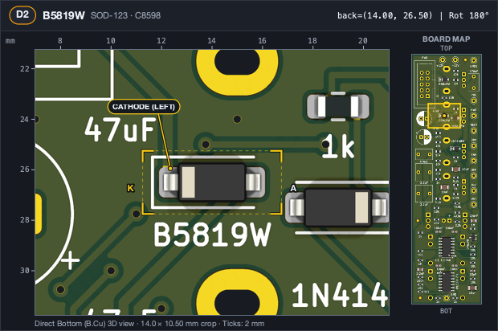

- [ ] **`D4`** — `1N4148W` (`SOD-123`, `C81598`, Basic, Attack diode) — `back=(19.00, 27.50)` | `board=(11.00, 27.50)` | KiCad `Rot=0°`
  - **Orientation:** Horizontal.
  - **Cathode check (CRITICAL):** Diode **cathode band (`K`, Pin 1) MUST face RIGHT** (`back X = 20.65`, toward right edge), aligned with the closed `B.SilkS` cathode U-bar. Anode (`A`, Pin 2) is on the left (`back X = 17.35`).

  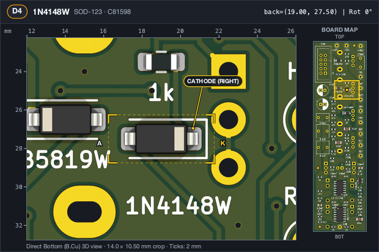

- [ ] **`D5`** — `1N4148W` (`SOD-123`, `C81598`, Basic, Release diode) — `back=(19.00, 40.80)` | `board=(11.00, 40.80)` | KiCad `Rot=180°`
  - **Orientation:** Horizontal.
  - **Cathode check (CRITICAL):** Diode **cathode band (`K`, Pin 1) MUST face LEFT** (`back X = 17.35`, toward board center — **180° opposite to `D4`**), aligned with the closed `B.SilkS` cathode U-bar. Anode (`A`, Pin 2) is on the right (`back X = 20.65`).

  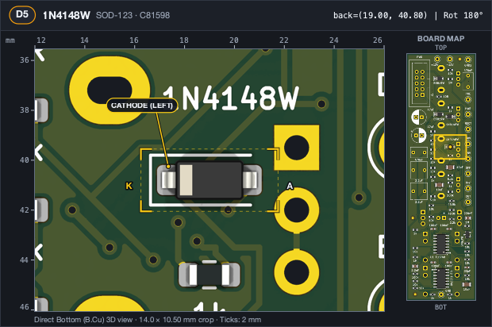

---

## Section B — SMD Ceramic Capacitors (`10` parts — All Non-Polarized, Horizontal `0°`/`180°`)

Confirm each chip capacitor body is **horizontal**, centered cleanly across its two pads (zero tombstone/offset warnings), and paired with its expected `B.SilkS` value label:

- [ ] **`C3`** — `100nF` (`0603`, `C14663`, Basic) — `back=(18.50, 76.80)` | `board=(11.50, 76.80)` | Rot `0°` — Above `U1` right (`+12V` decoupling)

  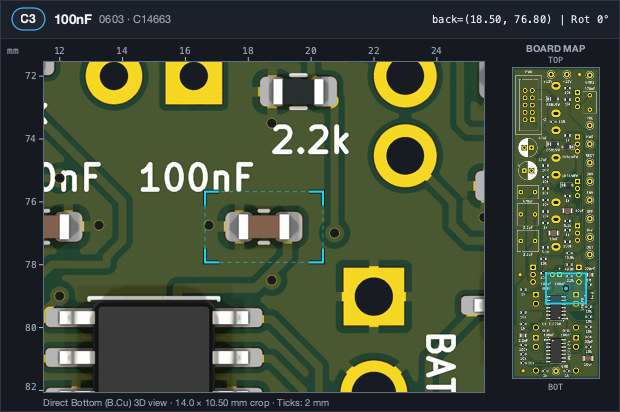

- [ ] **`C4`** — `100nF` (`0603`, `C14663`, Basic) — `back=(11.50, 76.80)` | `board=(18.50, 76.80)` | Rot `180°` — Above `U1` left (`-12V` decoupling)

  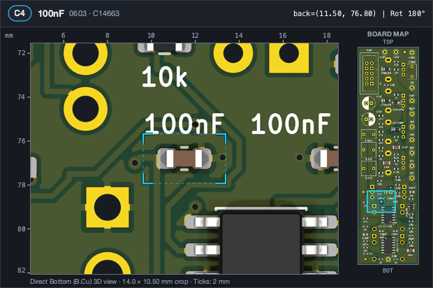

- [ ] **`C5`** — `100nF` (`0603`, `C14663`, Basic) — `back=(11.50, 91.50)` | `board=(18.50, 91.50)` | Rot `180°` — Above `U2` left (`+12V` decoupling)

  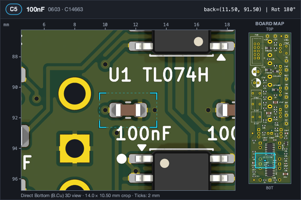

- [ ] **`C6`** — `100nF` (`0603`, `C14663`, Basic) — `back=(18.50, 91.50)` | `board=(11.50, 91.50)` | Rot `0°` — Above `U2` right (`-12V` decoupling)

  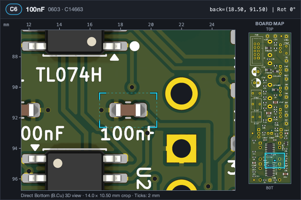

- [ ] **`C8`** — `33pF` C0G (`0603`, `C1663`, Basic) — `back=(26.45, 93.70)` | `board=(3.55, 93.70)` | Rot `0°` — Lower-right column (`U1A` feedback stabilization)

  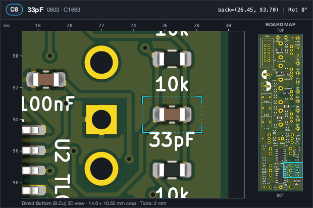

- [ ] **`C9`** — `10uF` (`1206`, `C13585`, Basic) — `back=(26.20, 101.20)` | `board=(3.80, 101.20)` | Rot `0°` — Lower-right bottom (`U1A` DC-gain block)

  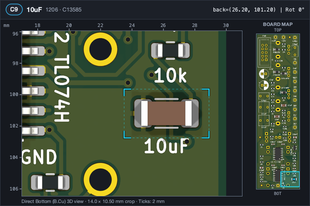

- [ ] **`C10`** — `2.2nF` C0G (`0805`, `C28260`, Basic) — `back=(3.55, 93.20)` | `board=(26.45, 93.20)` | Rot `0°` — Lower-left column (`U1D` loop compensation)

  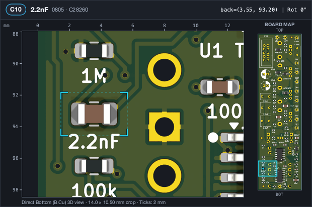

- [ ] **`C14`** — `220nF` (`0805`, `C5378`, Basic) — `back=(26.80, 72.00)` | `board=(3.20, 72.00)` | Rot `0°` — Mid-right edge (`SMOOTH` T-filter shunt)

  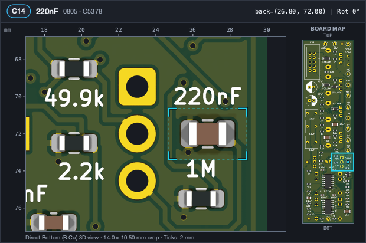

- [ ] **`C15`** — `10uF` (`1206`, `C13585`, Basic) — `back=(14.20, 57.50)` | `board=(15.80, 57.50)` | Rot `180°` — Center mid-bay (`+OFFSET` RC filter)

  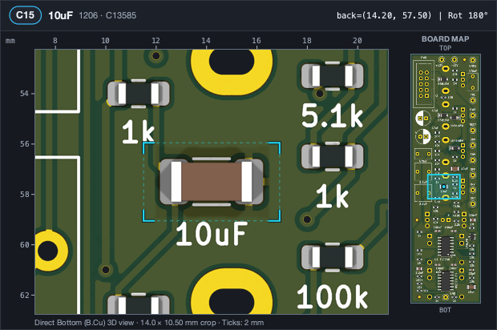

- [ ] **`C16`** — `10uF` (`1206`, `C13585`, Basic) — `back=(19.00, 49.75)` | `board=(11.00, 49.75)` | Rot `0°` — Mid-right corridor (`-OFFSET` RC filter)

  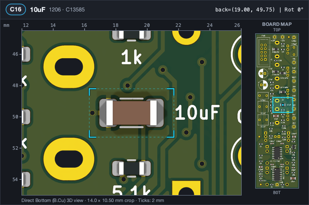

---

## Section C — SMD Resistors (`33` parts — All `0603`, Non-Polarized, Horizontal `0°`/`180°`)

Confirm every `0603` resistor is **horizontal**, centered on its two pads, and free of solder-pad/THT interference:

- [ ] **`R1`** — `10R` (`0603`, `C22859`, Basic) — `back=(14.00, 18.75)` | `board=(16.00, 18.75)` | Rot `180°` — `+12V` RC rail resistor

  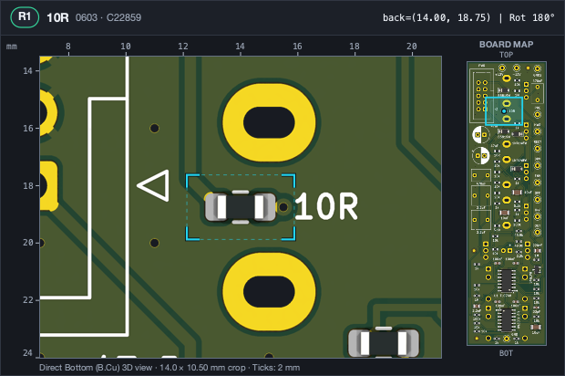

- [ ] **`R2`** — `10R` (`0603`, `C22859`, Basic) — `back=(11.30, 34.00)` | `board=(18.70, 34.00)` | Rot `180°` — `-12V` RC rail resistor

  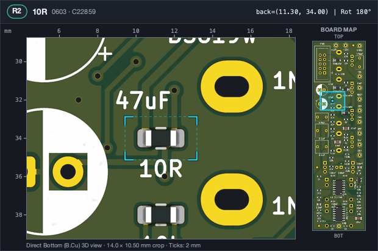

- [ ] **`R3`** — `1M` (`0603`, `C22935`, Basic) — `back=(26.45, 75.50)` | `board=(3.55, 75.50)` | Rot `0°` — `J1` input jack bleed

  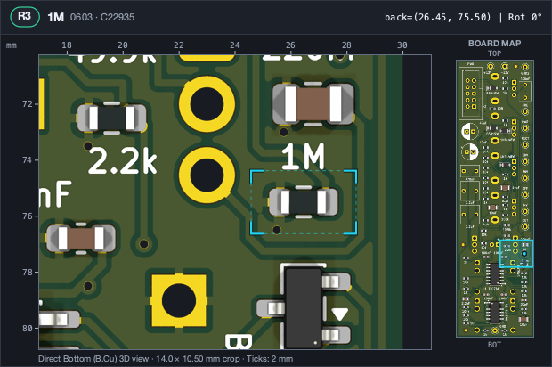

- [ ] **`R4`** — `10k 0.1%` (`0603`, `C95204`, **Extended**) — `back=(19.00, 7.00)` | `board=(11.00, 7.00)` | Rot `0°` — `GAIN` wiper to `U1A.+`

  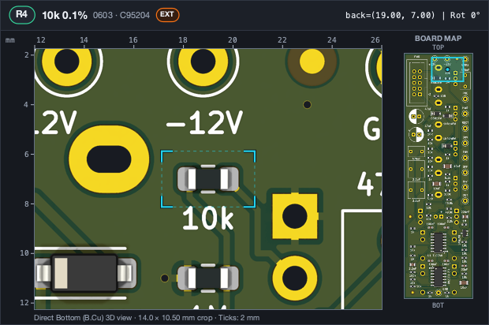

- [ ] **`R5`** — `1M` (`0603`, `C22935`, Basic) — `back=(19.00, 11.00)` | `board=(11.00, 11.00)` | Rot `0°` — `U1A.+` wiper-lift pull-down

  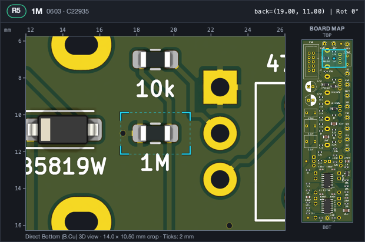

- [ ] **`R6`** — `10k 0.1%` (`0603`, `C95204`, **Extended**) — `back=(26.45, 90.20)` | `board=(3.55, 90.20)` | Rot `0°` — `U1A` feedback

  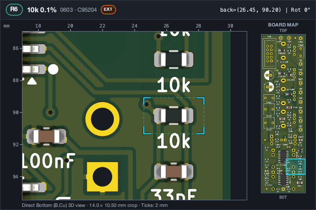

- [ ] **`R7`** — `10k 0.1%` (`0603`, `C95204`, **Extended**) — `back=(26.45, 97.20)` | `board=(3.55, 97.20)` | Rot `0°` — `U1A` gain to `C9`

  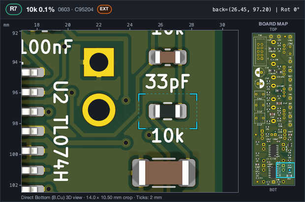

- [ ] **`R8`** — `10k 0.1%` (`0603`, `C95204`, **Extended**) — `back=(26.45, 83.20)` | `board=(3.55, 83.20)` | Rot `180°` — `U1B` HWR input

  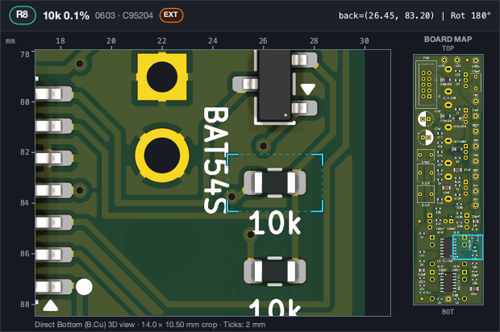

- [ ] **`R9`** — `10k 0.1%` (`0603`, `C95204`, **Extended**) — `back=(26.45, 86.70)` | `board=(3.55, 86.70)` | Rot `0°` — `U1B` HWR feedback

  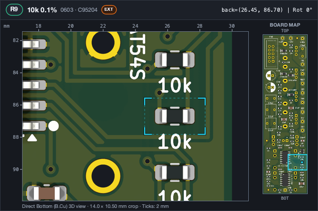

- [ ] **`R10`** — `10k 0.1%` (`0603`, `C95204`, **Extended**) — `back=(10.60, 71.50)` | `board=(19.40, 71.50)` | Rot `0°` — FWR HWR-to-summer (`U1C.-`)

  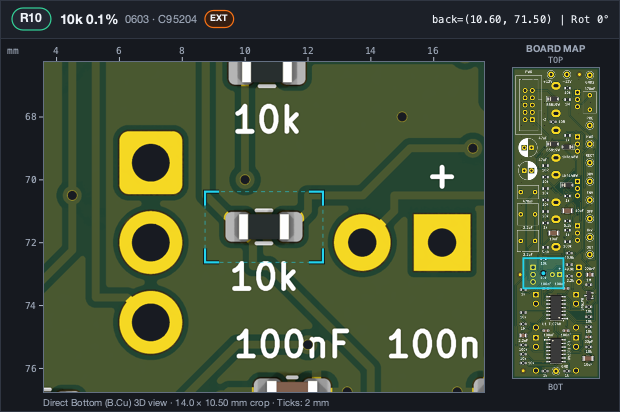

- [ ] **`R11`** — `10k 0.1%` (`0603`, `C95204`, **Extended**) — `back=(11.30, 38.00)` | `board=(18.70, 38.00)` | Rot `0°` — FWR feedforward 1/2

  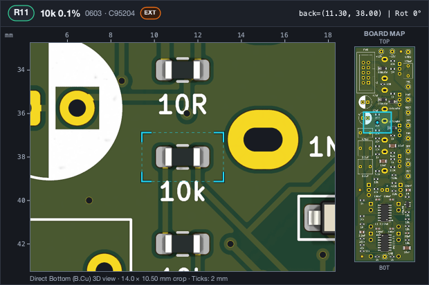

- [ ] **`R12`** — `10k 0.1%` (`0603`, `C95204`, **Extended**) — `back=(11.30, 42.00)` | `board=(18.70, 42.00)` | Rot `180°` — FWR feedforward 2/2

  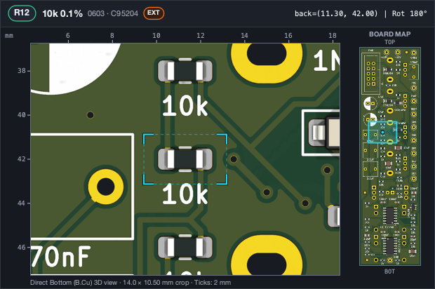

- [ ] **`R13`** — `10k 0.1%` (`0603`, `C95204`, **Extended**) — `back=(11.30, 46.00)` | `board=(18.70, 46.00)` | Rot `0°` — FWR summer feedback 1/2

  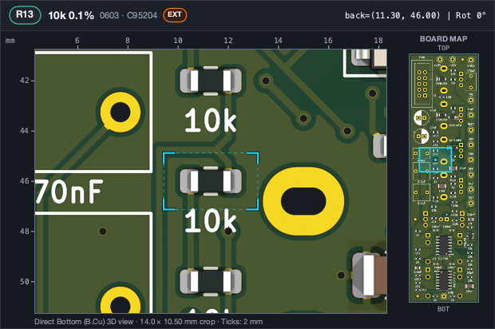

- [ ] **`R14`** — `10k 0.1%` (`0603`, `C95204`, **Extended**) — `back=(11.30, 50.00)` | `board=(18.70, 50.00)` | Rot `180°` — FWR summer feedback 2/2

  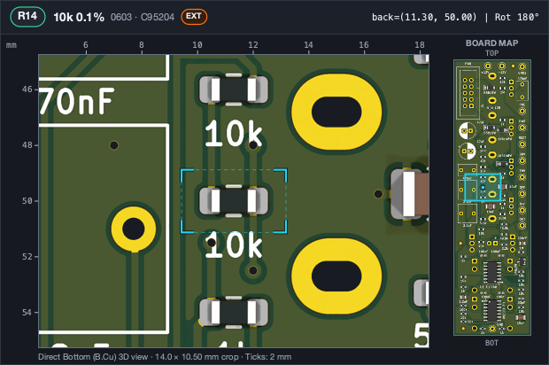

- [ ] **`R15`** — `1k` (`0603`, `C21190`, Basic) — `back=(3.55, 77.20)` | `board=(26.45, 77.20)` | Rot `180°` — `J2 SLEW IN` normal protection

  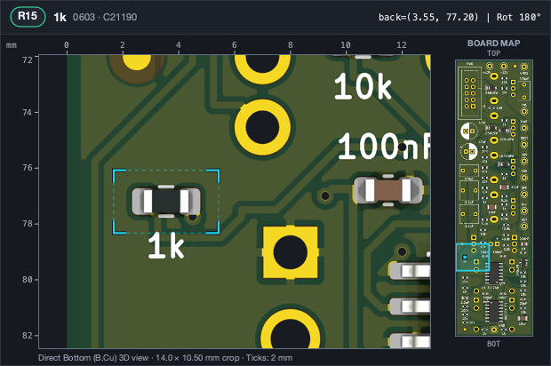

- [ ] **`R16`** — `1M` (`0603`, `C22935`, Basic) — `back=(3.55, 89.20)` | `board=(26.45, 89.20)` | Rot `0°` — `J2 SLEW IN` ground reference

  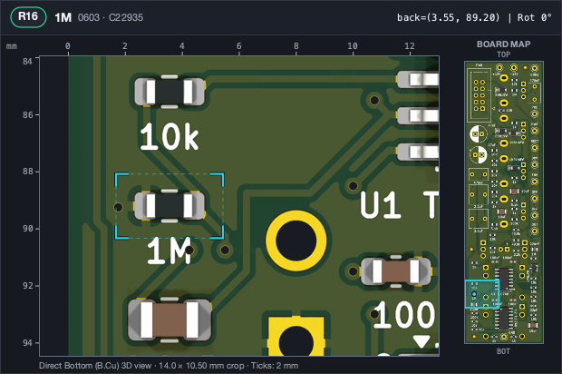

- [ ] **`R17`** — `10k 0.1%` (`0603`, `C95204`, **Extended**) — `back=(3.55, 85.20)` | `board=(26.45, 85.20)` | Rot `180°` — `SLEW IN` to `U1D.+`

  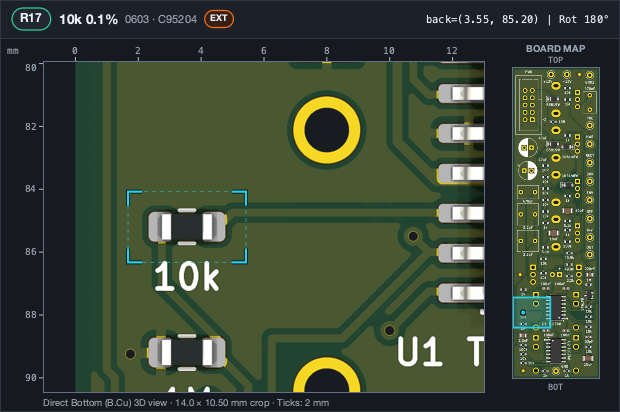

- [ ] **`R18`** — `10k 0.1%` (`0603`, `C95204`, **Extended**) — `back=(10.70, 66.50)` | `board=(19.30, 66.50)` | Rot `0°` — `U2A.OUT` feedback to `U1D.-`

  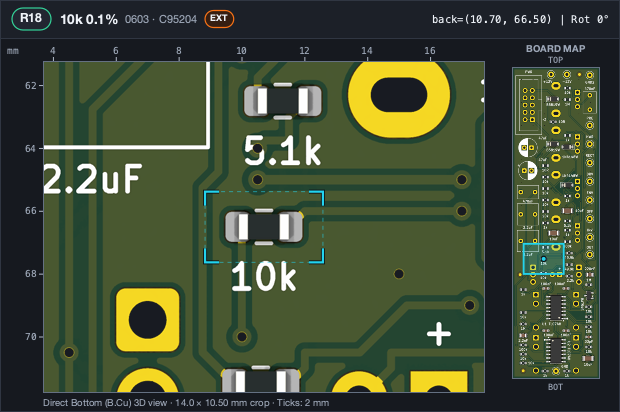

- [ ] **`R19`** — `1k` (`0603`, `C21190`, Basic) — `back=(19.00, 23.50)` | `board=(11.00, 23.50)` | Rot `0°` — `R_atk_min` linear-safe floor

  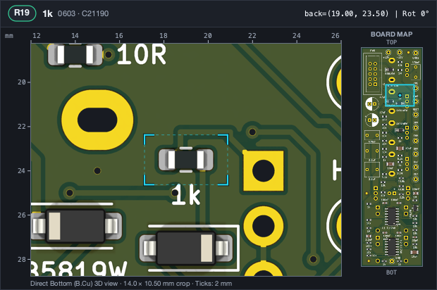

- [ ] **`R20`** — `1k` (`0603`, `C21190`, Basic) — `back=(19.00, 44.60)` | `board=(11.00, 44.60)` | Rot `0°` — `R_rel_min` linear-safe floor

  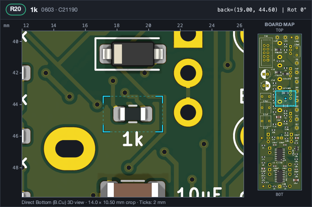

- [ ] **`R21`** — `49.9k` (`0603`, `C23184`, Basic) — `back=(19.60, 64.50)` | `board=(10.40, 64.50)` | Rot `0°` — `SMOOTH` T-filter leg 1/2

  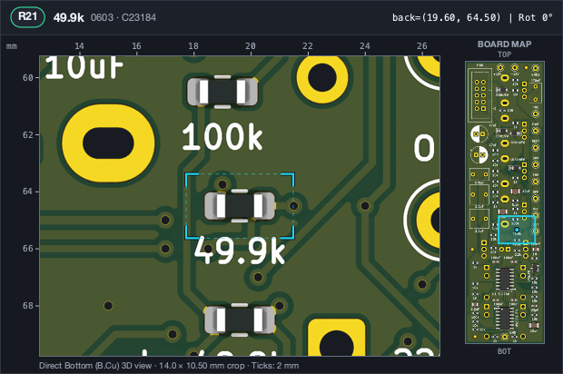

- [ ] **`R22`** — `49.9k` (`0603`, `C23184`, Basic) — `back=(19.60, 68.50)` | `board=(10.40, 68.50)` | Rot `0°` — `SMOOTH` T-filter leg 2/2

  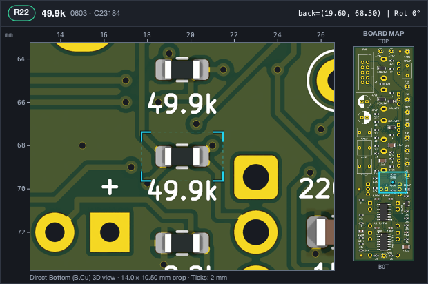

- [ ] **`R23`** — `100k` (`0603`, `C25803`, Basic) — `back=(19.00, 60.50)` | `board=(11.00, 60.50)` | Rot `0°` — `U2B` offset summing input

  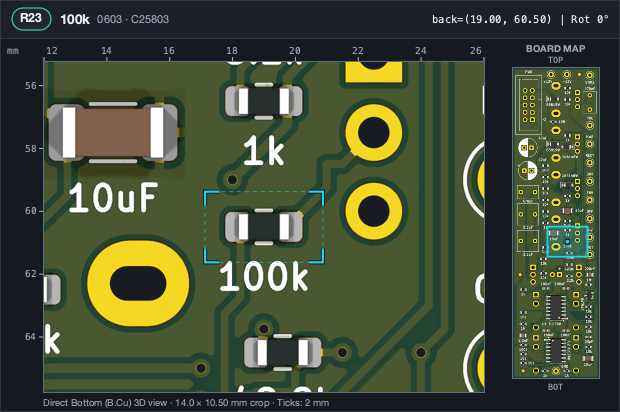

- [ ] **`R24`** — `100k` (`0603`, `C25803`, Basic) — `back=(3.55, 96.50)` | `board=(26.45, 96.50)` | Rot `180°` — `U2B` virtual-ground feedback

  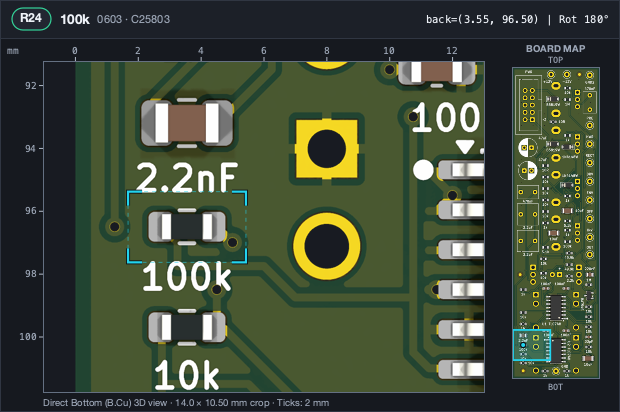

- [ ] **`R25`** — `1k` (`0603`, `C21190`, Basic) — `back=(11.20, 105.60)` | `board=(18.80, 105.60)` | Rot `180°` — `J4 INV_OUT` output protection

  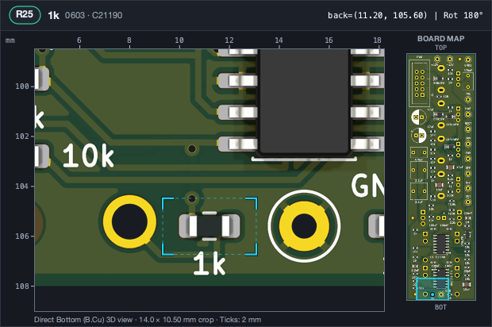

- [ ] **`R26`** — `1k` (`0603`, `C21190`, Basic) — `back=(11.30, 54.00)` | `board=(18.70, 54.00)` | Rot `180°` — `+12V OFFSET` RC filter input

  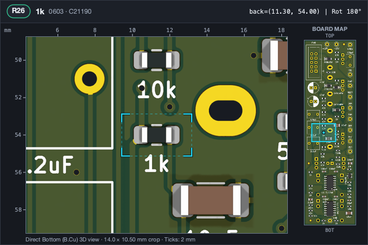

- [ ] **`R27`** — `5.1k` (`0603`, `C23186`, Basic) — `back=(11.30, 62.50)` | `board=(18.70, 62.50)` | Rot `180°` — `+OFFSET` range resistor

  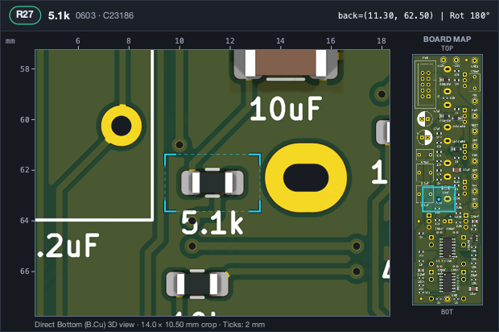

- [ ] **`R28`** — `1k` (`0603`, `C21190`, Basic) — `back=(19.00, 56.50)` | `board=(11.00, 56.50)` | Rot `0°` — `-12V OFFSET` RC filter input

  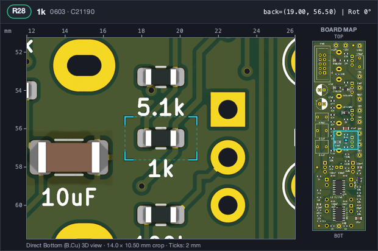

- [ ] **`R29`** — `5.1k` (`0603`, `C23186`, Basic) — `back=(19.00, 53.30)` | `board=(11.00, 53.30)` | Rot `0°` — `-OFFSET` range resistor

  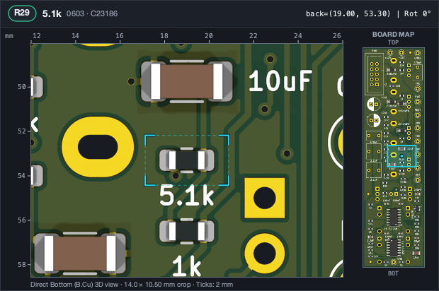

- [ ] **`R30`** — `10k 0.1%` (`0603`, `C95204`, **Extended**) — `back=(3.55, 99.70)` | `board=(26.45, 99.70)` | Rot `0°` — `U2C` unity inverter input

  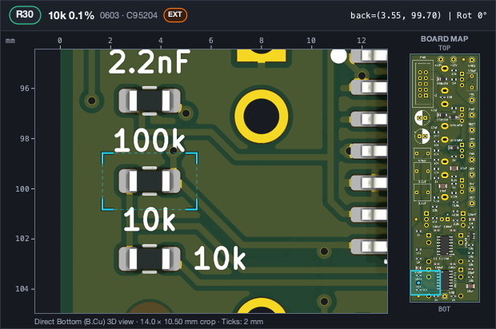

- [ ] **`R31`** — `10k 0.1%` (`0603`, `C95204`, **Extended**) — `back=(3.55, 102.80)` | `board=(26.45, 102.80)` | Rot `180°` — `U2C` unity inverter feedback

  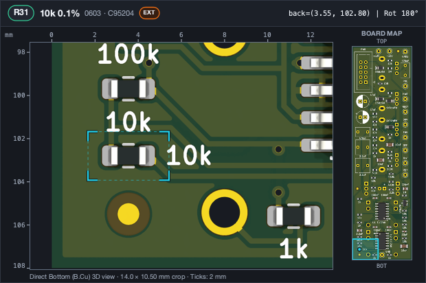

- [ ] **`R32`** — `1k` (`0603`, `C21190`, Basic) — `back=(18.80, 105.60)` | `board=(11.20, 105.60)` | Rot `0°` — `J3 OUT` output protection

  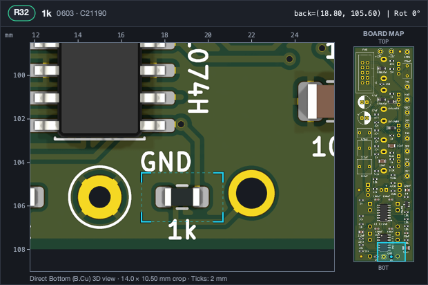

- [ ] **`R33`** — `2.2k` (`0603`, `C4190`, Basic) — `back=(19.60, 72.50)` | `board=(10.40, 72.50)` | Rot `0°` — `U2D` active LED current sense

  

---

## Section D — Final Placement Viewer Sign-Off

- [ ] **Total placed component count:** `50` on **Bottom**, `0` on **Top**
- [ ] **Clearance check:** No SMD body overlaps any adjacent THT pad/drill hole (`RV1`–`RV4`, `SW1`–`SW2`, `J1`–`J4`, `C1`–`C2`, `C7`, `C11`–`C13`, `J_PWR`, `TP1`–`TP12`) or extends beyond the `30.0 × 108.0 mm` board outline
- [ ] **3D view sanity check:** Visually confirm `U1` Pin 1 (bottom-right), `U2` Pin 1 (top-left), `D3` (2 pins right, 1 pin left), `D1`/`D2` cathode bands facing left, `D4` cathode band facing right, and `D5` cathode band facing left
- [ ] **Save screenshots** of both the JLCPCB **Bottom 2D** and **Bottom 3D** previews before confirming the order
