# Hand Assembly Checklist (Post-PCBA Through-Hole & Panel Build)

Follow this assembly sequence **strictly in order**. Installing `B.Cu` through-hole parts **before** `F.Cu` panel controls gives unrestricted soldering access on `F.Cu` and lets you trim every lead completely flush underneath the front-side pots and jacks.

> **Useful Tool — Interactive Hand-Assembly BOM:** Open [`../bom/ibom.html`](../bom/ibom.html) locally in a web browser while building. It is pre-filtered to the `18` hand-soldered non-SMD (`Manual THT`) parts (`7` on `B.Cu`, `11` on `F.Cu`) with `MPN` and `Manufacturer` columns, clickable front/back placement highlighting, and built-in **Sourced** / **Placed** progress checkboxes.
>
> **Embedded Reference Screenshots:** All images below are direct Bottom (`B.Cu`, with JLCPCB's `50` SMDs populated) and Front (`F.Cu`) 3D renders exported from [`../envelope_follower.kicad_pcb`](../envelope_follower.kicad_pcb) with through-hole component bodies hidden so empty plated holes and silkscreen polarity markings stay clearly visible. Regenerate after any PCB or silkscreen change with `python3 checklists/generate_hand_assembly_images.py`.

---

## 0. Incoming PCBA Inspection & Prep

- [ ] **Inspect JLCPCB assembled board(s) under magnification:**
  - Verify `U1` Pin 1 is bottom-right and `U2` Pin 1 is top-left in direct `B.Cu` view (matching the white `B.SilkS` Pin-1 dots).
  - Verify `D1` & `D2` (`B5819W`) cathode bands face **left**; `D4` (`1N4148W`) cathode band faces **right**; `D5` (`1N4148W`) cathode band faces **left**; `D3` (`BAT54S`) has 2 pins right / 1 pin left.
  - Check for solder bridges, tombstones, cold joints, or shipping damage on all `50` SMDs.
- [ ] **Quick bare-PCBA cold check (DMM resistance):**
  - `TP2 (+12V)` to `TP1 (GND)`: no short (reads open / `> 10 kΩ` after MLCC charge).
  - `TP3 (-12V)` to `TP1 (GND)`: no short (`> 10 kΩ`).
- [ ] **Stage tools & workspace:** Temperature-controlled soldering iron (fine chisel/conical tip), solder wire (`SAC305` lead-free recommended to match lead-free PCBA), flux pen/no-clean tacky flux, sharp flush cutters, DMM, `5 V` supply + `1 kΩ` series resistor (for `LED1` test), `99%` IPA + ESD brush, and your `6 HP` front panel.
- [ ] **Bag & label all `18` Tayda THT parts** (plus optional `TP1`–`TP12`) so values are never mixed up.
- [ ] **Open [`../bom/ibom.html`](../bom/ibom.html) in a browser** as a live placement map alongside this checklist (use its `B` / `F` view toggles to match Sections 2 and 4).

---

## 1. Optional DNP Test Points (`TP1`–`TP12`, `B.Cu` — Optional)

> You can skip fitting pins and probe the `1.0 mm` plated holes directly, fit wire/Ronghe `RH-5001` loops **only** on `TP1` (`GND`) and `TP12` (`GND2`) for easy scope ground clips, or populate all `12`.

- [ ] **Decide population scope** and install any desired `B.Cu` test loops (`TP1` `GND`, `TP2` `+12V`, `TP3` `-12V`, `TP4` `PRE`, `TP5` `RECT`, `TP6` `ENV`, `TP7` `INV`, `TP8` `OUT`, `TP9` `HWR`, `TP10` `DRV`, `TP11` `OFF`, `TP12` `GND2`).
- [ ] **Solder from `F.Cu` and trim all leads flush (`< 1.0 mm`)** on `F.Cu` so nothing touches front-panel pot/jack casings.

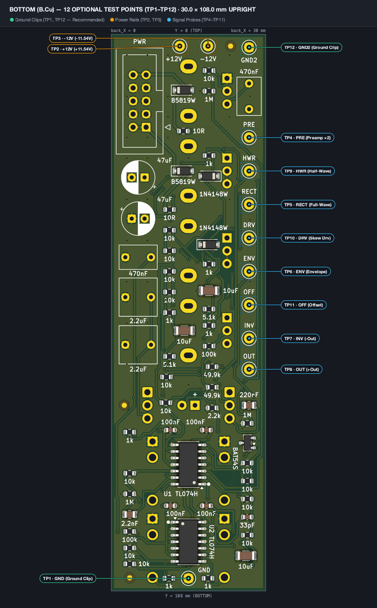

---

## 2. Back-Side (`B.Cu`) Through-Hole Components (`7` Parts — Do BEFORE `F.Cu` Controls!)

> **CRITICAL CLEARANCE RULE:** Solder all `B.Cu` parts from the **`F.Cu` (front) side**, sit every component body flush against `B.Cu`, and trim every `F.Cu` lead **flush (`< 1.0 mm`)** so it cannot short against `RV1`–`RV4`, `SW1`–`SW2`, or `J1`–`J4`!

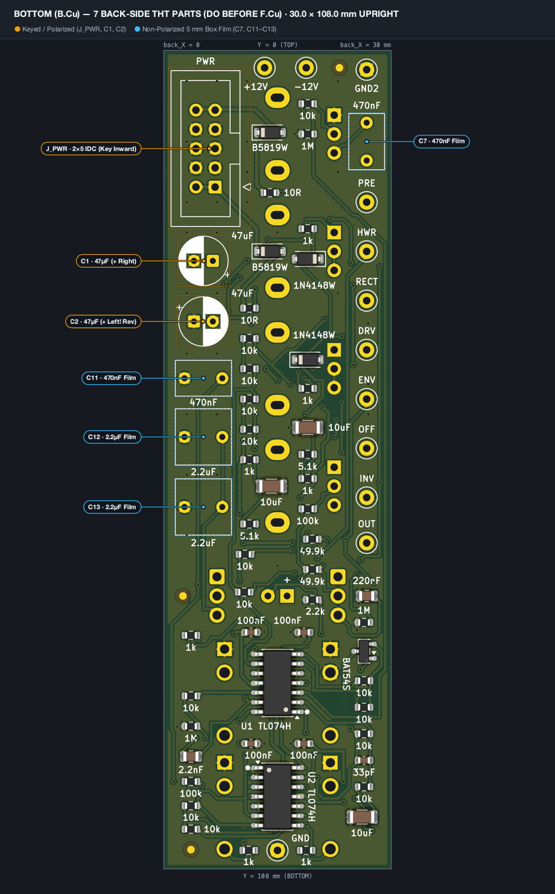

### Box Film Capacitors (`4` parts, non-polarized, `B.Cu`)

- [ ] **`C7`** (`470 nF / 63 V`, `5 mm` pitch box film, `B.Cu` top-right in back view) — Seat flush, solder on `F.Cu`, trim leads flush.

  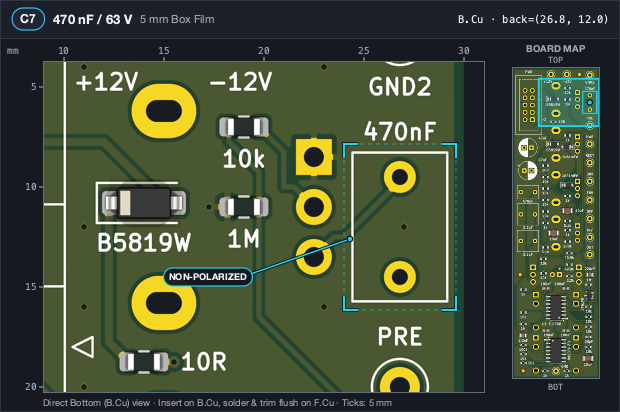

- [ ] **`C11`** (`470 nF / 63 V`, `5 mm` pitch box film, `B.Cu` mid-left column) — Seat flush, solder on `F.Cu`, trim leads flush.

  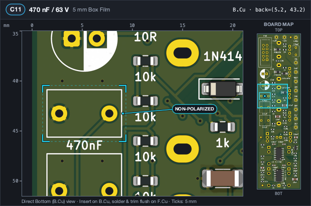

- [ ] **`C12`** (`2.2 µF / 50 V`, `5 mm` pitch box film, `B.Cu` mid-left column below `C11`) — Seat flush, solder on `F.Cu`, trim leads flush.

  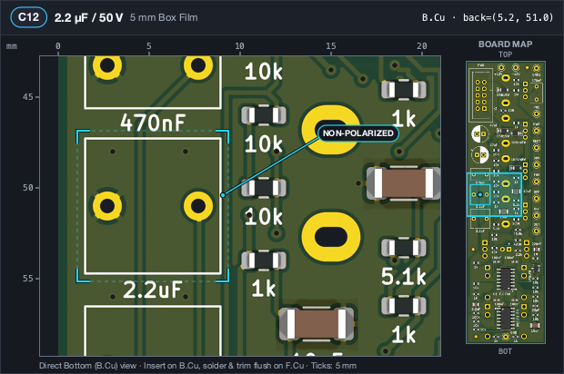

- [ ] **`C13`** (`2.2 µF / 50 V`, `5 mm` pitch box film, `B.Cu` mid-left column below `C12`) — Seat flush, solder on `F.Cu`, trim leads flush.

  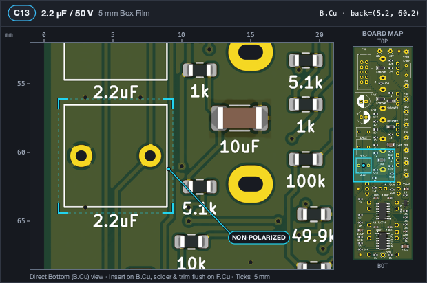

### Shrouded Eurorack Power Header (`1` part, **KEYING CRITICAL**, `B.Cu`)

- [ ] **`J_PWR`** (`10-pin` `2×5` `2.54 mm` vertical shrouded IDC box header, `B.Cu` top-left in back view):
  - **Keying notch orientation:** Shroud keying slot MUST face **INWARD toward the center of the board** (toward `D1`/`R1` — matching the `B.SilkS` shroud outline).
  - **`-12V` / Pin 1 check:** Square Pad 1 & Pin 2 (`-12V`) are at the **BOTTOM** of the header (matching the `B.SilkS` Pin-1 triangle at bottom-right of `J_PWR`, and the `F.SilkS` `-12V` label + white bar at the bottom). Pins `9–10` (`+12V`) sit at the **TOP** under `PWR`.
  - Tack **1 corner pin** first, verify the shroud sits completely flush and square on `B.Cu`, solder the remaining `9` pins on `F.Cu`, and trim all `10` pins flush (`< 1.0 mm`) underneath `RV1`.

  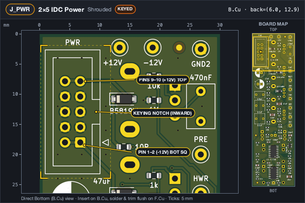

### Polarized Bulk Electrolytic Capacitors (`2` parts, **OPPOSITE POLARITIES!**, `B.Cu`)

- [ ] **`C1`** (`47 µF / 35 V` radial electrolytic, `+12V` rail, `B.Cu` below `J_PWR`):
  - **Long lead (`+`)** goes into **square Pad 1 (`+12V`)** — **INNER / RIGHT hole** in direct `B.Cu` view (marked `+` on `B.SilkS`).
  - **Short lead / white stripe (`-`)** goes into **round Pad 2 (`GND`)** — **OUTER / LEFT hole** near the board edge (hatched half-circle on `B.SilkS`).
  - Seat flush (watch `11 mm` max height clearance), solder on `F.Cu`, trim leads flush.

  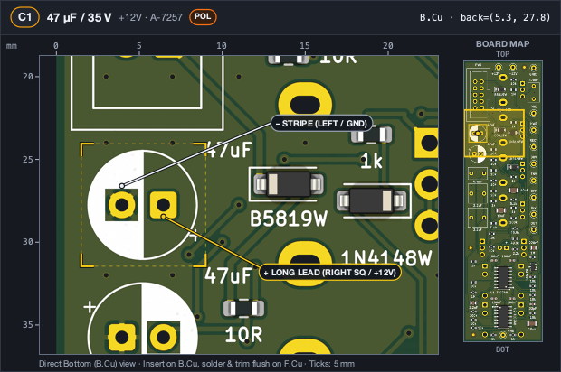

- [ ] **`C2`** (`47 µF / 35 V` radial electrolytic, `-12V` rail, `B.Cu` below `C1` — **REVERSED RELATIVE TO `C1`!**):
  - **Long lead (`+`)** goes into **square Pad 1 (`GND`)** — **OUTER / LEFT hole** near the board edge (marked `+` on `B.SilkS`).
  - **Short lead / white stripe (`-`)** goes into **round Pad 2 (`-12V`)** — **INNER / RIGHT hole** (hatched half-circle on `B.SilkS`).
  - **DMM sanity check BEFORE trimming/moving on:** Confirm continuity (`< 0.5 Ω`) from **`C2 (+)` case/lead to `TP1 (GND)`** and **`C2 (-)` lead to `TP3 (-12V)`**. Installing `C2` backward will reverse-bias and rupture the cap on power-up!
  - Seat flush, solder on `F.Cu`, trim leads flush.

  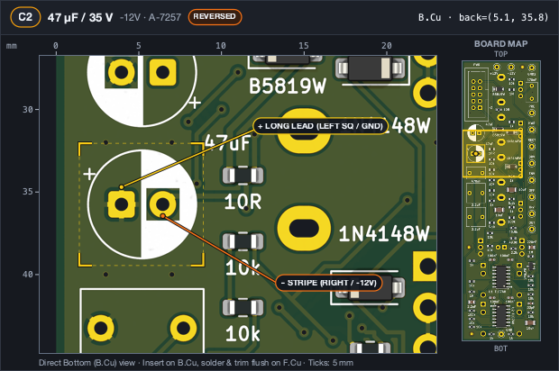

---

## 3. Bench-Check `LED1` (`A-1076`) Polarity

- [ ] **Test `LED1` (`3 mm` 2-pin anti-parallel Red/Green) BEFORE inserting into PCB:**
  - Connect a `5 V` bench source in series with a `1 kΩ` resistor across the two leads.
  - Note which polarity lights **GREEN** (and confirm reversing lights **RED**).
  - Mark the **Green-anode (`+V = Green`)** lead with a Sharpie or bend — this lead **MUST** go into **`LED1` Pad 1 (LEFT square pad on `F.Cu`, `NET_LED_DRV`)**, and the other lead goes into **Pad 2 (RIGHT round pad on `F.Cu`, `NET_LED_SENSE`)** *(see `LED1` placement card in Section 4 below)*.
  - *(Verify: with `+5 V` applied to `Pad 1` and `GND` on `Pad 2`, `LED1` lights **GREEN**.)*

---

## 4. Front-Side (`F.Cu`) Panel Controls — Dry-Fit Everything First (`11` Parts)

> **CRITICAL RULE:** **DO NOT SOLDER** any `F.Cu` component until **ALL `11` front-panel controls** are inserted, fitted through the `6 HP` front panel, and aligned with tightened nuts! Soldering crooked pots or jacks before panel mating causes severe mechanical stress.

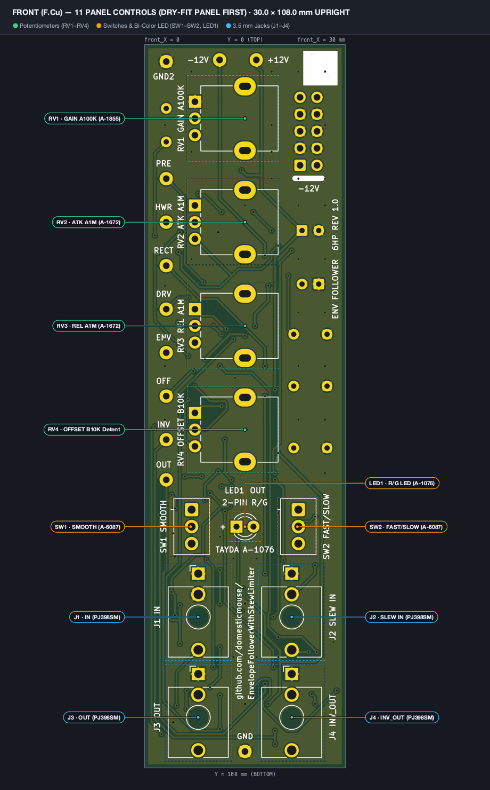

### Component Prep & Dry-Fit on `F.Cu`

- [ ] **Snap off `RV1`–`RV4` anti-rotation tabs:** [`../envelope_follower_panel.kicad_pcb`](../envelope_follower_panel.kicad_pcb) has no anti-rotation tab holes — cleanly snap off the small metal locating tab on each Alpha `9 mm` pot with flush cutters/pliers before dry-fitting.
- [ ] **Insert Potentiometers (`4` parts on `F.Cu`, verify exact taper in each position!):**
  - [ ] **`RV1` (`GAIN`, top):** `A100K` (`A-1855`)

    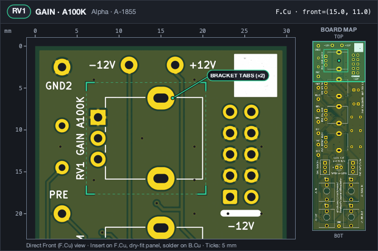

  - [ ] **`RV2` (`ATK`, 2nd):** `A1M` (`A-1672`)

    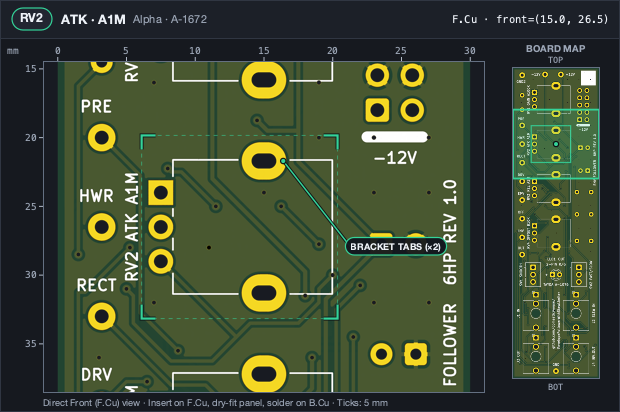

  - [ ] **`RV3` (`REL`, 3rd):** `A1M` (`A-1672`)

    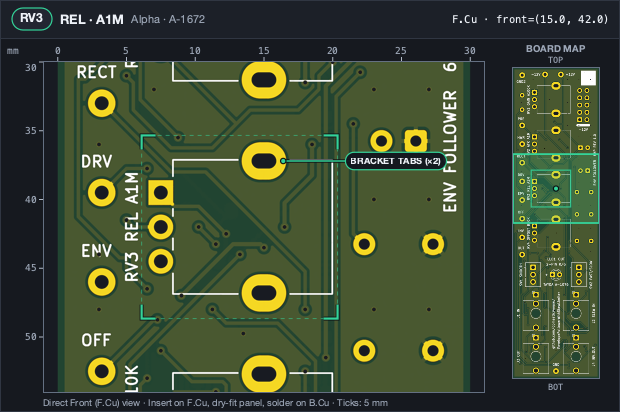

  - [ ] **`RV4` (`OFFSET`, 4th):** `B10K` **center-detent** (`A-8401`) — rotate shaft to verify crisp center click before inserting!

    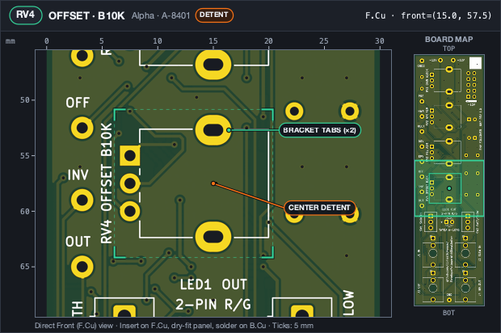

- [ ] **Insert Toggle Switches (`2` parts on `F.Cu`, `Dailywell 2MS1` / `A-6087`)** — check continuity with DMM before fitting so **Pin 2 (center) connects to Pin 3 (bottom pad) when the toggle lever is UP** (flip switch `180°` if inverted, or align Pin 1 `NC` with the top square pad/tick mark), and install an inner backing nut/washer on `SW1`/`SW2` bushings if needed to match pot/jack panel stand-off height:
  - [ ] **`SW1` (`SMOOTH` / `RAW`, middle-left):** UP = `SMOOTH`, DOWN = `RAW`

    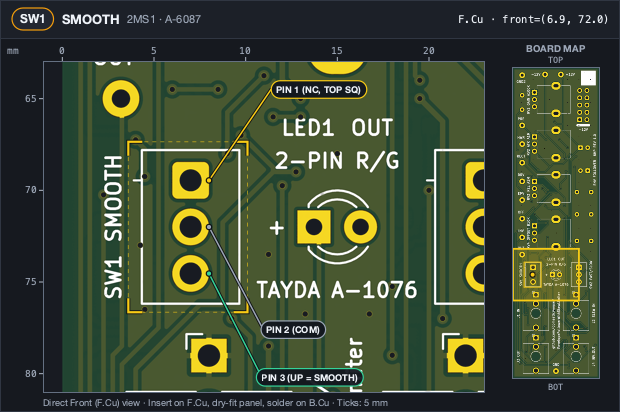

  - [ ] **`SW2` (`SLOW` / `FAST`, middle-right):** UP = `SLOW`, DOWN = `FAST`

    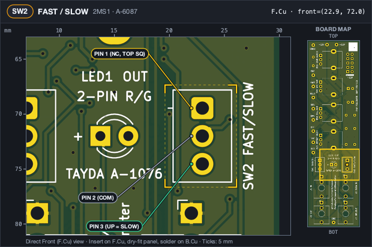

- [ ] **Insert `LED1` (`A-1076`) on `F.Cu`:**
  - Insert marked **Green-anode lead (`+V = Green`) into LEFT square Pad 1** and remaining lead into **RIGHT round Pad 2**. Do **not** push fully down onto PCB yet — leave leads long so the LED dome seats cleanly into the front-panel hole.

  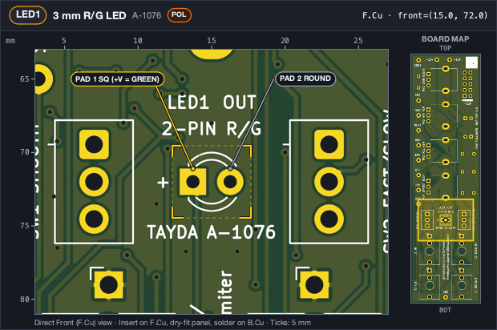

- [ ] **Insert `3.5 mm` Thonkiconn Jacks (`4` parts on `F.Cu`, `WQP-PJ398SM`):**
  - Confirm all 4 jacks seat flat on `F.Cu` (`Sleeve` at top square pad, `Tip` at bottom).
  - [ ] **`J1` (`IN`)** — middle-left

    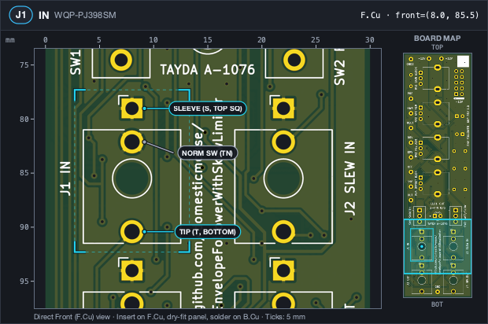

  - [ ] **`J2` (`SLEW IN`)** — middle-right

    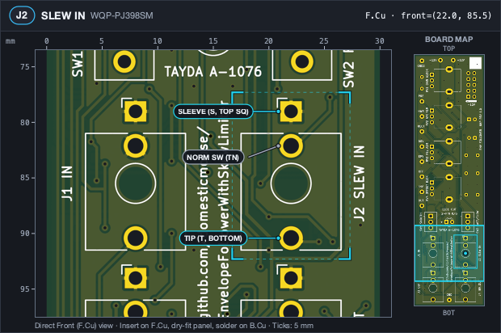

  - [ ] **`J3` (`OUT`)** — bottom-left

    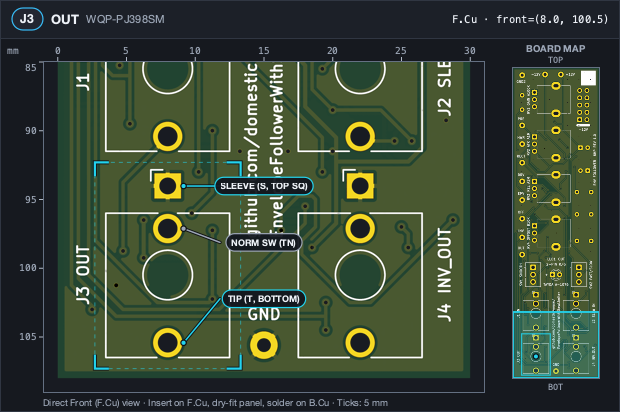

  - [ ] **`J4` (`INV_OUT`)** — bottom-right

    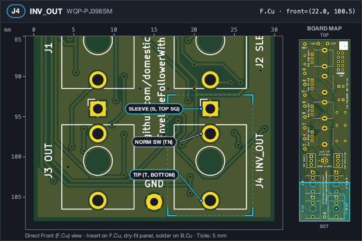

### Panel Mating & Soldering (Solder from `B.Cu`)

- [ ] **Fit the `6 HP` front panel** over all `4` pot shafts, `2` toggle bushings, `4` jack bushings, and `LED1` *(protect the Matte Black solder mask & ENIG gold `F.Mask` artwork from scratches — use nylon washers under nuts/M3 screws and non-marring socket/finger tightening)*.
- [ ] **Finger-tighten panel nuts** on `J1`–`J4`, `SW1`–`SW2`, and `RV1`–`RV4` so the PCB sits completely parallel and stress-free behind the panel.
- [ ] **Seat `LED1` dome** flush/protruding consistently in its panel bezel hole, then slightly splay its `B.Cu` leads so it stays put during soldering.
- [ ] **Solder `F.Cu` parts carefully on `B.Cu`** using a clean, fine iron tip — **watch adjacent `B.Cu` SMDs** (`C3`–`C6`, `R3`, `D3`, `R15`–`R17`, `R25`, `R32`, `R33`, `C14`):
  - [ ] Tack **1 pin** per component first and re-check alignment/flushness.
  - [ ] Solder all remaining electrical pins on `J1`–`J4` (`3` pins each), `SW1`–`SW2` (`3` pins each), `LED1` (`2` pins), and `RV1`–`RV4` (`3` signal pins + **`2` large mechanical bracket tabs** each).
  - [ ] Trim all `B.Cu` leads cleanly above solder fillets; double-check zero solder bridges to nearby SMDs.

---

## 5. Flux Cleaning & Final Pre-Power Inspection

- [ ] **Clean all hand-soldered joints thoroughly with `99%` IPA** and a soft brush, especially around **`NET_ENV_CAP`** (`RV2` pins `2/3`, `RV3` pins `2/3`, `C11.1`, `SW2.2`, `U2.3`) and **`NET_SLOW_CAPS`** (`SW2.3`, `C12.1`, `C13.1`) — rosin flux residue causes multi-second leakage drift in `SLOW` mode!
- [ ] **Allow board to dry completely** before applying power.
- [ ] **Inspect every hand-soldered joint** on both `F.Cu` and `B.Cu` under magnification (shiny/smooth fillets, zero cold joints, zero bridges, zero unclipped whiskers touching pot bodies).
- [ ] **Check `J1`–`J4` nut torque & `SW1`–`SW2` tightness**, then proceed to [`05-board-bringup.md`](05-board-bringup.md) before pushing knobs onto `RV1`–`RV4`. *(When installing knobs after bringup, align `RV4 OFFSET` pointer straight UP `12 o'clock` at the center detent!)*
