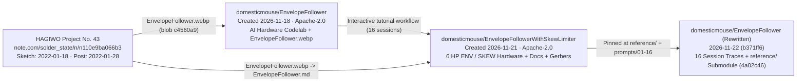

# Origin & Attribution Research: HAGIWO Project No. 43 → `domesticmouse/EnvelopeFollower` → `EnvelopeFollowerWithSkewLimiter`

> **Ticket:** [#6 — Research Hagiwo origin post and domesticmouse/EnvelopeFollower attribution facts](https://github.com/domesticmouse/EnvelopeFollowerWithSkewLimiter/issues/6) (Parent: [#4](https://github.com/domesticmouse/EnvelopeFollowerWithSkewLimiter/issues/4), Unblocks: [#12](https://github.com/domesticmouse/EnvelopeFollowerWithSkewLimiter/issues/12))
> **Research scope:** Primary-source verification across HAGIWO's Note publication (`note.com/solder_state`), [`domesticmouse/EnvelopeFollower`](https://github.com/domesticmouse/EnvelopeFollower), and this repository ([`domesticmouse/EnvelopeFollowerWithSkewLimiter`](https://github.com/domesticmouse/EnvelopeFollowerWithSkewLimiter)).

---

## Executive Summary

1. **Circuit & Schematic Origin (Jan 2022):** The hand-drawn schematic [`EnvelopeFollower.webp`](../../EnvelopeFollower.webp) (`1551 × 1019 px`, git blob `c4560a908b3d03180385ed37b09e530056dd5ba5`) originates from **HAGIWO/ハギヲ** (`@solder_state` on `note.com`), specifically his **No. 43** DIY Eurorack module article, ***\$4 Envelope Follower module-DIY Eurorack Modular Synthesizer*** ([`https://note.com/solder_state/n/n110e9ba066b3?hl=en`](https://note.com/solder_state/n/n110e9ba066b3?hl=en)), published **`2022-01-28T01:07:14+09:00`** (schematic timestamped **`2022年1月18日 22:58`**).
2. **Licensing & Attribution Facts:**
   - HAGIWO's 2022 Note article describes itself as an **"open source project"** (`オープンソースプロジェクト`) and asks readers to support his ongoing open-source DIY work via Patreon ([`patreon.com/hagiwo`](https://www.patreon.com/hagiwo)), **without attaching an explicit SPDX or Creative Commons license tag to the 2022 post itself**. (By contrast, HAGIWO's later 2025–2026 module posts explicitly adopt **CC0 1.0 Universal** while asking makers not to redistribute Patreon-exclusive CAD/Gerber files.)
   - Both [`domesticmouse/EnvelopeFollower`](https://github.com/domesticmouse/EnvelopeFollower) and [`domesticmouse/EnvelopeFollowerWithSkewLimiter`](https://github.com/domesticmouse/EnvelopeFollowerWithSkewLimiter) are published by **Brett Morgan** (`domesticmouse`) under the **Apache License 2.0** (`LICENSE`), with an engineering disclaimer (*"This is not an officially supported Google product."*).
   - `EnvelopeFollowerWithSkewLimiter` is a ground-up SKiDL / KiCad 10 / VectorCraft hardware re-engineering (not derived from HAGIWO's Patreon CAD/Gerber data), while retaining HAGIWO's schematic image `EnvelopeFollower.webp` as its baseline reference artifact.
3. **Bi-Directional Repo Lineage (Nov 2026):**
   - `domesticmouse/EnvelopeFollower` was created first (`2026-11-18T19:19:45Z`) as an Antigravity + KiCad hardware design tutorial starting from HAGIWO's sketch (`EnvelopeFollower.webp`).
   - `domesticmouse/EnvelopeFollowerWithSkewLimiter` was created three days later (`2026-11-21T08:32:20Z`) by interactively following and extending that tutorial into a complete 6 HP `2× TL074HIDR` Envelope Follower + Active Asymmetric Skew Limiter (`ENV / SKEW`) with a Matte Black + ENIG front panel.
   - `domesticmouse/EnvelopeFollower` was then rewritten (`b371ff6`, `2026-11-22T10:42:58Z`) to embed all 16 exported session transcripts (`prompts/01-*`–`16-*`) and pin `EnvelopeFollowerWithSkewLimiter` (`4a02c46`) as its `reference/` Git submodule.
4. **Current Attribution Gap Here:** [`README.md`](../../README.md) currently credits `domesticmouse/EnvelopeFollower`, and [`EnvelopeFollower.md`](../../EnvelopeFollower.md) quotes the image header date (`2022年1月18日 22:58`), **but nowhere in `EnvelopeFollowerWithSkewLimiter` are HAGIWO (`@solder_state`), Project No. 43, or `note.com/solder_state/n/n110e9ba066b3` currently cited**. Updating `README.md` and the new GitHub Pages Origin Story closes this gap.

---

## 1. Primary Source A: HAGIWO's Original Note Post & Companion Sources

All `note.com` pages and image assets below returned `HTTP/2 200` directly over standard HTTPS without any CAPTCHA, Cloudflare challenge, paywall, or authentication gate.

### 1.1 Exact Titles, Author Identifiers, and Dates

| Field | Verified Value | Primary Source Evidence |
| :--- | :--- | :--- |
| **Article Title (EN & JA)** | `$4 Envelope Follower module-DIY Eurorack Modular Synthesizer` (browser `<title>`: `$4 Envelope Follower module-DIY Eurorack Modular Synthesizer｜HAGIWO/ハギヲ`) | `<title>`, JSON-LD `headline`, and `<article>` `<h1>` on [`n110e9ba066b3?hl=en`](https://note.com/solder_state/n/n110e9ba066b3?hl=en) and Japanese canonical [`n110e9ba066b3`](https://note.com/solder_state/n/n110e9ba066b3) |
| **Project Number & Catalog Title** | **No.43 Envelope Follower** (*"This is my 43rd DIY modular synth project."* / `自作モジュラーシンセの43作品目`) | Article body + master catalog [*Starting Modular Synthesis on a Budget - Repository of HAGIWO's DIY Modular Synth*](https://note.com/solder_state/n/n54e016f19c94?hl=en) (`モジュラーシンセを安く始める - Repository of HAGIWO's DIY Modular Synth/ハギヲDIYモジュラーシンセまとめ`, published `2022-05-29T02:08:41+09:00`, modified `2026-09-22T10:48:06+09:00`) |
| **Author Display Name & Handle** | **`HAGIWO/ハギヲ`** (`solder_state` on Note) | Author `Person.name` and profile [`https://note.com/solder_state`](https://note.com/solder_state) (profile created `2019-11-17T16:23:43+09:00`; bio: `モジュラーシンセを始めた人。仕事はレガシーなエンジニア。`) |
| **Schematic Drawing Timestamp** | **`2022年1月18日 22:58`** (January 18, 2022, 22:58) | Embedded top-left caption inside both [`EnvelopeFollower.webp`](../../EnvelopeFollower.webp) and Note's uploaded JPEG [`1642957220667-18yuM6QcDU.jpg`](https://assets.st-note.com/img/1642957220667-18yuM6QcDU.jpg) |
| **Schematic Image Upload** | `2022-01-23T17:00:20.667Z` (`2022-01-24T02:00:20+09:00` JST) | Epoch prefix `1642957220667` in `https://assets.st-note.com/img/1642957220667-18yuM6QcDU.jpg` (`1551 × 1019 px`, `171,129` bytes) |
| **Article `datePublished`** | **`2022-01-28T01:07:14.000+09:00`** (displayed `Jan 28, 2022 01:07` / `2022年1月28日 01:07`) | JSON-LD `BlogPosting.datePublished` and `<article>` header on `n110e9ba066b3` |
| **Article `dateModified`** | **`2022-02-15T12:24:09.000+09:00`** | JSON-LD `BlogPosting.dateModified` on `n110e9ba066b3` |
| **Companion YouTube Video** | `[ $4 ] DIY eurorack modular synth Envelope Follower / inversed out and multi control` | Embedded at top of Note article (`https://www.youtube.com/watch?v=0eHllqHmlZQ`), channel `HAGIWO` ([`https://www.youtube.com/@HAGIWO`](https://www.youtube.com/@HAGIWO)), verified via YouTube oEmbed |
| **Official Social / Support Links** | Patreon: `https://www.patreon.com/hagiwo` · YouTube: `@HAGIWO` · X: `@HAGIWO1` (`https://x.com/HAGIWO1`) · Instagram: `@hagiwo_1` (`https://www.instagram.com/hagiwo_1/`) · Email: `SolderStateSurvivor@gmail.com` | Note article `socialLinks` payload, Patreon promo embed, and [*Self-Introduction: HAGIWO - Modular Synthesizer DIYer*](https://note.com/solder_state/n/nca7e94f93418?hl=en) (`2025-12-31T01:47:07+09:00`) |

### 1.2 Original Module Specs, Parts Cost & Design Intent (`n110e9ba066b3` & `n54e016f19c94`)

In `n110e9ba066b3`, HAGIWO documents the circuit as a low-cost, hand-built Eurorack utility module:

- **Form factor & supply:** `Eurorack standard 3U 12HP size + alpha`; dual `±12V` supply (`≤30 mA` `+12V`, `≤25 mA` `-12V` estimated from bench supply).
- **Parts cost & sourcing philosophy:** Total cost **~450 JPY (`~$4`)** (panel 100 JPY, op-amps 90 JPY, 4× pots 100 JPY, 3× jacks 24 JPY, passives linking to his general parts guide [`n8ef0479418a0`](https://note.com/solder_state/n/n8ef0479418a0?hl=en), published `2021-11-19`). Uses **E6-series resistor values** and `TL074 or TL072` op-amps for broad availability.
- **Stated design motivation:**
  1. **Side-chaining:** Ducking other instruments against a kick drum's envelope curve — the explicit reason HAGIWO included **`INV OUT`** and **`OFFSET`**.
  2. **Acoustic instrument dynamic effects:** Setting `GAIN` to `10×` for line-level signals (noting `100×` may be easier for electric guitar) and feeding `PCM`/`FM` DIY modules that lack envelope generators.
- **Circuit structure described by HAGIWO:** Input inverting amplifier (`1–10×`), precision full-wave rectifier folding negative potential to positive, buffer isolating the rectifier, peak-hold CR attack/release filter with `1N4148` discharge-blocking diode and `1 kΩ` current-limiting resistor (`ATTACK = 0` op-amp overload protection), `INV OUT` inverter, and an op-amp LED driver (*"Lighting the LED could be achieved without using an op-amp, but I used one because I had extra op-amps"*).
- **Catalog metadata (`No.43` in `n54e016f19c94`):** Recommendation `★★★★☆`, Difficulty `★★★☆☆`, Parts Cost `$4`, Overview: *"Includes inverted output. Built with general-purpose ICs"*, Learning: *"Full-wave rectifier circuit"*, Notes: *"Intended for use as a sidechain."*
- **Later HAGIWO derivative (`No.78` Opto Compressor in `n54e016f19c94`):** HAGIWO later noted: *"I repurposed an Envelope follower I created in the past by putting it on a small PCB. This was my first time outsourcing SMT."*

### 1.3 Licensing, Open-Source Framing & Attribution Preferences

Primary inspection shows an important distinction between the **2022 Envelope Follower post** and HAGIWO's **later 2025–2026 posts**:

- **What `n110e9ba066b3` (2022) states verbatim:**
  - There is **no formal SPDX or Creative Commons license tag** anywhere in the 2022 article text or metadata.
  - Under **`Promotion: Please support this open source project`** (`宣伝：オープンソースプロジェクトの支援をお願いします`), HAGIWO writes: *"To continue my open-source DIY modular synthesizer projects, I am looking for patrons on the service called Patreon. I would appreciate your support, even if it's just the price of a cup of coffee. I also share exclusive content for patrons."*
- **What HAGIWO's broader posts state (2025–2026 context):**
  - In [*Self-Introduction*](https://note.com/solder_state/n/nca7e94f93418?hl=en) (`2025-12-31`), HAGIWO explains his sharing ethos: *"I respect the philosophy of FabLabs and Makers, and my values regarding 'sharing' stem from this. The democratization of technology and opportunities for craftsmanship is a core principle of mine."* He also acknowledges that many of his circuits draw inspiration from existing open-source modules, guitar pedals, and datasheet circuits, adapted for low cost and minimal parts count.
  - In newer 2025–2026 module posts visible on [`note.com/solder_state`](https://note.com/solder_state) (such as `No.90 MOD3` and `No.91 SSI2190`), HAGIWO explicitly answers licensing questions with **`CC0 1.0 Universal (CC0 1.0) Public Domain Dedication`** (*"ライセンスフリー、CC0 ... You can copy, modify, distribute and perform the work, even for commercial purposes, all without asking permission"*), with one explicit boundary: *"PatreonのCADデータを公開するのは勘弁してください"* (*please do not publicly release Patreon-exclusive CAD/Gerber data*).
- **Practical attribution conclusion for this repo:**
  - Credit **HAGIWO/ハギヲ (`@solder_state`)** directly as the creator of the original *No. 43: \$4 Envelope Follower* schematic (`2022-01-28`), linking the Note article (`?hl=en`), YouTube demo (`0eHllqHmlZQ`), and Patreon (`patreon.com/hagiwo`).
  - Explicitly distinguish that `EnvelopeFollowerWithSkewLimiter`'s SKiDL circuit, KiCad 10 schematic/PCB, VectorCraft front panel, and Gerbers are original **Apache License 2.0** re-engineering (not redistributed Patreon CAD/Gerber files), while noting that [`EnvelopeFollower.webp`](../../EnvelopeFollower.webp) is HAGIWO's January 18, 2022 schematic reproduced as the design baseline (from a post labeled `"open source project"` without an explicit SPDX identifier).

---

## 2. Primary Source B: `domesticmouse/EnvelopeFollower`

Inspected via GitHub REST API (`gh api repos/domesticmouse/EnvelopeFollower`, `/contents`, `/commits`, `README.md`, `LICENSE`, `mkdocs.yml`, `docs/index.md`, `docs/tutorial/stage-1-agent-skills.md`, `docs/tutorial/stage-2-circuit-upgrades.md`, `docs/reference/netlist-and-bom.md`, `prompts/README.md`, `PotentialImprovements.md`, `TutorialUpdateTodo.md`).

### 2.1 Repository Metadata

| Field | Verified Value |
| :--- | :--- |
| **Repository** | [`https://github.com/domesticmouse/EnvelopeFollower`](https://github.com/domesticmouse/EnvelopeFollower) |
| **Owner / Author** | `domesticmouse` (**Brett Morgan**, `brett.morgan@gmail.com`) |
| **GitHub Description** | `"Building Eurorack modules using Google Antigravity"` |
| **GitHub Pages Homepage** | [`https://domesticmouse.github.io/EnvelopeFollower/`](https://domesticmouse.github.io/EnvelopeFollower/) (MkDocs Material: *Eurorack Envelope Follower Tutorial*) |
| **Created / Initial Commit** | Repo created `2026-11-18T19:19:45Z`; initial commit `d2c0739` at `2026-11-18T19:12:03Z` |
| **Latest Commit / Push** | Commit [`b371ff6`](https://github.com/domesticmouse/EnvelopeFollower/commit/b371ff6216a83f27476a99220c510c007da1a26c) at `2026-11-22T10:42:58Z` (`pushed_at`: `2026-11-22T10:43:58Z`) |
| **License** | **Apache License 2.0** (`LICENSE`, SPDX `Apache-2.0`; boilerplate appendix notice without filled `Copyright [yyyy] [name]` line) |

### 2.2 Evolution & Attribution in `domesticmouse/EnvelopeFollower`

1. **Initial commit & HAGIWO credit (`2026-11-18`):**
   - `d2c0739` (`2026-11-18T19:12:03Z`) added `EnvelopeFollower.webp` (blob `c4560a908b3d03180385ed37b09e530056dd5ba5`), `ENVELOPE_FOLLOWER_NETLIST_AND_TODO.md`, and `README.md`, stating: *"The original schematic is based on Hagiwo's [\$4 Envelope Follower module - DIY Eurorack Modular Synthesizer](https://note.com/solder_state/n/n110e9ba066b3)."*
   - `c5b1081` (`2026-11-18T19:17:08Z`) added the Apache 2.0 `LICENSE` and Google disclaimer.
   - `039e0ef` (`2026-11-18T23:53:07Z`) appended `?hl=en` to the Note URL across the README and tutorial docs so readers land on the English-localized version.
2. **Pivot to tutorial-only MkDocs site (`2026-11-18`–`2026-11-21`):**
   - `5437c55` (`2026-11-18T21:56:05Z`) added MkDocs Material + GitHub Pages deployment; `1f70e87` (`2026-11-19T20:04:42Z`) removed KiCad project artifacts to turn `domesticmouse/EnvelopeFollower` into a pure tutorial repo validated by clean-room `stages/` runs.
3. **Rewrite around `EnvelopeFollowerWithSkewLimiter` (`2026-11-21`–`2026-11-22`):**
   - Commits `de5e28a`, `ce9bd1c`, `6ddb67c`, `a0a7fc0`, `208cd16`, and `b371ff6` archived **16 session transcripts** (`prompts/01-*.md` through `prompts/16-*.md`) from the `EnvelopeFollowerWithSkewLimiter` build, added `.gitmodules` pinning `https://github.com/domesticmouse/EnvelopeFollowerWithSkewLimiter` at `reference/` (commit `4a02c46`), and rewrote `README.md`, `docs/index.md`, `docs/tutorial/stage-1..7`, and `docs/reference/*`.
   - `domesticmouse/EnvelopeFollower`'s current `README.md` credits **both** ends of the chain:
     - Upstream origin: *"Hagiwo's hand-drawn [\$4 Envelope Follower sketch](https://note.com/solder_state/n/n110e9ba066b3?hl=en) (`EnvelopeFollower.webp`)"*
     - Companion hardware implementation: *"`domesticmouse/EnvelopeFollowerWithSkewLimiter`, pinned as a Git submodule at `reference/` (commit `4a02c46`)"*

---

## 3. Primary Source C: `domesticmouse/EnvelopeFollowerWithSkewLimiter` (This Repository)

### 3.1 Repository Metadata & Local History

| Field | Verified Value |
| :--- | :--- |
| **Repository** | [`https://github.com/domesticmouse/EnvelopeFollowerWithSkewLimiter`](https://github.com/domesticmouse/EnvelopeFollowerWithSkewLimiter) |
| **Owner / Author** | `domesticmouse` (**Brett Morgan**, `brett.morgan@gmail.com`) |
| **Description** | `"An Envelope Follower Eurorack Module, with a Skew Limiter"` |
| **Topics** | `eurorack`, `eurorack-diy`, `eurorack-module` |
| **Created / Initial Commit** | Repo created `2026-11-21T08:32:20Z`; commit `4cca738` at `2026-11-21 19:32:22 +1100` (`2026-11-21T08:32:22Z`) |
| **License** | **Apache License 2.0** ([`LICENSE`](../../LICENSE), boilerplate text) |
| **Disclaimer** | *"This is not an officially supported Google product."* ([`README.md`](../../README.md#L195)) |

### 3.2 Key Local Attribution & Provenance Findings

- **Exact image identity (`EnvelopeFollower.webp`):** Added in commit `9747c5d` (`2026-11-21 21:37:42 +1300`). `git hash-object EnvelopeFollower.webp` is `c4560a908b3d03180385ed37b09e530056dd5ba5` — **byte-for-byte identical** (`147,460` bytes, `1551 × 1019 px` RGB WebP) to `EnvelopeFollower.webp` in `domesticmouse/EnvelopeFollower`, and matching the dimensions and visual content of HAGIWO's `1642957220667-18yuM6QcDU.jpg` (`1551 × 1019 px`) in `n110e9ba066b3`.
- **Existing attribution in this repo:**
  - [`README.md`](../../README.md#L3) (commits `221569c` and `9257485`): *"Building on [domesticmouse/EnvelopeFollower](https://github.com/domesticmouse/EnvelopeFollower) with all the mod cons — this module is the result of loosely following the tutorial housed in that GitHub repository."*
  - [`EnvelopeFollower.md`](../../EnvelopeFollower.md#L3): Notes *"Source schematic: `EnvelopeFollower.webp` (titled Envelope Follower, dated `2022年1月18日 22:58`)."*
- **Verified gap:** Across `README.md`, `EnvelopeFollower.md`, `EnvelopeFollowerImprovements.md`, `DesignSpec.md`, Python generators, `checklists/`, and `patches/`, **HAGIWO (`@solder_state`) and [`https://note.com/solder_state/n/n110e9ba066b3?hl=en`](https://note.com/solder_state/n/n110e9ba066b3?hl=en) are not yet named or linked**.

---

## 4. Design Lineage: HAGIWO No. 43 → `EnvelopeFollower` Tutorial → `EnvelopeFollowerWithSkewLimiter` (`ENV / SKEW`)

### Stage-by-Stage Technical Evolution (Baseline Schematic → `ENV / SKEW` Rev 1.0)

Every transformation below is traced directly through [`EnvelopeFollower.md`](../../EnvelopeFollower.md) (baseline transcription of `EnvelopeFollower.webp`), [`EnvelopeFollowerImprovements.md`](../../EnvelopeFollowerImprovements.md) (engineering audit), and [`DesignSpec.md`](../../DesignSpec.md) (finalized module):

| Subsystem | HAGIWO Project No. 43 (`EnvelopeFollower.webp` / `EnvelopeFollower.md`) | `EnvelopeFollowerWithSkewLimiter` (`DesignSpec.md` / `envelope_follower.py`) | Engineering Rationale |
| :--- | :--- | :--- | :--- |
| **Form Factor & Op-Amps** | `3U 12HP+`; `TL074` or `TL072` (`6` active sections; `41` parts / `30` nets) | **6 HP (`30.0 × 128.5 mm` panel, `30.0 × 108.0 mm` PCB)**; **`2× TL074HIDR`** SOIC-14 (**`8 / 8` sections used, `0` unused, `0` trimmers**); `80` netlist components (`83` PCB footprints incl. `3` fiducials) across `48` nets | Consolidates onto 1 IC SKU; `TL074H` eliminates phase reversal, expands headroom (`~±11.5 V`), lowers $V_{os}$ (`1 mV` typ.) and $I_b$ (`~1–10 pA`). |
| **Input & Preamp (`U1A`)** | `J1 IN` → `C1` (`4.7 µF`) → `R1` (`1 MΩ` post-cap) → inverting `U1A` (`R2 = 10 kΩ`, `RV1 = 100 kΩ` `0×` to `−10×`); `Z_in = 9.90 kΩ`; total max gain `24.75×` | `J1` (`TN → GND`) + jack-side `R3` (`1 MΩ`) → `C7` (`470 nF` film, `3.72 Hz` HPF) → **`RV1` (`A100K` attenuator, `Z_in = 90.9 kΩ`)** → **switchless `×2.00` AC / `×1.00` DC non-inverting preamp (`U1A`)** with `C9 = 10 µF` | Raises `Z_in` to Eurorack standard (`~100 kΩ`), prevents DC hot-plug pops, and cures `10 Vpp` clipping at `9.8%` `GAIN` knob rotation. |
| **Full-Wave Rectifier (`U1B`, `U1C`)** | `U1B` HWR (`10 kΩ`, `D1`/`D2` `1N4148`) + `U1C` summing (`R6+R7 = 20 kΩ`, `R8 = 22 kΩ`, `+1.10×` gain) | `10 kΩ ±0.1%` thin-film resistors (`R8`–`R14`), **`BAT54S`** dual Schottky (`D3`) in `U1B`, `R13 + R14 = 20 kΩ` (`+1.000×` exact gain) | Halves zero-crossing step inside `U1B`, suppresses `1f` ripple leakage, and calibrates rectifier to exact unity. |
| **Envelope Detector / Skew Core (`J2`, `U1D`, `U2A`, `SW2`)** | Passive `D3` (`1N4148`) → `RV2` (`50 kΩ` `ATK`) → `C2` (`1 µF`) → `R9` (`1 kΩ`) → `R10` (`10 kΩ`) + `RV3` (`1 MΩ` `Release`) | **Normaled `J2 SLEW IN`** → **2-op-amp Active Precision Skew Limiter (`U1D` + `U2A`)** (`1N4148W` `D4`/`D5` in loop, `R18 = 10 kΩ` + `C10 = 2.2 nF` C0G `~90°` phase margin, `R19`/`R20 = 1 kΩ` min floor, `A1M` fail-safe rheostats `RV2`/`RV3`, **`SW2 FAST/SLOW`** `470 nF` vs. `4.87 µF`) | Eliminates `-15.7 dB` `ATK`/`Release` divider collapse, `9.0%` `R9` shift, `~0.65 V` `D3` dead zone/thermal drift, and `0 Ω` surge; adds DC-coupled asymmetric slew mode (`0.18 ms` to `3.00 s`). |
| **Ripple Filter (`SW1`)** | None (`50 Hz` bass droops `59.7%` per half-cycle at `11 ms` release) | Switchable **`SW1 SMOOTH`** split-resistor T-filter (`2× 49.9 kΩ` `R21`/`R22`, `220 nF` `C14`, `f_c = 29.0 Hz`, `−11.1 dB @ 100 Hz`, `0.00%` DC loss) | Cleans kick/bass `2f` ripple for smooth sidechain ducking without slowing `RAW` transients. |
| **Offset & Outputs (`U2B`, `U2C`)** | Non-inverting `U1D` summing `RV4` (`100 kΩ` across `±12V` via `10 kΩ`/`10 kΩ` into `U1D.-`, `G = 2.25×`–`2.52×`, CW = negative) → `J2 OUT` (`1 kΩ`); `U2A` unity inverter → `J3 INV_OUT` | **Virtual-ground inverting unity summer (`U2B` → `J4 INV_OUT`) + unity inverter (`U2C` → `J3 OUT`)**; RC-filtered `±4.98 V` `RV4` (`B10K` center-detent, `16.7 Hz` rail LPF, `CW = +OUT`) | Eliminates `+12.1%` offset gain modulation, `72.5%` pot-loading compression, inverted knob sense, and raw rail ripple. |
| **LED Indicator (`U2D`, `LED1`)** | `U2B` buffer → `22 kΩ` → `LED1` → `-2.79 V` cathode pre-bias (`10 kΩ` / `33 kΩ`), sensing pre-offset `NET_ENV_SENSE` | **Post-offset active $V$-to-$I$ driver (`U2D`)** with **`3 mm` 2-pin anti-parallel Red/Green `LED1` (`Tayda A-1076`)** across `R33 = 2.2 kΩ` | `0.00 mA` at `0 V`, `2.27 mA @ ±5 V`; self-clamping bipolar dies provide immediate visual zero-crossing feedback for kick ducking. |
| **Power, DFT & Hardware Mfg.** | Unprotected `±12V` entry (`4.7 µF` caps); hand-wired / perfboard DIY | Shrouded 10-pin `J_PWR`, series `B5819W` Schottkys, `10 Ω` + `47 µF/35 V` RC filters, `4× 100 nF` bypasses, **`12` DNP `B.Cu` test points (`TP1`–`TP12`)**, `50` JLCPCB `B.Cu` SMDs (`3` Extended SKUs) + `18` Manual THT (`ibom.html`), mated **Matte Black + ENIG** panel (`vectorcraft-cli`) | Safe bench bring-up, single-sided Economic PCBA, and reproducible manufacturing packages. |

---

## 5. Attribution Recommendations for Issue #12 (Site & README Overhaul)

To credit both upstream sources accurately on the `ENV / SKEW` GitHub Pages site and in `README.md`:

1. **Credit HAGIWO explicitly as the circuit origin:**
   - Name: **HAGIWO (ハギヲ, `@solder_state`)**
   - Original work: **Project No. 43 — *\$4 Envelope Follower module-DIY Eurorack Modular Synthesizer*** (schematic drawn `2022-01-18`, Note article published `2022-01-28`, modified `2022-02-15`)
   - Links: [Note article (EN)](https://note.com/solder_state/n/n110e9ba066b3?hl=en) · [YouTube demo](https://www.youtube.com/watch?v=0eHllqHmlZQ) · [Patreon](https://www.patreon.com/hagiwo)
2. **Credit `domesticmouse/EnvelopeFollower` explicitly as the bridge tutorial:**
   - Name & handle: **Brett Morgan (`domesticmouse`)** — [`domesticmouse/EnvelopeFollower`](https://github.com/domesticmouse/EnvelopeFollower) ([live tutorial site](https://domesticmouse.github.io/EnvelopeFollower/), Apache License 2.0, created `2026-11-18`)
   - Note the two-way relationship: `EnvelopeFollower` introduced the Antigravity + SKiDL + KiCad 10 tutorial pipeline starting from HAGIWO's sketch (`EnvelopeFollower.webp`), `EnvelopeFollowerWithSkewLimiter` was built interactively by following and extending that workflow across 16 sessions (`2026-11-21`–`2026-11-22`), and `EnvelopeFollower` now pins `EnvelopeFollowerWithSkewLimiter` (`4a02c46`) as its `reference/` companion hardware submodule.
3. **Be accurate on licensing:**
   - State clearly that `EnvelopeFollowerWithSkewLimiter` and `domesticmouse/EnvelopeFollower` are licensed under **Apache License 2.0**, and all KiCad schematics, PCBs, Gerbers, Python scripts, and panel artwork in this repo were authored from scratch via SKiDL/KiCad/VectorCraft (not redistributed from HAGIWO's Patreon CAD/Gerber data).
   - Note factually that HAGIWO's 2022 Note post describes itself as an *"open source project"* (with Patreon support) without an explicit SPDX/CC license tag on that page, while [`EnvelopeFollower.webp`](../../EnvelopeFollower.webp) is retained verbatim as the reference origin sketch.

---

## 6. Primary Sources & Verification Log

| Source | Identifier / Path / URL | Retrieval / Access Notes |
| :--- | :--- | :--- |
| HAGIWO Note article (EN view) | `https://note.com/solder_state/n/n110e9ba066b3?hl=en` | Direct `curl` `HTTP/2 200` (`228,665` bytes); JSON-LD + full text parsed; no CAPTCHA/anti-bot block |
| HAGIWO Note article (JA original) | `https://note.com/solder_state/n/n110e9ba066b3` | Direct `curl` `HTTP/2 200` (`218,457` bytes); confirmed identical dates & open-source phrasing |
| HAGIWO schematic image on Note CDN | `https://assets.st-note.com/img/1642957220667-18yuM6QcDU.jpg` | Direct `curl` `HTTP/2 200` (`171,129` bytes, `1551 × 1019 px` JPEG); matches `EnvelopeFollower.webp` |
| HAGIWO YouTube demo metadata | `https://www.youtube.com/oembed?url=https://www.youtube.com/watch?v=0eHllqHmlZQ&format=json` | `HTTP/2 200` JSON confirming exact title and author `HAGIWO` (`@HAGIWO`) |
| HAGIWO Note profile, repo index, parts list & self-intro | `https://note.com/solder_state`, `.../n/n54e016f19c94?hl=en`, `.../n/n8ef0479418a0?hl=en`, `.../n/nca7e94f93418?hl=en` | Direct `curl` `HTTP/2 200` on all 4 pages; verified `No.43` catalog entry, `No.78` follow-up, Maker/FabLab philosophy, and 2025–2026 CC0 pattern vs. 2022 post |
| `domesticmouse/EnvelopeFollower` GitHub repo | `gh api repos/domesticmouse/EnvelopeFollower` (+ `/contents`, `/commits`, `README.md`, `LICENSE`, `mkdocs.yml`, `docs/index.md`, `docs/tutorial/stage-1..2`, `prompts/README.md`) | Verified metadata, Apache-2.0 `LICENSE`, commit history (`d2c0739`–`b371ff6`), `reference/` submodule (`4a02c46`), and `EnvelopeFollower.webp` blob SHA `c4560a908b3d03180385ed37b09e530056dd5ba5` |
| `domesticmouse/EnvelopeFollowerWithSkewLimiter` (local & GitHub) | `gh api repos/domesticmouse/EnvelopeFollowerWithSkewLimiter`, `git log`, `README.md`, `EnvelopeFollower.md`, `EnvelopeFollowerImprovements.md`, `DesignSpec.md`, `LICENSE`, `EnvelopeFollower.webp` | Verified `created_at` (`2026-11-21T08:32:20Z`), git history (`4cca738`–`8cb0b0a`), `EnvelopeFollower.webp` SHA `c4560a908b3d03180385ed37b09e530056dd5ba5`, and current attribution gap |
