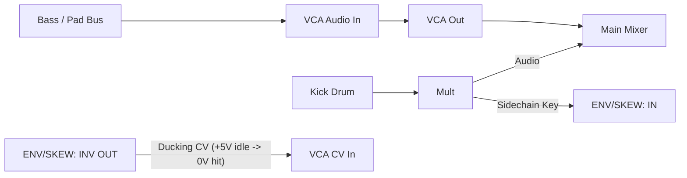

[← All Effect Guides](README.md)

# 01 — Sidechain Ducking & Pumping

> **Mode:** Envelope Follower (`IN` patched — leave **`SLEW IN` unpatched**)

This module was tuned specifically around techno kick-drum sidechain ducking. Combining **`INV OUT`**, **`OFFSET`**, the zero-gain-drop **`SMOOTH`** filter, and the post-offset **`+ / −` LED**, you can dial in clean, ripple-free pumping by eye in seconds—without losing bass weight or clipping your VCA.

---

## What You Need

- **Kick drum / trigger audio source** (`10 Vpp` Eurorack level ideal)
- **Passive or buffered mult** *(to split the kick to both `ENV / SKEW` and your mixer)*
- **Bassline, pad, or submix bus** to be ducked
- **Linear or exponential VCA** *(unipolar `0 V to +5 V` CV input; avoid offset-biased VCAs unless turned fully down)*
- **Output mixer**

---

## Patch Diagram

---

## Front-Panel Starting Settings

| Control | Starting Position | Electrical State & Purpose |
| :--- | :--- | :--- |
| **`GAIN`** | `7 o'clock` (Full CCW) | Start muted; raise until kicks dip **`+ / −`** LED to Dark |
| **`ATK`** | `7 o'clock` (Full CCW) | `0.29 ms` instant transient clamp (`FAST` mode) |
| **`REL`** | `11–2 o'clock` (`40–65%`) | `~20–80 ms` recovery (`FAST`) — adjust to tempo groove |
| **`OFFSET`** | `7 o'clock` (Full CCW, `−`) | Shifts `OUT` to `−4.98 V` so **`INV OUT` rests at `+4.98 V`** |
| **Left Toggle** | **UP (`SMOOTH`)** | Engages `29.0 Hz` T-filter (`−11.1 dB @ 100 Hz` kick ripple) |
| **Right Toggle** | **DOWN (`FAST`)** | Selects `470 nF` hold cap (`0.29–289 ms` range) |
| **`+ / −` LED** | **Steady Red** (idle) | Confirms `OUT = −4.98 V` (`INV OUT = +4.98 V`, VCA open) |

---

## Step-by-Step Dial-In

1. **Confirm `SLEW IN` is empty** and patch your ducked audio through the VCA with the VCA's manual bias/level knob at zero, relying on **`INV OUT`** to hold it open.
2. **Set `OFFSET` full CCW (`−`)** and verify **`+ / −` LED glows steady Red** with no kick playing (`INV OUT` is sitting at **`+4.98 V`**, holding your bass/pad at full volume).
3. **Flip the left toggle UP (`SMOOTH`)** and **right toggle DOWN (`FAST`)**.
4. **Start your kick pattern** and slowly turn **`GAIN` clockwise**. Because **`GAIN`** uses an `A100K` audio-taper pot feeding a `×2.00` preamp, most of the sweet spot sits between **12 o'clock and 4 o'clock**:
   - Watch the **`+ / −` LED** on every kick transient.
   - Stop turning **`GAIN`** up the moment each kick pulse dips the Red LED **cleanly to Dark (`0.00 V`)** without flashing **Green**.
   - At **Dark (`0 V`)**, `INV OUT` reaches `0.00 V` right at the kick peak — 100% ducking without undershooting negative.
5. **Shape the groove with `REL`:**
   - **9–11 o'clock (`7–20 ms`):** Tight, transparent pocket where bass vanishes only during the kick's sub body.
   - **12–2 o'clock (`27–80 ms`):** Classic four-on-the-floor warehouse pumping ("breathing" offbeat lift).
   - **3–5 o'clock (`100–178 ms`):** Long, exaggerated sidechain suction.
6. **Fine-tune transient click with `ATK`:** Leave **`ATK`** at `7 o'clock` (`0.29 ms`) for clean kick separation, or nudge it slightly clockwise (`8–9 o'clock`, `1–5 ms`) if you want a bit of bass attack to poke through before ducking clamps down.

---

## How the Controls Shape the Effect

- **Why the `+ / −` LED calibration works:** The LED monitors `+(V_env + V_off)` directly at **`OUT`** via the `U2D` active V-to-I driver (`0.00 mA` at `0 V`). Because **`INV OUT`** is the exact mirror `−(V_env + V_off)`, `OUT = 0 V` (LED **Dark**) equals `INV OUT = 0 V` (VCA **fully closed**). If you drive `GAIN` so hard that the LED flashes **Green** (`OUT > 0 V`), **`INV OUT` swings negative**. On a 4-quadrant/bipolar VCA (or ring-mod VCA), negative CV will **re-open the VCA out of phase** during the kick peak, causing an audible double-thump or buzz! On a unipolar VCA, going past `0 V` creates a flat "hold" floor at the bottom of the duck before recovery begins—useful only when intentional.
- **Why `SMOOTH` matters on kicks:** A `50 Hz` kick body creates `100 Hz` full-wave rectified pulses after `U1C`. With fast `REL`, that `100 Hz` ripple causes audible intermodulation flutter on the ducked bass. Flipping **`SMOOTH` UP** places `C14` (`220 nF`) into the split-`R_env` T-filter (`49.9 kΩ` + `49.9 kΩ`), cutting `100 Hz` ripple by **`−11.1 dB`** while keeping **`0.00%` DC amplitude loss**—so your ducking depth never shifts when toggling **`RAW` / `SMOOTH`**.
- **Zero `OFFSET` gain interaction:** Unlike passive summing networks, `U2B` is a virtual-ground summer, meaning adjusting **`OFFSET`** moves your resting VCA level cleanly (`±4.98 V`) without altering the depth of the envelope swing (`0.00%` gain modulation).

---

## Variations & Creative Patches

- **Soft-Knee Partial Ducking (3–6 dB Pocket):** Instead of dipping the **`+ / −` LED** all the way to **Dark**, back **`GAIN`** down until the LED dims from bright Red to dim Red on each kick (`INV OUT` drops from `+5 V` to `+2 V` instead of `0 V`). Ideal for subtle mix glue on pads and guitars.
- **Silent Ghost-Kick Rhythm:** Patch a muffled click, short rimshot, or muted secondary kick pattern (like an offbeat syncopated trigger) strictly to **`IN`**—without sending it to the main mixer—so sustained chords pump rhythmically even during kick-less breakdowns.
- **Half-Bar Ambient Suction (`SLOW` Mode):** Flip the right toggle **UP (`SLOW`)** (`4.87 µF`). Even with **`REL`** at **11–1 o'clock** (`150–400 ms`), the linear fall sweeps smoothly across half a bar for dramatic slow-house or breakbeat swells.
- **Simultaneous Duck + Swell (`OUT` + `INV OUT`):** While **`INV OUT`** ducks your bass VCA, patch **`OUT`** (centered at `OFFSET = 12 o'clock` or slightly CCW) to open a noise hat or high-shelf filter boost on every kick hit!

---

## Troubleshooting & Tips

| Symptom | Likely Cause | Fix |
| :--- | :--- | :--- |
| Bass buzzes or double-triggers on loud kicks | `GAIN` too high; LED flashing **Green** (`INV OUT` going negative into bipolar VCA) | Back **`GAIN`** CCW until **`+ / −` LED** just reaches **Dark** at peak |
| Audible flutter / grit on sustained bass during kick | Left toggle is **DOWN (`RAW`)** | Flip left toggle **UP (`SMOOTH`)** to attenuate `100 Hz` ripple |
| Ducked audio never reaches full volume between beats | `REL` too long or `OFFSET` not far enough CCW | Shorten **`REL`** (or switch **`SLOW` → `FAST`**) and turn **`OFFSET`** full CCW |
| Very weak ducking even with `GAIN` high | Input is quiet line-level (`< 1 Vpp`) or `OFFSET` is CW (`> 0 V`) | Boost kick before **`IN`** or check `OFFSET` is at **`7 o'clock`** (LED steady Red) |

---

[← All Effect Guides](README.md) · [Next: 02 — Auto-Wah & Dynamic Envelope Filter →](02-auto-wah-envelope-filter.md)
