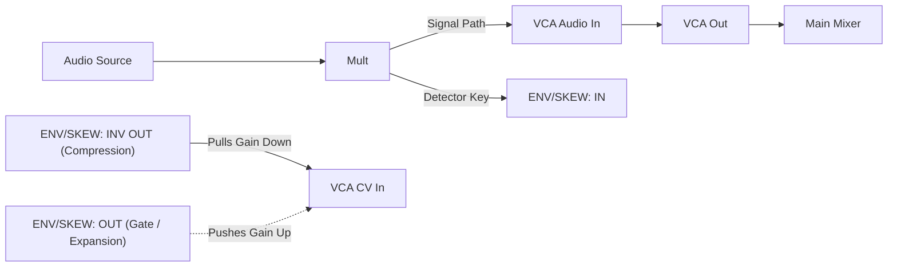

[← All Effect Guides](README.md)

# 03 — Dynamic Compression, Expansion & Noise Gating

> **Mode:** Envelope Follower (`IN` patched — leave **`SLEW IN` unpatched**)

Because `ENV / SKEW` gives you **`100%` independent `ATK` and `REL`**, zero `0.65 V` diode dead zone, linear ramp behavior, and mirrored **`OUT`** / **`INV OUT`** outputs with a calibrated `±4.98 V` **`OFFSET`**, a single `VCA` plus `ENV / SKEW` builds an **opto-style compressor/limiter**, an **upward expander**, a **threshold noise gate**, or a **transient shaper**.

---

## What You Need

- **Audio source** (drum bus, synth voice, bass, noisy external loop)
- **Passive or buffered mult**
- **Linear or exponential VCA** *(unipolar `0 V to +5 V` CV input recommended; an external CV attenuator helps dial compression ratio)*
- **Output mixer**

---

## Patch Diagram

---

## Front-Panel Starting Settings

### A. Opto-Style Compressor / Limiter (`INV OUT` → VCA CV)

| Control | Starting Position | Electrical State & Purpose |
| :--- | :--- | :--- |
| **`GAIN`** | `7 o'clock` → dial up (`1–4 o'clock`) | Acts as **Ratio / Drive** — higher `GAIN` = deeper gain reduction |
| **`ATK`** | `8:30–10 o'clock` (`10–30%`) | `3–15 ms` (`FAST`) — lets drum transients punch through before clamping |
| **`REL`** | `11–2 o'clock` (`40–65%`) | `~20–80 ms` (`FAST`) — smooth sustain leveling & glue |
| **`OFFSET`** | `7–8 o'clock` (CCW, `−`) | Biases **`INV OUT`** to `+4–5 V` (steady **Red** LED = unity VCA gain) |
| **Left Toggle** | **UP (`SMOOTH`)** | Prevents `100 Hz` low-end modulation distortion ("ripple buzz") |
| **Right Toggle** | **DOWN (`FAST`)** | `470 nF` range (`0.29–289 ms` attack / `0.18–178 ms` release) |

### B. Threshold Noise Gate / Upward Expander (`OUT` → VCA CV)

| Control | Starting Position | Electrical State & Purpose |
| :--- | :--- | :--- |
| **`GAIN`** | `2–4 o'clock` (`65–90%`) | Scales loud hits cleanly to `+5 V` (**Bright Green**) |
| **`ATK`** | `7 o'clock` (Full CCW) | `0.29 ms` instant gate open — never chops off snare or hi-hat clicks |
| **`REL`** | `10–1 o'clock` (`30–60%`) | `~10–40 ms` (`FAST`) or flip **UP (`SLOW`)** for `100–600 ms` gated tails |
| **`OFFSET`** | `10–11:30 o'clock` (CCW of detent) | **Noise Threshold!** Sets idle `OUT` to `−0.5 V to −2.5 V` (**Dim Red**) |
| **Left Toggle** | **DOWN (`RAW`)** *(or **UP (`SMOOTH`)**)* | `RAW` for tight percussive gates; `SMOOTH` to prevent gate chatter |
| **Right Toggle** | **DOWN (`FAST`)** | Snappy rhythmic gating (`SLOW` for long ambient decay gates) |

---

## Step-by-Step Dial-In

### Building the Compressor (`INV OUT`)
1. **Patch `INV OUT` → VCA CV**, VCA manual bias at `0%`, and turn **`OFFSET`** near **`7 o'clock` (`−4.98 V`, LED steady Red)**. Your audio passes at full volume through the open VCA.
2. **Dial `GAIN` clockwise** while playing your drum loop or synth:
   - Watch the **`+ / −` LED** dim from steady Red toward **Dark (`0 V`)** on loud peaks (`0 V` = heavy limiting!).
   - For gentle **2:1–4:1 bus compression**, stop turning **`GAIN`** up when loud peaks dip the LED to **dim Red** (`INV OUT` drops from `+5 V` to `+2.5–3.5 V`).
   - For **brickwall peak limiting**, turn **`GAIN`** up until transients hit **Dark (`0 V`)** without flashing **Green** (negative `INV OUT` on a bipolar VCA causes phase-inverted distortion).
3. **Set `ATK` for Punch vs. Control:**
   - **Snappy Drums:** `ATK` at `9–10 o'clock` (`~5–15 ms`) lets the stick crack pass before `INV OUT` pulls the body down—making drums sound punchier!
   - **Peak Limiting:** `ATK` at `7 o'clock` (`0.29 ms`) catches every transient immediately.
4. **Set `REL` for Musical Recovery:** Match `REL` to the groove (`10–1 o'clock`) so gain recovers cleanly before the next beat without audible pumping.

### Building the Threshold Noise Gate (`OUT`)
1. **Patch `OUT` → VCA CV**, turn **`OFFSET`** to `12 o'clock` center detent (`0.00 V`), and play a noisy loop or spring reverb tail.
2. **Turn `OFFSET` slightly CCW (`10–11:30 o'clock`, dim Red LED):** Because **`OUT`** now rests negative (`−0.5 V` to `−2.5 V`), a standard unipolar VCA shuts **100% silent** whenever input audio stays below the threshold!
3. **Raise `GAIN`** until intended notes push **`OUT`** cleanly above `0 V` (**Green** LED = gate open!). Background hiss, hum, or low synth bleed remains trapped in the **Red** zone below `0 V`.
4. **Set `ATK` = `7 o'clock`** (`0.29 ms`) for click-free immediate opening, and **`REL`** (`10–2 o'clock`, or **`SLOW`** mode) to tailor how tightly silence clamps down after each hit.

---

## How the Controls Shape the Effect

- **Why independent `ATK` / `REL` makes compression work here:** Many simple envelope followers wire `ATK` and `REL` into a passive resistive divider where slowing `ATK` (`RV2` up) with fast `REL` (`RV3` down) collapses the envelope amplitude by over `15 dB`—destroying compression consistency. Here, `U1D` drives `D4` and `D5` in opposite directions inside an active feedback loop: raising `ATK` lets drum cracks slip past **without losing peak compression depth (`0 dB` collapse)** once sustained audio arrives.
- **Linear decay stops cleanly at zero:** Because `U1D` pulls toward `−10.89 V` instead of passively bleeding toward `0 V`, gate release drops linearly and snaps off sharply at `0.00 V` rather than dragging an endless exponential tail.

---

## Variations & Creative Patches

- **Transient Shaper (De-Sharpener / Softener):** Using the **Compressor (`INV OUT`)** patch with `ATK` at `7 o'clock` (`0.29 ms`) and `REL` very fast (`7:30–8:30 o'clock`, `1–5 ms`), only the initial `1–5 ms` transient spike gets ducked—taming harsh FM plucks or piercing hi-hats while leaving body volume untouched.
- **Parallel "New York" Crush Bus:** Send a dry mix and the heavily limited **`INV OUT`** VCA output to separate mixer channels; blend the squashed channel underneath your dry drums for weight and sustain.
- **Gated Reverb (`SLOW` Mode):** Run drums into a huge reverb, put the reverb's wet output into a VCA, and key `IN` from the dry snare/kick. Set **`OFFSET`** slightly CCW (`11 o'clock`), **`ATK` = `7 o'clock`**, **`SW2` = UP (`SLOW`)**, and **`REL`** around `11 o'clock` (`~150 ms`) for massive 1980s gated-reverb slams that slam shut dead silent between hits.

---

## Troubleshooting & Tips

| Symptom | Likely Cause | Fix |
| :--- | :--- | :--- |
| Compressor distorts or buzzes on bass frequencies | Left toggle **DOWN (`RAW`)** or `GAIN` flashing **Green** | Flip left toggle **UP (`SMOOTH`)**; keep **`+ / −` LED** strictly Red → Dark (no Green flash) |
| Noise gate chatters open/closed at the tail of notes | Threshold right on noise edge with fast `RAW` release | Flip left toggle **UP (`SMOOTH`)**, lengthen **`REL`**, or nudge **`OFFSET`** slightly more CCW |
| Gate softens drum transients | `ATK` set too high | Turn **`ATK`** full CCW (`7 o'clock`, `0.29 ms`) |
| VCA won't pass audio at all in Compression mode | Using `OUT` instead of `INV OUT`, or `OFFSET` is CW | Connect **`INV OUT`** and set **`OFFSET`** to `7 o'clock` (`−`, steady **Red** LED) |

---

[← Previous: 02 — Auto-Wah & Dynamic Envelope Filter](02-auto-wah-envelope-filter.md) · [All Effect Guides](README.md) · [Next: 04 — Ducking & Blooming Reverb / Delay →](04-ducking-and-blooming-fx.md)
