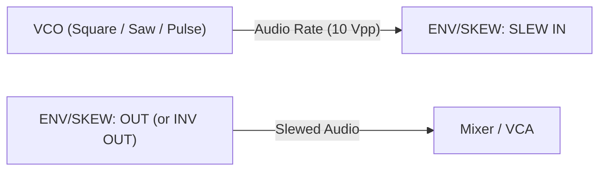

[← All Effect Guides](README.md)

# 06 — Audio-Rate Slew Waveshaping & Nonlinear LPF

> **Mode:** Asymmetric Skew Limiter (**`SLEW IN` patched** — **`IN` and `GAIN` are bypassed**)

Patching an oscillator directly into the DC-coupled **`SLEW IN`** jack bypasses the rectifier completely and turns `ENV / SKEW` into an **audio-rate nonlinear slew-rate low-pass filter and asymmetric waveshaper**. Matching **`ATK`** and **`REL`** transforms harsh squares into silky triangles; setting **`ATK` ≠ `REL`** bends waveforms asymmetrically for warm even-order harmonics, ramp morphing, and sub-harmonic distortion.

---

## What You Need

- **Audio-rate VCO** (`10 Vpp` / `±5 V` square, pulse, saw, or triangle output)
- **Mixer** or **VCA** *(to monitor `OUT`)*
- *(Optional)* **Wavefolder** or **Oscilloscope** to see and push asymmetric waveshaping

---

## Patch Diagram

> **Note:** When a cable is inserted into **`SLEW IN`**, the **`GAIN`** knob has **no effect** (`IN` is disconnected at the normaling switch). Make sure the left toggle is **DOWN (`RAW`)** so the `29.0 Hz` filter doesn't cut out audio frequencies!

---

## Front-Panel Starting Settings

| Control | Starting Position | Electrical State & Purpose |
| :--- | :--- | :--- |
| **`GAIN`** | *Bypassed* | Disconnected when **`SLEW IN`** is patched |
| **`ATK`** | `7 o'clock` (Full CCW) | `1 kΩ` min floor (`0.47 ms` full `10 Vpp` rise in `FAST`) |
| **`REL`** | `7 o'clock` (Full CCW) | `1 kΩ` min floor (`0.47 ms` full `10 Vpp` fall in `FAST`) |
| **`OFFSET`** | `12 o'clock` (Center Detent) | `0.00 V` DC offset so output audio stays centered at `0 V` |
| **Left Toggle** | **DOWN (`RAW`)** *(Mandatory!)* | Bypasses the `29.0 Hz` `SMOOTH` LPF so audio passes cleanly |
| **Right Toggle** | **DOWN (`FAST`)** | Selects `470 nF` hold cap (`SLOW` drops cutoff `10.36×` into sub-audio!) |
| **`+ / −` LED** | **Blended Amber** (or Green/Red shift) | High-speed `Red`/`Green` alternation blends visually; shifts color if skewed |

---

## Step-by-Step Dial-In

1. **Patch a raw VCO square wave (`±5 V` / `10 Vpp`, around `100–300 Hz`) into `SLEW IN`**, and patch **`OUT`** to your mixer (turn your mixer channel down first—`10 Vpp` oscillator waves are loud!).
2. **Verify switches BEFORE playing:**
   - **Left toggle = DOWN (`RAW`)** — *if UP (`SMOOTH`), audio above `~29 Hz` is filtered by `−6 dB/oct`!*
   - **Right toggle = DOWN (`FAST`)** — selects `470 nF`.
   - **`OFFSET` = `12 o'clock` center detent** (`0.00 V`).
3. **Explore Symmetrical Nonlinear Low-Pass Filtering (`ATK = REL`):**
   - With **`ATK`** and **`REL`** both at `7 o'clock` (`0%`), `U1D` slews a full `10 Vpp` (`−5 V ↔ +5 V`) swing in `0.47 ms` (`0.93 ms` full triangle period $\approx 1.07\,\text{kHz}$). A `200 Hz` square wave already sounds noticeably rounded into a **trapezoid**!
   - Slowly turn **`ATK` and `REL` up together** (`7:30 → 9 o'clock`): the trapezoid edges lengthen until the square becomes a **pure triangle wave**, and then softens in amplitude like a warm, amplitude-dependent analog low-pass filter (`~90°` phase-margin loop stability means **zero ringing or squealing**).
4. **Create Asymmetric Harmonics (`ATK ≠ REL`):**
   - Return **`REL`** to `7 o'clock` (`0.47 ms` fall) and raise **`ATK`** slowly from `7 o'clock` to `10 o'clock`: rising edges turn into slow ramps while falling edges snap down sharply—morphing a hollow square wave into a **bright, nasal ramp/saw hybrid** rich in even harmonics!
   - Flip it: keep **`ATK` = `7 o'clock`** and raise **`REL`** (`8–11 o'clock`) for downward saw shapes with warm mid-bass punch.
5. **Push into Sub-Harmonic Slew Tracking (`ATK` or `REL` High):**
   - Play a higher pitch (`400–800 Hz`) and push **just `REL`** up past `10–12 o'clock`: the hold cap doesn't have time to fall all the way down between cycles, so it catches every second or third crest—generating **gritty, unstable octave-down sub-harmonics and analog slew-fuzz**!

---

## How the Controls Shape the Effect

- **Why slew limiting sounds different from a standard VCF:** A linear `1-pole` VCF cuts high harmonics regardless of input level. A slew limiter sets a **maximum volts-per-second speed limit** (`±10.89 V` driving through `R × 470 nF`). Loud notes hit the speed limit early (heavy filtering + triangle conversion), while quiet notes (`1–2 Vpp`) pass higher frequencies cleanly—producing an organic, level-reactive saturation you can't get from normal filters!
- **Why `C10` (`2.2 nF` C0G) matters at audio rates:** Audio-rate op-amp slew limiters without local lead-lag compensation often burst into MHz ultrasonic oscillation as pots sweep. `ENV / SKEW` compensates `U1D` at `7.23 kHz`, keeping **`~90°` phase margin** across the full `1 kΩ–1 MΩ` range so sweeps sound smooth and glitch-free.
- **Using `OFFSET` intentionally:** At `12 o'clock` detent, audio has minimal DC offset. Turning **`OFFSET`** away from center (`−` Red or `+` Green) shifts the output wave up or down by up to `±4.98 V`—which is a secret weapon before **DC-coupled wavefolders, VCA clippers, or diode rectifiers**, shifting symmetry dynamically as you turn the knob! *(Just insert an AC-coupled mixer or HPF afterward if your speakers/system dislike DC.)*

---

## Variations & Creative Patches

- **Pre-Wavefolder Asymmetric Bias & Harmonics:** Feed a sine or triangle oscillator into **`SLEW IN`**, sweep **`ATK`** vs **`REL`** for asymmetric triangle-to-saw waveshaping, and use **`OFFSET`** to shift DC symmetry straight into a **Wavefolder**—yielding wildly shifting formant timbres from one VCO!
- **Dual-Phase Stereo / Mid-Side Split (`OUT` + `INV OUT`):** Send **`OUT`** to Mixer Left and **`INV OUT`** to Mixer Right—on a centered mono listen they cancel (`0 V`), while panned hard L/R with a subtle stereo chorus or reverb on one channel they create huge **wide-phase stereo width**!
- **Sub-Audio Rumble Extractor (`SMOOTH` Abuse):** Intentionally flip the left toggle **UP (`SMOOTH`)** while feeding PWM or asymmetric waves into **`SLEW IN`**. `C14` (`220 nF`) strips the audio carrier and leaves behind only the **low-frequency sub-bass (`< 29 Hz`) DC duty-cycle shifts**, great for driving weird rhythmic VCA thumps!

---

## Troubleshooting & Tips

| Symptom | Likely Cause | Fix |
| :--- | :--- | :--- |
| Output is almost silent / muffled sub-rumble | Left toggle **UP (`SMOOTH`)** or right toggle **UP (`SLOW`)** | Flip **both toggles DOWN** (**`RAW`** + **`FAST`**) |
| Turning `GAIN` does nothing | Normal! **`SLEW IN`** bypasses `IN` and `GAIN` | Adjust input level at your VCO or mixer instead |
| Speaker cone jumps or clicks when muting/unmuting | `OFFSET` not centered (sending DC to mixer) | Return **`OFFSET`** to **`12 o'clock` center detent** (or AC-couple downstream) |
| High-pitched square wave already sounds soft at `7 o'clock` | Min `1 kΩ` + `470 nF` (`0.47 ms` / `10 Vpp`) is slewing `> 1 kHz` waves | Use lower-octave bass notes (`40–400 Hz`) or lower-amplitude waveforms (`2–5 Vpp`) for brighter tracking |

---

[← Previous: 05 — Cross-Modulation & Push-Pull Stereo / Timbral Effects](05-cross-modulation-push-pull.md) · [All Effect Guides](README.md) · [Next: 07 — Asymmetric Portamento & 303-Style Slides →](07-asymmetric-portamento-slides.md)
