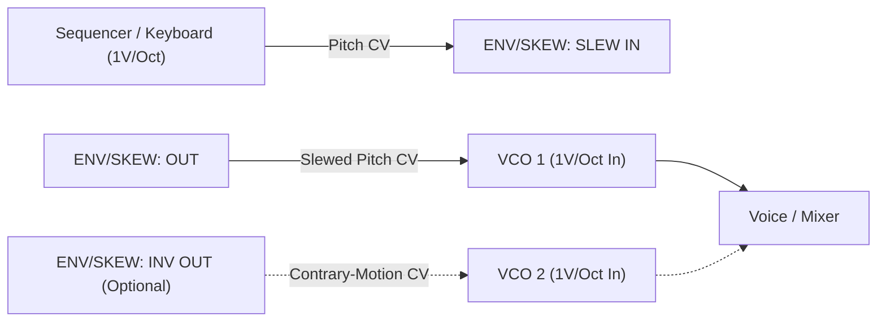

[← All Effect Guides](README.md)

# 07 — Asymmetric Portamento & 303-Style Slides

> **Mode:** Asymmetric Skew Limiter (**`SLEW IN` patched** — **`IN` and `GAIN` are bypassed**)

Patching `1 V/Oct` pitch CV through **`SLEW IN`** turns `ENV / SKEW` into a **musical asymmetric portamento processor**. Because **`ATK`** and **`REL`** are 100% independent and the **`SLOW` (`4.87 µF`)** mode hits **`~70 ms/octave`** right near `12 o'clock`, you can dial in classic **TB-303 acid slides**, upward-only vocal pitch scoops, downward laser drops, or simultaneous **contrary-motion harmony** via **`INV OUT`**.

---

## What You Need

- **Quantized pitch CV source** (Eurorack sequencer, keyboard, or quantizer outputting `1 V/Oct`)
- **Analog or digital VCO** (`1 V/Oct` pitch input)
- **Output mixer** *(plus VCA/VCF for your main synth voice)*

---

## Patch Diagram

---

## Front-Panel Starting Settings

| Control | Starting Position | Electrical State & Purpose |
| :--- | :--- | :--- |
| **`GAIN`** | *Bypassed* | Disconnected when **`SLEW IN`** is patched |
| **`ATK`** | `12 o'clock` (`50%`) | `~70.8 ms / octave` upward glide in **`SLOW`** (`~6.8 ms/oct` in `FAST`) |
| **`REL`** | `12 o'clock` (`50%`) | `~64.6 ms / octave` downward glide in **`SLOW`** (`~6.2 ms/oct` in `FAST`) |
| **`OFFSET`** | `12 o'clock` (Center Detent) | `0.00 V` baseline (or turn intentionally to transpose up/down!) |
| **Left Toggle** | **DOWN (`RAW`)** | Crisp linear ramps (`UP = SMOOTH` rounds slide corners into S-curves) |
| **Right Toggle** | **UP (`SLOW`)** | **`4.87 µF`** cap puts classic 303 slides across the middle of the knobs |
| **`+ / −` LED** | Tracks pitch polarity | **Green** above `0 V`, **Dark** at `0 V`, **Red** below `0 V` |

---

## Step-by-Step Dial-In

1. **Patch your sequencer's `1 V/Oct` pitch CV into `SLEW IN`** and **`OUT` → VCO `1 V/Oct` input**.
2. **Set `OFFSET` strictly to `12 o'clock` center detent (`0.00 V`)**, **Left toggle DOWN (`RAW`)**, and **Right toggle UP (`SLOW`)**.
3. **Tune your VCO with `ENV / SKEW` patched inline:**
   - Start with **`ATK`** and **`REL`** at `7 o'clock` (`0.47 ms/oct` in `SLOW`, effectively instant) and tune your VCO's base note to match your sequencer/tuner. *(See the Calibration Note below on why tuning inline matters!)*
4. **Dial in Classic 303 Acid Slides (`ATK = REL`):**
   - Turn **`ATK`** and **`REL`** together toward **`11–1 o'clock` (`~40–100 ms/octave`)** in **`SLOW`** mode. Two-octave jumps take `~130–140 ms`, while tight semi-tone steps glide in `~6 ms`—giving basslines that unmistakable liquid squelch!
   - Switch right toggle **DOWN (`FAST`)** for ultra-subtle micro-glides (`6.8 ms/oct` at noon, `45 ms/oct` max at `5 o'clock`).
5. **Try Asymmetric Portamento (`ATK ≠ REL`):**
   - **Upward Vocal Scoop:** Set **`ATK` = `11–1 o'clock`** (`SLOW`, `~45–100 ms/oct`) and keep **`REL` = `7 o'clock`** (`0.43 ms/oct`). Jumps *up* to high accents glide expressively like a fretless bass or singer, while drops *down* to root notes lock tight on the grid!
   - **Downward Acid Laser:** Set **`ATK` = `7 o'clock`** (instant upward attack on high notes) and **`REL` = `12–3 o'clock`** (`65–250 ms/oct` downward glide) so high notes ping sharply on beat and slide back down into sub-bass.

---

## How the Controls Shape the Effect

- **Per-Octave (`1 V` Step) Glide Times (`0 V ↔ 1 V`):**

| Knob Position | `FAST` (`470 nF`) Up / Down per Oct | `SLOW` (`4.87 µF`) Up / Down per Oct | Musical Feel |
| :--- | :--- | :--- | :--- |
| **7 o'clock (`0%`)** | `0.045 ms` / `0.041 ms` | `0.47 ms` / `0.43 ms` | Crisp quantized steps (no audible glide) |
| **9:30 o'clock (`25%`)** | `1.85 ms` / `1.69 ms` | `19.2 ms` / `17.5 ms` | Subtle legato tightening |
| **12 o'clock (`50%`)** | `6.8 ms` / `6.2 ms` | **`70.8 ms` / `64.6 ms`** | **Classic TB-303 slide sweet spot (`SLOW`)** |
| **5 o'clock (`100%`)** | `45.3 ms` / `41.3 ms` | **`469 ms` / `428 ms`** | Multi-octave cinematic risers & dives |

- **Honest Engineering Calibration Note (`1 V/Oct` Tracking):**
  Because **`SLEW IN`** feeds `U1D` (`U2A` unity buffer) through `R21 + R22` (`99.8 kΩ`) into `U2B` (`R24 = 100 kΩ`) and `U2C` (`10 kΩ ±0.1%`), the nominal DC gain from **`SLEW IN`** to **`OUT`** is **`1.002×`** (`+0.2%`, or roughly **`+2.4 cents/octave`**) plus `1%` component tolerances (`R21`–`R24`) and up to `±120 mV` center-detent tolerance on `RV4` (`OFFSET`). For 1–3 octave basslines, leads, and acid lines this tracks tightly by ear—simply tune your VCO oscillator frequency *after* patching through `ENV / SKEW`!
- **`OFFSET` as Instant Live Octave / Interval Transpose:** Because `OFFSET` shifts `OUT` smoothly across **`±4.98 V` (`~±5 octaves`)** via a linear pot with `16.7 Hz` filtering, turning **`OFFSET`** live lets you manually bend or transpose the entire melody (`+ / −` LED shifts Green/Red with pitch height) while keeping portamento intact! *(If you want quantized transpose, patch `OUT` into a quantizer instead—though that disables portamento unless the quantizer follows only before `SLEW IN`.)*

---

## Variations & Creative Patches

- **Contrary-Motion Twin VCO Harmony (`OUT` + `INV OUT`):** Patch **`OUT`** → VCO 1 `1 V/Oct` and **`INV OUT`** → VCO 2 `1 V/Oct`, tuned together on your root note (`0 V` step). Whenever your melody climbs up an octave, VCO 2 simultaneously glides **down** an octave in perfect symmetrical mirror harmony!
- **Rounded "S-Curve" Analog Glide (`SMOOTH` UP):** Normally linear slews hit their target note with a sharp velocity corner. Flip the left toggle **UP (`SMOOTH`)** (`f_c = 29.0 Hz`, `τ = 5.49 ms`)—this gently rounds both the launch and landing corners of every portamento slide with **zero pitch shift (`0.00%` DC drop)**!
- **Stepped-to-Gliding Filter Tracking (`OUT` → VCF Cutoff):** Split **`OUT`** (or use **`INV OUT`**) to also modulate your VCF Cutoff so high slurred notes smoothly sweep the filter brighter in lockstep with pitch!

---

## Troubleshooting & Tips

| Symptom | Likely Cause | Fix |
| :--- | :--- | :--- |
| VCO plays several semitones sharp or flat across all notes | `OFFSET` knocked off `12 o'clock` detent (`±120 mV` tolerance = ~1.4 semitones max) | Snap **`OFFSET`** back into the **`12 o'clock` center detent** and re-zero VCO coarse tune |
| Melody glides too slowly (`> 1 s`) and never reaches target pitch | `ATK`/`REL` past `2 o'clock` in **`SLOW`** mode | Lower **`ATK`/`REL`** toward `9:30–12 o'clock` (`18–70 ms/oct`) or flip right toggle **DOWN (`FAST`)** |
| High notes sound slightly out of tune on `1 V/Oct` | VCO tuned before patching inline, or `1.002×` + `1%` path tolerance over 5+ octaves | Tune VCO **with `ENV / SKEW` patched inline**; reserve `4+` octave unison tracking for direct VCO patching |
| Slides feel abrupt at note changes | Left toggle **DOWN (`RAW`)** with small `FAST` times | Flip right toggle **UP (`SLOW`)** and optionally flip left toggle **UP (`SMOOTH`)** |

---

[← Previous: 06 — Audio-Rate Slew Waveshaping & Nonlinear LPF](06-audio-rate-slew-waveshaping.md) · [All Effect Guides](README.md) · [Next: 08 — Gate-to-AR Envelope & Slewed Modulation →](08-gate-to-ar-envelope-and-slewed-mod.md)
