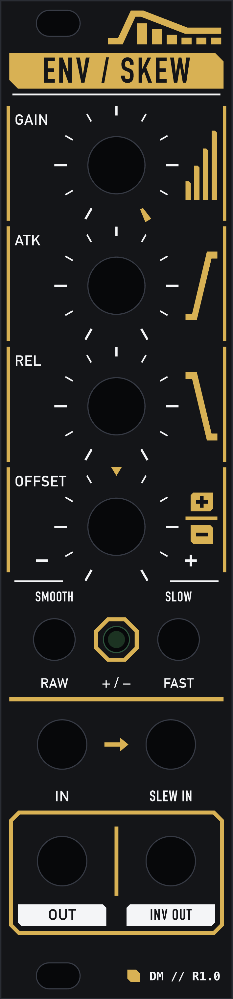

# ENV / SKEW — Audio Effect & Patch Guides

Practical Eurorack patch guides for the **6 HP Envelope Follower with Skew Limiter (`ENV / SKEW`)** — covering both audio-driven envelope following (`IN`) and DC-coupled asymmetric slew processing (`SLEW IN`).

---

## Two Modules in 6 HP

`ENV / SKEW` operates in two distinct modes depending on whether a cable is plugged into **`SLEW IN`**:

1. **Envelope Follower Mode (`IN` patched, `SLEW IN` unpatched):**
   Audio enters **`IN`**, passes through the **`GAIN`** attenuator and switchless `×2` AC preamp (`U1A`), and hits a precision full-wave rectifier (`U1B` + `U1C`) that is internally normaled (`→`) to the active skew limiter. Turning **`ATK`** and **`REL`** shapes how fast the voltage rises and falls, **`OFFSET`** shifts the DC baseline up or down by `±4.98 V`, and **`OUT`** / **`INV OUT`** deliver simultaneous mirrored control voltages.
2. **Asymmetric Skew Limiter Mode (`SLEW IN` patched):**
   Inserting a patch cable into **`SLEW IN`** breaks the normal connection from **`IN`** (bypassing **`IN`** and **`GAIN`**) and sends any DC-coupled bipolar CV or audio waveform (`Z_in = 1.00 MΩ`, `1.002×` nominal DC gain) straight into the active skew limiter. Use **`ATK`** and **`REL`** independently for audio-rate waveshaping, asymmetric portamento slides, linear AR envelopes, or smoothed stepped modulation.

---

## Front-Panel Control Reference

<table>
<tr>
<td width="240" valign="top" align="center">

</td>
<td valign="top">

| Control / Jack | Label | Range / Behavior | Notes |
| :--- | :--- | :--- | :--- |
| **Knob 1 (`RV1`)** | `GAIN` | `0×` (7 o'clock) to **`2.00×`** (5 o'clock gold wedge) | `A100K` audio taper + switchless `×2` AC preamp (`Z_in = 90.9 kΩ`, `3.72 Hz` HPF). `12 o'clock` ≈ `0.3×`; `~2:30` ≈ `1.0×` unity (`±5 V` audio → `5 V` env); `5 o'clock` = `2.0×` (`±10 V` headroom). Active only in `IN` mode. |
| **Knob 2 (`RV2`)** | `ATK` | `0.29 ms – 289 ms` (`FAST`) / `3.0 ms – 3.00 s` (`SLOW`) | `A1M` log rheostat (`1 kΩ` min floor). Sets rising slew rate with zero voltage-divider collapse or diode dead zone. |
| **Knob 3 (`RV3`)** | `REL` | `0.18 ms – 178 ms` (`FAST`) / `1.84 ms – 1.84 s` (`SLOW`) | `A1M` log rheostat (`1 kΩ` min floor). Sets falling slew rate independently of `ATK`. |
| **Knob 4 (`RV4`)** | `OFFSET` | `−4.98 V` (`−`, 7 o'clock) to `+4.98 V` (`+`, 5 o'clock) | `B10K` linear pot with gold center-detent (`0.00 V`) at `12 o'clock`. Adds DC bias via virtual-ground summer (`0.00%` gain shift). |
| **Left Toggle (`SW1`)** | `SMOOTH` / `RAW` | **UP = `SMOOTH`**, **DOWN = `RAW`** | `29.0 Hz` split-resistor T-filter (`−11.1 dB @ 100 Hz` kick ripple) with **`0.00%` DC amplitude loss**. |
| **Center LED (`LED1`)** | `+ / −` | **Green** (`+V`), **Dark** (`0 V`), **Red** (`−V`) | Post-offset active monitor of **`OUT`** (`2.27 mA @ ±5 V`, `4.55 mA @ ±10 V`). |
| **Right Toggle (`SW2`)** | `SLOW` / `FAST` | **UP = `SLOW`** (`4.87 µF`), **DOWN = `FAST`** (`470 nF`) | Multiplies all `ATK` and `REL` times by **`10.36×`**. |
| **Top-Left Jack (`J1`)** | `IN` | AC-coupled audio input (`90.9 kΩ`, `3.72 Hz` HPF) | Grounded when unpatched; normaled (`→`) via preamp + FWR to `SLEW IN`. |
| **Top-Right Jack (`J2`)** | `SLEW IN` | DC-coupled bipolar CV / audio input (`1.00 MΩ`) | Patching breaks internal normal from `IN` (`GAIN` bypassed). |
| **Bottom-Left Jack (`J3`)** | `OUT` | `+(V_env + V_off)` via `1 kΩ` | Positive envelope or non-inverted slewed output (`LED1` = **Green** when `+`). |
| **Bottom-Right Jack (`J4`)** | `INV OUT` | `−(V_env + V_off)` via `1 kΩ` | Exact inverted mirror (`LED1` = **Red** when `INV OUT` is `+`). |

</td>
</tr>
</table>

> **Knob Dial Scale:** All four knobs have **11 radial ticks** spaced `30°` apart from **7 o'clock (`0%`)** to **5 o'clock (`100%`)** — each tick step represents `10%` of mechanical rotation.
>
> **LED Polarity Cheat Sheet:** Because **`LED1` (`+ / −`)** tracks **`OUT`** directly after `OFFSET`:
> - **Green** = `OUT > 0 V` and `INV OUT < 0 V`
> - **Dark** = `OUT = 0.00 V` and `INV OUT = 0.00 V` *(exact zero-crossing!)*
> - **Red** = `OUT < 0 V` and `INV OUT > 0 V`

---

## Timing Quick Reference

Because `U1D` drives the timing capacitor toward `±10.89 V` (`±11.54 V` rails minus `~0.65 V` silicon diode drop), **`0–5 V` ramps are nearly linear** and stop cleanly at `0.00 V`:

| Knob Position (`A1M` Taper) | Approx. `R` | `0→5 V` Rise (`FAST`) | `5→0 V` Fall (`FAST`) | `0→5 V` Rise (`SLOW`) | `5→0 V` Fall (`SLOW`) | `1 V/Oct` Glide (`SLOW`, Rise / Fall) |
| :--- | :--- | :--- | :--- | :--- | :--- | :--- |
| **7 o'clock (`0%`, CCW)** | `1 kΩ` | `0.29 ms` | `0.18 ms` | `2.99 ms` | `1.84 ms` | `0.47 ms` / `0.43 ms` |
| **9:30 o'clock (`25%`)** | `~41 kΩ` | `11.8 ms` | `7.28 ms` | `123 ms` | `75.4 ms` | `19.2 ms` / `17.5 ms` |
| **12 o'clock (`50%`)** | `~151 kΩ` | `43.6 ms` | `26.8 ms` | `452 ms` | `278 ms` | `70.8 ms` / `64.6 ms` |
| **5 o'clock (`100%`, CW)** | `1.001 MΩ` | `289 ms` | `178 ms` | **`3.00 s`** | **`1.84 s`** | `469 ms` / `428 ms` |

---

## Effect Guides Index

### Envelope Follower Mode (`IN` Patched, `SLEW IN` Unpatched)

| # | Guide | Companion Modules Needed | Primary Controls Used | Best For |
| :- | :--- | :--- | :--- | :--- |
| **01** | [Sidechain Ducking & Pumping](01-sidechain-ducking.md) | Mult, VCA, Mixer | `INV OUT`, `OFFSET` (CCW), `SMOOTH`, `FAST`, `+ / −` LED | Techno kick ducking, pumping bass/pads, ghost-kick groove |
| **02** | [Auto-Wah & Dynamic Envelope Filter](02-auto-wah-envelope-filter.md) | Mult, VCF | `OUT` or `INV OUT`, `ATK`, `REL`, `RAW`/`SMOOTH` | Funk bass/guitar auto-wah, acid sweeps, upward/downward filter modulation |
| **03** | [Dynamic Compression, Expansion & Noise Gating](03-compression-expansion-gating.md) | Mult, VCA | `INV OUT` (comp) or `OUT` (expand/gate), `OFFSET`, `ATK`, `REL` | Opto-style limiting, threshold noise gating, independent transient shaping |
| **04** | [Ducking & Blooming Reverb / Delay](04-ducking-and-blooming-fx.md) | Mult, VCA, Reverb / Delay, Mixer | `INV OUT` (duck) or `OUT` (bloom), `SLOW` (`4.87 µF`), `SMOOTH` | Keeping leads dry while phrases play; multi-second ambient reverb swells |
| **05** | [Cross-Modulation & Push-Pull Stereo / Timbral Effects](05-cross-modulation-push-pull.md) | VCA / Panner / Wavefolder / FM VCO | `OUT` + `INV OUT` simultaneously, `OFFSET` | Complementary stereo panning, push-pull voice crossfading, dynamic FM/folds |

### Asymmetric Skew Limiter Mode (`SLEW IN` Patched)

| # | Guide | Companion Modules Needed | Primary Controls Used | Best For |
| :- | :--- | :--- | :--- | :--- |
| **06** | [Audio-Rate Slew Waveshaping & Nonlinear LPF](06-audio-rate-slew-waveshaping.md) | VCO (audio source), Mixer / VCA | `SLEW IN`, `RAW` (**mandatory**), `FAST`, `ATK` vs `REL` | Turning squares into triangles/ramps, asymmetric harmonic fuzz, nonlinear LPF |
| **07** | [Asymmetric Portamento & 303-Style Slides](07-asymmetric-portamento-slides.md) | Sequencer/Keyboard (`1V/Oct`), VCO | `SLEW IN`, `OFFSET` (`12 o'clock`), `SLOW`/`FAST`, `ATK` vs `REL` | Classic TB-303 slides, upward-only vocal scoops, downward laser glides |
| **08** | [Gate-to-AR Envelope & Slewed Modulation](08-gate-to-ar-envelope-and-slewed-mod.md) | Gate/Trigger, S&H or LFO, VCA/VCF | `SLEW IN`, `ATK`, `REL`, `SMOOTH` (vactrol curve), `OUT` + `INV OUT` | Crisp linear AR/ASR envelopes, smoothing stepped random CV, LFO waveshaping |

---

## Hardware & Technical References

- Circuit specification, timing math, and netlist: [`../DesignSpec.md`](../DesignSpec.md)
- SKiDL circuit capture: [`../envelope_follower.py`](../envelope_follower.py)
- Front-panel artwork & mechanical coordinates: [`../panel_art/`](../panel_art/) · [`../panel_svg_spec.md`](../panel_svg_spec.md)
- Bench test & calibration checklist: [`../checklists/05-board-bringup.md`](../checklists/05-board-bringup.md)
