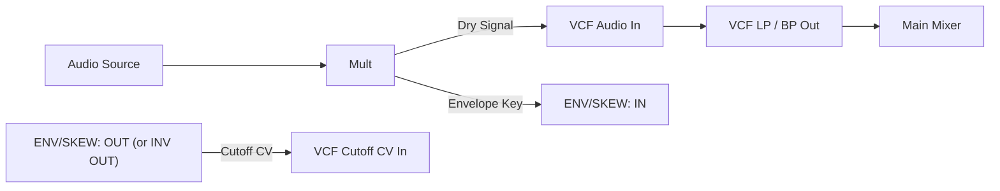

[← All Patch Guides](README.md)

# 02 — Auto-Wah & Dynamic Envelope Filter

> **Mode:** Envelope Follower (`IN` patched — leave **`SLEW IN` unpatched**)

Patching an instrument or synth through a resonant filter modulated by **`OUT`** turns dynamics directly into brightness—classic funk bass/guitar auto-wah, squelchy acid plucks, and expressive percussion filtering. Swapping to **`INV OUT`** instantly flips the sweep into a **reverse (downward) envelope filter** that closes darker on hard notes and blooms open on decay.

---

## What You Need

- **Dynamic audio source** (plucked synth, bass, drum loop, acid line; *electric guitar/bass needs an external Eurorack preamp to reach ~`5–10 Vpp`*)
- **Passive or buffered mult**
- **Voltage-controlled filter (VCF)** with low-pass or band-pass output and FM / Cutoff CV attenuverter
- **Output mixer**

---

## Patch Diagram

---

## Front-Panel Starting Settings

| Control | Starting Position | Electrical State & Purpose |
| :--- | :--- | :--- |
| **`GAIN`** | `2–4 o'clock` (`65–90%`) | `~0.6×–1.5×` gain so loud notes push `OUT` toward `+4–8 V` (**Green**) |
| **`ATK`** | `7:30–9 o'clock` (`5–20%`) | `1–8 ms` (`FAST`) — crisp "wah" bite without swallowing the pick transient |
| **`REL`** | `10–1 o'clock` (`30–60%`) | `10–40 ms` (`FAST`) — smooth vocal close after each note |
| **`OFFSET`** | `12 o'clock` (Center Detent) | `0.00 V` baseline so quiet rests return to VCF's panel cutoff |
| **Left Toggle** | **DOWN (`RAW`)** *(or **UP (`SMOOTH`)** for sub-bass)* | `RAW` preserves fast percussive snap; `SMOOTH` stops low-note ripple chatter |
| **Right Toggle** | **DOWN (`FAST`)** | Selects `470 nF` hold cap for responsive note-by-note articulation |
| **`+ / −` LED** | **Dark** idle → **Bright Green** on notes | Directly mirrors positive filter sweep voltage (`OUT`) |

---

## Step-by-Step Dial-In

1. **Set your VCF:** Choose Low-Pass (`LP`) for classic bass/acid sweeps or Band-Pass (`BP`) for vocal "cry-baby" wah. Turn VCF **Resonance** up (`50–75%`) just shy of self-oscillation, set **Cutoff** low (barely audible or warm), and open the VCF's **Cutoff CV attenuator** to ~`50%`.
2. **Patch `OUT` → VCF Cutoff CV** and leave **`OFFSET` at `12 o'clock` center detent** (`+ / −` LED Dark when silent).
3. **Play your source and raise `GAIN`:** Watch the **`+ / −` LED** pulse **Green** in sync with your playing. Dial **`GAIN`** up until the loudest notes flash bright Green (`+5 V` to `+8 V`), then tune the sweep width on the VCF's CV attenuator.
4. **Sculpt the "Vowel" with `ATK` and `REL`:**
   - **Funky / Snappy Pluck:** Keep **`ATK`** near `7–8 o'clock` (`0.3–3 ms`) so the filter snaps open instantly, and **`REL`** around `11–1 o'clock` (`20–45 ms`).
   - **Slow Vocal "Oooo-Waaaah":** Raise **`ATK`** to `10–12 o'clock` (`15–44 ms`) — because `U1D` + `U2A` isolate **`ATK`** and **`REL`** with zero divider collapse, slowing attack swells the filter upward smoothly without losing peak cutoff height!
5. **Clean up low-frequency filter flutter (`RAW` vs `SMOOTH`):**
   - On high-pitched leads or drums, **DOWN (`RAW`)** keeps transient tracking razor-sharp.
   - On low sub-bass (`40–100 Hz`), fundamental cycles leak `80–200 Hz` ripple into the filter cutoff, sounding like FM rasp. Flip the left toggle **UP (`SMOOTH`)** to attenuate `100 Hz` ripple by **`−11.1 dB`** with **zero change to your peak cutoff (`0.00%` DC drop)**!

---

## How the Controls Shape the Patch

- **Zero diode dead zone (`0.65 V` eliminated):** Traditional passive envelope followers lose quiet guitar or synth sustain tails once signal amplitude drops below `~0.6 V`. Because `U1D` wraps `D4`/`D5` (`1N4148W`) inside its feedback loop and drives down to `0.00 V`, your filter closes smoothly all the way down into silence without abruptly snapping shut mid-note.
- **Line-level instrument note:** `IN` has a switchless `×2.00` preamp optimized for `10 Vpp` (`±5 V`) Eurorack audio (`90.9 kΩ` input impedance). Passive electric guitars or pedals output `~0.2–1.5 Vpp`, yielding `~0.2–1.5 V` envelopes even at `GAIN` = `5 o'clock`; use an external guitar preamp module before the mult for full-range Eurorack sweeps.
- **`OFFSET` as Dynamic Range Shift:** Turning **`OFFSET`** slightly **CCW** (`10–11 o'clock`, dim **Red**) drops `OUT` below `0 V` at rest—if your VCF only responds to positive CV (or has a low cutoff floor), soft ghost notes stay completely dark while hard accents break past `0 V` (LED **Green**) and bark open!

---

## Variations & Creative Patches

- **Reverse (Downward) Auto-Wah (`INV OUT`):**
  - Unplug `OUT` and patch **`INV OUT`** into VCF Cutoff CV.
  - Set VCF panel **Cutoff** bright (`12–2 o'clock`) and **`OFFSET`** at `12 o'clock` (or **CCW** if your VCF ignores negative CV, using `INV OUT` resting at `+5 V` and dipping toward `0 V`). Every loud hit yanks the filter **down** into subby warmth, then blooms bright as the note fades!
- **Resonance Anti-Scream Limiter (Dual Output):**
  - Patch **`OUT`** → VCF Cutoff CV (`+`) AND patch **`INV OUT`** (attenuated) → VCF Resonance CV (`−`).
  - As loud transients shoot the cutoff high, **`INV OUT`** simultaneously dips resonance down so screaming filter peaks never clip your speakers, then restores juicy squelch as the cutoff falls back down.
- **Slow Liquid Morph (`SLOW` Mode):**
  - Flip the right toggle **UP (`SLOW`)** (`4.87 µF`) on sustained synth pads or drum buses (`ATK` `11 o'clock`, `REL` `1 o'clock`) to turn rhythmic drum transients into sweeping slow-motion phaser/filter tides.

---

## Troubleshooting & Tips

| Symptom | Likely Cause | Fix |
| :--- | :--- | :--- |
| Filter buzzes / chatters on low bass notes | `2f` rectifier ripple modulating fast VCF cutoff | Flip left toggle **UP (`SMOOTH`)** or nudge **`REL`** slightly CW |
| Filter hits ceiling on every note and loses dynamics | `GAIN` + `×2` preamp saturating VCF CV input | Back **`GAIN`** down (`1–3 o'clock`) or reduce VCF's Cutoff CV attenuator |
| Weak sweep from electric guitar / bass | Passive instrument `~0.3–1 Vpp` needs external boost | Insert a Eurorack instrument preamp before the mult feeding `IN` |
| Quiet notes never open the filter | `OFFSET` turned CCW (`−` Red) pushing baseline negative | Return **`OFFSET`** to `12 o'clock` center detent (**Dark** idle) |

---

[← Previous: 01 — Sidechain Ducking & Pumping](01-sidechain-ducking.md) · [All Patch Guides](README.md) · [Next: 03 — Dynamic Compression, Expansion & Noise Gating →](03-compression-expansion-gating.md)
