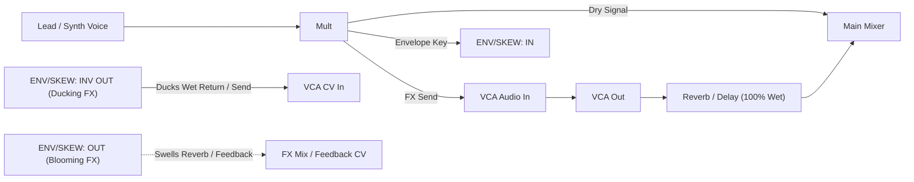

[← All Patch Guides](README.md)

# 04 — Ducking & Blooming Reverb / Delay (Ambient Swells)

> **Mode:** Envelope Follower (`IN` patched — leave **`SLEW IN` unpatched**)

Using **`SLOW` mode (`4.87 µF`)**—which extends attack times up to **`3.00 s`** and releases up to **`1.84 s`**—`ENV / SKEW` unlocks two signature ambient studio techniques: **Ducking Delay/Reverb** (keeping fast notes crystal clear, then flooding the space between phrases) and **Ambient Bloom** (gradually swelling into huge reverbs or delay feedback washes only on sustained chords).

---

## What You Need

- **Lead synth, vocal, arpeggio, or pad source**
- **Passive or buffered mult**
- **Stereo or mono Reverb / Delay** *(ideally with CV-controllable Wet/Mix, Feedback, or a VCA on the send/return)*
- **VCA** *(if your FX unit lacks a Wet/Send CV input)*
- **Output mixer**

---

## Patch Diagram

---

## Front-Panel Starting Settings

### A. Ducking Reverb / Delay Send (`INV OUT` → Send VCA)

| Control | Starting Position | Electrical State & Purpose |
| :--- | :--- | :--- |
| **`GAIN`** | `7 o'clock` → dial up (`1–3 o'clock`) | Set until active phrases pull **`+ / −`** LED to **Dark** (`0 V` wet) |
| **`ATK`** | `7:30–9 o'clock` (`5–20%`) | `3–30 ms` (`SLOW`) — ducks wet wash gently as notes start |
| **`REL`** | `11–2 o'clock` (`40–65%`) | `150–450 ms` (`SLOW`) — FX swells organically into musical rests |
| **`OFFSET`** | `7 o'clock` (Full CCW, `−`) | **`INV OUT` rests at `+4.98 V`** (steady **Red** LED = full FX tail) |
| **Left Toggle** | **UP (`SMOOTH`)** | Eliminates low-frequency CV ripple on delicate delay/reverb tails |
| **Right Toggle** | **UP (`SLOW`)** | `4.87 µF` timing cap for lush multi-hundred-ms return swells |

### B. Multi-Second Ambient Bloom (`OUT` → Reverb Mix / Shimmer / Delay Feedback CV)

| Control | Starting Position | Electrical State & Purpose |
| :--- | :--- | :--- |
| **`GAIN`** | `2–4 o'clock` (`65–90%`) | Ensures sustained notes hold `OUT` near `+5 V` (**Bright Green**) |
| **`ATK`** | `2–5 o'clock` (`65–100%`) | **`1.0 s – 3.00 s`** linear rise (`SLOW`) — ignores short staccato plucks! |
| **`REL`** | `1–5 o'clock` (`55–100%`) | **`0.4 s – 1.84 s`** fall (`SLOW`) — gradual fading shimmer decay |
| **`OFFSET`** | `12 o'clock` (Center Detent) | `0.00 V` baseline (or slightly CCW for delayed bloom threshold) |
| **Left Toggle** | **UP (`SMOOTH`)** | Ultra-clean, click-free CV sweep into reverb pitch/feedback |
| **Right Toggle** | **UP (`SLOW`)** | Essential for `1–3 s` ambient swell times (`10.36×` slower than `FAST`) |

---

## Step-by-Step Dial-In

### Technique A: Ducking Delay & Reverb Clarity
1. **Place the VCA either on the Reverb/Delay Send or on the `100% Wet` Return:**
   - **VCA on Return (Classic Mix Ducking):** Delay/reverb continuously receives your notes, while **`INV OUT`** ducks the loud wet wash while you play and lets the hidden tails bloom upward whenever you pause.
   - **VCA on Send (Selective Delay Throw):** Only the final note or pause before a rest feeds the delay input, leaving rapid 16th-note runs completely dry and un-mudded!
2. **Set `OFFSET` full CCW (`7 o'clock`, steady Red LED)** and flip **both toggles UP (`SMOOTH` + `SLOW`)**.
3. **Play a busy phrase and turn `GAIN` up** until the **`+ / −` LED** dims down to **Dark (`0 V`)** while playing, then glows back **Red (`+5 V`)** during rests.
4. **Tune `REL` in `SLOW` mode:** At `12 o'clock`, the wet signal swells back up over `~278 ms`; at `3–5 o'clock`, it glides in gradually over `~0.6–1.84 s`.

### Technique B: Multi-Second Ambient Bloom (`SLOW` Mode)
1. **Patch `OUT` → Reverb Wet Mix, Shimmer Pitch/Blend, or Delay Feedback CV** (or a wet VCA).
2. **Set `OFFSET` to `12 o'clock` center detent (`0.00 V`)** and flip **both toggles UP (`SMOOTH` + `SLOW`)**.
3. **Set `ATK` between `2 o'clock` and `5 o'clock` (`~1.0–3.0 s` rise):**
   - Short staccato notes barely nudge the capacitor before **`REL`** drains it back down—staying intimate and dry.
   - Hold a long pad chord or drone, and watch **`+ / −` LED** slowly brighten from **Dark** to **Green** over up to **3 full seconds**, gradually opening a massive cavern behind the held chord!
4. **Use low-leakage hold stability:** `D4` and `D5` are low-leakage silicon **`1N4148W`** diodes (never leaky Schottkys), and `C11`–`C13` are `5 mm` box film capacitors (`WIMA MKS2`) buffered by `U2A`'s `~1–10 pA` CMOS/JFET input—allowing rock-steady `3.00 s` swells and `1.84 s` decays without capacitor bleed sagging.

---

## How the Controls Shape the Patch

- **Why `VCA on Send` vs `VCA on Return` sounds different:** Patching `INV OUT` to a VCA on the **wet return** creates dramatic "vacuum" pumping after loud hits because delay echoes recorded *during* the phrase leap forward when you stop. Patching `INV OUT` to a VCA on the **FX send** keeps echoes clean and uncluttered—only phrases that end quietly get caught by the delay!
- **Active linear ramps feel musical:** Passive RC integrators sprint through the first 63% of a swell and stall asymptotically near the top. Because `U1D` drives `C11+C12+C13` (`4.87 µF`) toward `+10.89 V`, a `0 → +5 V` **`SLOW` bloom** climbs smoothly and predictably from start to finish.

---

## Variations & Creative Patches

- **Auto-Disappearing Dry Morph (Push-Pull Space):** Patch **`OUT`** to open your wet Reverb/Shimmer VCA while simultaneously patching **`INV OUT`** to gently duck your **Dry** mixer VCA. Held notes seamlessly dissolve from dry synth straight into pure atmospheric cloud!
- **Self-Oscillating Delay Safety Ceiling:** Patch **`OUT`** → Delay Feedback CV, turn **`OFFSET`** slightly **CCW (`10:30–11:30 o'clock`)**, and tune **`GAIN`** + the delay's CV attenuator so **`+ / −` LED** turning **Bright Green** pushes delay feedback to `98%` (infinite wash) on sustained notes without tipping into runaway overload, then safely decays back to short repeats when you stop playing.
- **Snappy Vocal/Acid Delay Throws (`FAST` Mode):** Flip the right toggle **DOWN (`FAST`)** (`SW2`) with `ATK` at `7 o'clock` (`0.29 ms`) and `REL` around `11 o'clock` (`~20 ms`) on a **Send VCA** so the delay catches only the last syllable of crisp staccato sequences.

---

## Troubleshooting & Tips

| Symptom | Likely Cause | Fix |
| :--- | :--- | :--- |
| Delay feedback runs away uncontrollably on `OUT` | `OUT` peak (`+5–10 V`) exceeds safe feedback ceiling | Lower the delay module's Feedback CV attenuator, reduce **`GAIN`**, or turn **`OFFSET`** slightly CCW |
| Bloom barely triggers on quiet ambient plucks | `ATK` at `3.00 s` drains away before quiet transient finishes | Back **`ATK`** toward `12–2 o'clock` (`0.45–1.2 s`) or raise **`GAIN`** |
| Reverb return doesn't reach full volume between notes | `REL` too slow (`5 o'clock` = `1.84 s`) for current tempo | Turn **`REL`** toward `9:30–12 o'clock` (`75–278 ms`) or flip right toggle **DOWN (`FAST`)** |
| Audible clicks on reverb pitch/shimmer CV | Left toggle **DOWN (`RAW`)** passing fast attack ripples | Flip left toggle **UP (`SMOOTH`)** |

---

[← Previous: 03 — Dynamic Compression, Expansion & Noise Gating](03-compression-expansion-gating.md) · [All Patch Guides](README.md) · [Next: 05 — Cross-Modulation & Push-Pull Stereo / Timbral Effects →](05-cross-modulation-push-pull.md)
