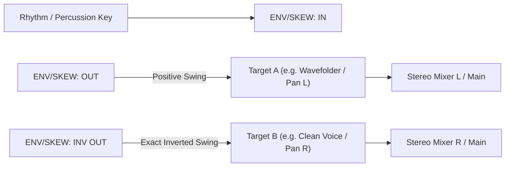

[← All Patch Guides](README.md)

# 05 — Cross-Modulation & Push-Pull Stereo / Timbral Effects

> **Mode:** Envelope Follower (`IN` patched — leave **`SLEW IN` unpatched**)

Because `U2B` and `U2C` provide independently buffered, `1 kΩ`-protected **`OUT` (`+(V_env + V_off)`)** and **`INV OUT` (`−(V_env + V_off)`)** signals with **`0.00%` offset gain interaction**, one dynamic instrument can drive **opposite stereo or timbral transformations at the exact same time**.

---

## What You Need

- **Modulating audio source** (percussion loop, snare/hat groove, bassline, or vocal preamp)
- **Target synth voice(s) or stereo sound stage** (e.g., **2× VCAs** for crossfading / stereo panning, **Wavefolder**, **FM VCO**, or **dual VCFs**)
- **Stereo or mono Mixer**

---

## Patch Diagram

---

## Front-Panel Starting Settings

### A. Push-Pull Voice Crossfader / Stereo Panner (`OUT` + `INV OUT`)

| Control | Starting Position | Electrical State & Purpose |
| :--- | :--- | :--- |
| **`GAIN`** | `1–3 o'clock` (`55–80%`) | Dial so peak hits swing **`OUT`** up by `+5.0 V` (`0 V → +5 V`) |
| **`ATK`** | `7:30–9 o'clock` (`5–20%`) | `1–8 ms` (`FAST`) — snappy rhythmic movement |
| **`REL`** | `10–1 o'clock` (`30–60%`) | `10–40 ms` (`FAST`) — musical return swing |
| **`OFFSET`** | `9:30 o'clock` (`~25%`, `−2.5 V`) *(or `7 o'clock` for unipolar)* | Centers a `0–5 V` envelope into **`±2.5 V` bipolar swing** (`+ / −` LED **Red → Green**) |
| **Left Toggle** | **UP (`SMOOTH`)** | Eliminates audio-rate CV chatter across stereo pans and crossfades |
| **Right Toggle** | **DOWN (`FAST`)** | `470 nF` range (`SLOW` for lush slow timbre shifts) |

### B. Dynamic Harmonic Animator (`OUT` → Wavefolder / FM Index)

| Control | Starting Position | Electrical State & Purpose |
| :--- | :--- | :--- |
| **`GAIN`** | `2–4 o'clock` (`65–90%`) | Scales loud notes toward `+5–8 V` (**Bright Green**) |
| **`ATK`** | `7–8:30 o'clock` (`0–15%`) | `0.3–4 ms` (`FAST`) — instant harmonic bite on hits |
| **`REL`** | `11–2 o'clock` (`40–65%`) | `20–80 ms` (`FAST`) — metallic harmonics bloom and recede smoothly |
| **`OFFSET`** | `12 o'clock` (Center Detent) | `0.00 V` idle (clean unmodulated timbre at rest) |
| **Left Toggle** | **UP (`SMOOTH`)** | Clean, smooth timbral tracking (try **`RAW`** for gritty FM audio-rate cross-mod!) |
| **Right Toggle** | **DOWN (`FAST`)** | Crisp note-by-note dynamics |

---

## Step-by-Step Dial-In

### Patch 1: Bipolar Push-Pull Stereo Panner / Timbre Morph
1. **Set `OFFSET` to `~9:30 o'clock` (`−2.5 V`, dim Red LED)** if driving a **bipolar CV input** (like a dedicated Stereo Panner or VCF Cutoff centered at noon):
   - Turn **`GAIN`** up until drum hits push **`+ / −` LED** evenly from **Red (`−2.5 V`)** through **Dark (`0 V`)** to **Green (`+2.5 V`)**.
   - **`OUT`** swings `−2.5 V → +2.5 V` while **`INV OUT`** swings `+2.5 V → −2.5 V`—creating balanced, symmetrical stereo throwing or push-pull filter panning!
2. **Or set `OFFSET` to `7 o'clock` (`−4.98 V`, bright Red LED) with two unipolar VCAs (Voice A & Voice B):**
   - Wait—think carefully about polarity! When **`OFFSET` = `7 o'clock` (`−4.98 V`)**, **`OUT`** rests at `−4.98 V` (closed on a unipolar VCA) and rises toward `0 V`, while **`INV OUT`** rests at `+4.98 V` (open) and drops toward `0 V`.
   - For **true complementary crossfading across two unipolar `0–5 V` VCAs**, set **`OFFSET` = `9:30 o'clock` (`−2.5 V`)** and dial **`GAIN`** so peaks reach `+5 V` (`V_env = +5 V`): **`OUT`** sweeps `−2.5 V → +2.5 V` (opens VCA A on hits, staying closed below `0 V`), or better yet, set **`OFFSET` = `12 o'clock`** (`OUT = 0→+5 V`), feed **`OUT` → VCA A**, and give **VCA B** a `50%` manual panel bias + **`INV OUT`** (`0→−5 V`) so VCA B opens wide at rest (`+5 V` bias) and closes (`0 V`) as VCA A opens (`+5 V`)!

### Patch 2: Drum-to-Drone Rhythmic FM / Wavefolder Animation
1. **Feed a continuous drone or bass oscillator** into a **Wavefolder** (or FM carrier modulated by another VCO through a VCA).
2. **Patch a drum loop or beat into `IN`** (muted or quiet in the mix).
3. **Patch `OUT` → Wavefolder Fold CV** (or FM VCA CV), keeping **`OFFSET` at `12 o'clock`** (`0.00 V`).
4. **Raise `GAIN` until **`+ / −` LED** flashes bright Green** on kicks/snares: every drum hit instantly injects metallic wavefold grit or FM clang into the sustained drone, snapping right back to pure sine/triangle warmth between beats!

---

## How the Controls Shape the Patch

- **Matching precision across `OUT` and `INV OUT`:** `U2C` uses `10 kΩ ±0.1%` thin-film resistors (`R30`, `R31`) to invert `U2B` (`INV OUT`), guaranteeing that `OUT` and `INV OUT` maintain virtually identical scale factors (`1.000×`) across the entire `±10 V` swing—so stereo width or dual-filter push-pull movements stay tightly balanced around the center image.
- **Audio-rate `RAW` grit vs `SMOOTH` polish:** Leaving the left toggle **DOWN (`RAW`)** with **`REL`** near `7–8 o'clock` lets rectified `2f` ripple leak deliberately into **`OUT`**—when routed to FM depth or wavefolder symmetry, this adds an aggressive, organic "octave-doubled growl" synchronized to your key signal! Flipping **UP (`SMOOTH`)** polishes the modulation back to silky dynamics.

---

## Variations & Creative Patches

- **Mid-Side / Stereo Width Expander:** Feed a dry mono pad to Left/Center, feed a wide chorus or shimmer copy to Right/Sides via two VCAs, and patch **`OUT`** to Sides + **`INV OUT`** (with manual bias) to Center—loud playing blooms into huge stereo width, while quiet tails collapse cleanly to focused mono!
- **Complementary Dual-Filter Vowel Morph:** Split one raw sawtooth into a **Low-Pass VCF (`OUT`)** and a **High-Pass VCF (`INV OUT` biased open)**; mix both filters together. Soft notes sound thin/airy (`HP`), while hard notes morph smoothly into heavy, roaring bass (`LP`).
- **Dynamic Vibrato Depth (`OUT` → LFO VCA):** Patch a `5 Hz` sine LFO into a VCA, modulate the VCA with **`OUT`**, and route to your VCO's pitch FM—notes start dead in-tune (`ATK` `11–1 o'clock` in `SLOW` mode) and bloom into expressive vibrato only on held notes!

---

## Troubleshooting & Tips

| Symptom | Likely Cause | Fix |
| :--- | :--- | :--- |
| One side of push-pull crossfade never opens | Unipolar VCA ignoring negative voltage below `0 V` | Bias the `INV OUT` VCA's manual level knob to `+50%` and keep **`OFFSET` at `12 o'clock`** |
| Stereo image drifts off-center when idle | `OFFSET` not tuned to target module's center point | Return **`OFFSET`** to **`12 o'clock` center detent** (`0 V`) or trim to match bipolar panner center |
| Harsh metallic buzz during FM / wavefolder modulation | `2f` rectifier ripple leaking through `RAW` mode | Flip left toggle **UP (`SMOOTH`)** or lengthen **`REL`** slightly |
| Dynamic timbre shifts feel sluggish | Right toggle left **UP (`SLOW`)** | Flip right toggle **DOWN (`FAST`)** for tight rhythmic articulation |

---

[← Previous: 04 — Ducking & Blooming Reverb / Delay](04-ducking-and-blooming-fx.md) · [All Patch Guides](README.md) · [Next: 06 — Audio-Rate Slew Waveshaping & Nonlinear LPF →](06-audio-rate-slew-waveshaping.md)
