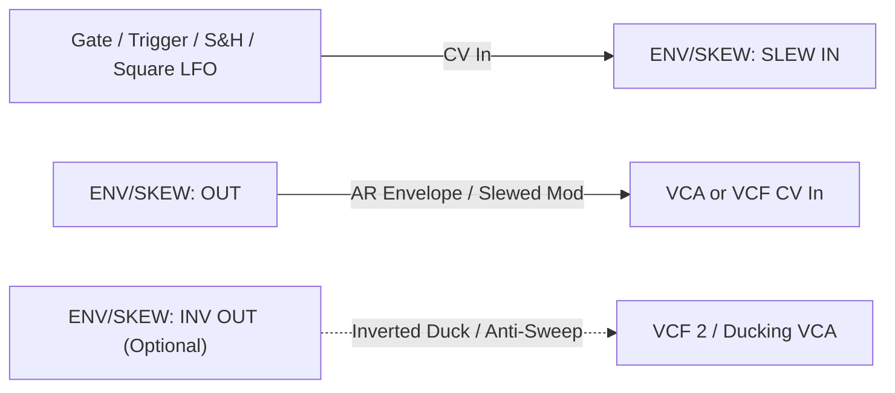

[← All Patch Guides](README.md)

# 08 — Gate-to-AR Envelope & Slewed Modulation

> **Mode:** Asymmetric Skew Limiter (**`SLEW IN` patched** — **`IN` and `GAIN` are bypassed**)

Any gate, trigger, stepped random voltage (Sample & Hold), or square LFO patched into **`SLEW IN`** transforms `ENV / SKEW` into a **linear-ramp AR / ASR envelope generator**, an **organic S&H smoother**, or an **asymmetric LFO waveshaper**—with **`OUT`** and **`INV OUT`** simultaneously generating positive and inverted modulation sweeps.

---

## What You Need

- **Gate / Trigger generator**, **Sample & Hold (stepped random)**, or **Square LFO**
- **Target VCA, VCF, Wavefolder, or FM VCO**
- **Audio source + Mixer** *(to hear the shaped modulation)*

---

## Patch Diagram

---

## Front-Panel Starting Settings

### A. Linear-Ramp AR / ASR Envelope Generator (Gate / Trigger → `SLEW IN`)

| Control | Starting Position | Electrical State & Purpose |
| :--- | :--- | :--- |
| **`GAIN`** | *Bypassed* | Disconnected when **`SLEW IN`** is patched |
| **`ATK`** | `7:30–11 o'clock` (`5–40%`) | `1–25 ms` (`FAST`) or `10–300 ms` (`SLOW`) linear rise to gate peak |
| **`REL`** | `11–3 o'clock` (`40–75%`) | `20–100 ms` (`FAST`) or `200 ms–1.0 s` (`SLOW`) linear decay to `0.00 V` |
| **`OFFSET`** | `12 o'clock` (Center Detent) | `0.00 V` rest floor (unipolar `0 V → +5 V` / `+8 V` gates) |
| **Left Toggle** | **DOWN (`RAW`)** *(or **UP (`SMOOTH`)** for vactrol curves)* | `RAW` = sharp linear triangle/trapezoid peaks; `SMOOTH` = rounded analog curves |
| **Right Toggle** | **DOWN (`FAST`)** *(or **UP (`SLOW`)**)* | `FAST` (`0.29–289 ms` / `0.18–178 ms`); `SLOW` (`3 ms–3.00 s` / `1.84 ms–1.84 s`) |
| **`+ / −` LED** | **Dark** idle → **Green** during gate | Shows envelope rise, sustain hold, and exact return to `0 V` |

### B. Stepped Random S&H Smoother / LFO Waveshaper (S&H or Square LFO → `SLEW IN`)

| Control | Starting Position | Electrical State & Purpose |
| :--- | :--- | :--- |
| **`ATK`** | `11–2 o'clock` (`40–65%`) | Sets upward ramp slope (slow `ATK` + fast `REL` = rising saw LFO!) |
| **`REL`** | `11–2 o'clock` (`40–65%`) | Sets downward ramp slope (fast `ATK` + slow `REL` = falling saw LFO!) |
| **`OFFSET`** | `12 o'clock` (Center Detent) | Centers bipolar `±5 V` S&H/LFO (`Red ↔ Green` LED) |
| **Left Toggle** | **UP (`SMOOTH`)** | Rounds stepped corner artifacts for ultra-silky modulation |
| **Right Toggle** | **UP (`SLOW`)** *(or **DOWN (`FAST`)** for fast LFOs)* | `SLOW` creates multi-second organic drifting tides from stepped random |

---

## Step-by-Step Dial-In

### Application A: Linear-Ramp AR / ASR Envelope & Vactrol Emulation
1. **Patch a `+5 V` or `+8 V` Gate (or Trigger) into `SLEW IN`** and **`OUT` → VCA CV** (and/or VCF Cutoff CV).
2. **Keep `OFFSET` at `12 o'clock` center detent (`0.00 V`)** so your VCA closes cleanly when the gate ends.
3. **Understand Gate Length Behavior (ASR vs. AR):**
   - **ASR (Sustain while held):** If **`ATK`** is shorter than your gate pulse width, `OUT` ramps linearly up to your gate voltage (`+5 V` or `+8 V`), holds flat while the gate stays high, and ramps linearly back to `0.00 V` when the gate drops (`REL`).
   - **AR Pluck from Triggers / Short Gates:** Turn **`ATK`** low (`7–8 o'clock`, `0.3–10 ms`) so even a `5–10 ms` trigger shoots `OUT` toward full height before **`REL`** smoothly decays down! *(Note: ultra-short `< 1 ms` triggers won't reach full `5 V` unless `ATK` is near `7 o'clock` in `FAST` mode—which takes `0.29 ms` to hit `+5 V`!)*
4. **Engage "Vactrol / LPG" Curve Mode (`SW1` = UP `SMOOTH`):**
   - Linear op-amp envelopes can sound stiff or mechanical at the peak corner. Flip the left toggle **UP (`SMOOTH`)** (`29.0 Hz` T-filter, `τ = 5.49 ms`): it gently rounds the transition into sustain/decay with **`0.00%` peak voltage loss**, creating a woody, natural low-pass-gate feel!

### Application B: Slewed Random (S&H) & LFO Morphing
1. **Patch a stepped Sample & Hold** (e.g., clock-synced random `±5 V`) into **`SLEW IN`**, flip **Right toggle UP (`SLOW`)** and **Left toggle UP (`SMOOTH`)**, and route **`OUT`** to VCF Cutoff, Wavetable Position, or Reverb Mix.
   - At `11–2 o'clock` on **`ATK`** and **`REL`**, jagged staircase jumps become rolling, tidal analog curves (`123–452 ms` per `5 V` move).
   - Keep **`ATK` fast (`8 o'clock`)** and **`REL` slow (`3 o'clock`)** for random "ping-and-drift" spikes—jumping abruptly to bright values and lazily drifting downward!
2. **Morph a 50% Square LFO into Triangle / Sawtooth Waves:**
   - Patch a `0.5–10 Hz` `±5 V` square LFO into **`SLEW IN`** (**`FAST`** mode, **`RAW`** toggle DOWN).
   - **Matched `ATK = REL`:** Converts the square wave into a **Triangle LFO** (or rounded trapezoid at faster knob settings).
   - **Fast `ATK` (`7 o'clock`) + Slow `REL` (`12–3 o'clock`):** Converts the square wave into a **Ramp-Down Sawtooth LFO** (instant jump up, linear slide down).
   - **Slow `ATK` (`12–3 o'clock`) + Fast `REL` (`7 o'clock`):** Converts the square wave into a **Ramp-Up Reverse Sawtooth LFO**!

---

## How the Controls Shape the Patch

- **Why `ENV / SKEW` excels as an AR generator (`0.00 V` stop + no droop):** Passive RC slews approach `0 V` asymptotically and leave a sluggish residual tail, while uncompensated diode slews stop prematurely around `0.65 V`. Because `U1D` drives `C11`–`C13` inside its feedback loop toward `±10.89 V` using low-leakage `1N4148W` silicon diodes (`D4`, `D5`) and `U2A`'s FET input, envelopes hit full target height cleanly and snap to an exact `0.00 V` baseline.
- **`OFFSET` turns any `0–5 V` gate into a Bipolar Envelope:** While holding **`ATK` / `REL`** in AR mode, turning **`OFFSET`** to `9:30 o'clock` (`−2.5 V`) turns a `0 → +5 V` gate into a **`−2.5 V → +2.5 V` bipolar sweep**—ideal for opening and closing bipolar VCF cutoffs or stereo panners around center!

---

## Variations & Creative Patches

- **Simultaneous Opening VCA + Ducking Filter (`OUT` + `INV OUT`):** Trigger **`SLEW IN`** with a rhythmic gate; send **`OUT`** to open a synth VCA while sending **`INV OUT`** (with VCF Cutoff set high) to darken a companion pad or drone on every note—zero extra envelope modules needed!
- **Rhythmic Decay Bursts from Clock Divisions:** Patch a dense `16th-note` or irregular Euclid gate pattern into **`SLEW IN`**, set **`ATK` = `7 o'clock`**, **`SW2` = UP (`SLOW`)**, and **`REL` = `2–4 o'clock`** (`0.5–1.2 s`). Rapid gate bursts pump the envelope up step-by-step like a bouncing delay before smoothly gliding back down during empty bars!
- **Sub-Audio Gate Delay / Elongation:** Feed a short `10 ms` trigger into **`SLEW IN`** (`FAST`, `ATK = 7 o'clock`, `REL = 2 o'clock`) and patch **`OUT`** into a comparator or another module's trigger/gate input (with threshold around `~1–2 V`) to stretch short trigger spikes into controllable `~50–150 ms` musical gates!

---

## Troubleshooting & Tips

| Symptom | Likely Cause | Fix |
| :--- | :--- | :--- |
| Short trigger (`1–2 ms`) produces tiny envelope peak | `ATK` not low enough or `SW2` set to `SLOW` (`2.99 ms` min rise) | Flip right toggle **DOWN (`FAST`)** (`0.29 ms` min rise) and set **`ATK` = `7 o'clock`** |
| Stepped random S&H barely moves | `ATK` and `REL` set too slow for clock rate in `SLOW` mode | Turn **`ATK`/`REL`** down (`8–11 o'clock`) or flip right toggle **DOWN (`FAST`)** |
| VCA leaks sound slightly when gate is off | `OFFSET` slightly CW of `12 o'clock` (or `+120 mV` detent tolerance) | Ensure **`OFFSET`** sits in center detent (or nudge tiny fraction CCW to dim **Red** if VCA has low threshold) |
| LFO turns into tiny wobble instead of triangle/saw | `ATK` or `REL` too slow for LFO frequency | Flip right toggle **DOWN (`FAST`)** and tune knobs so rise+fall fits inside one LFO period |

---

[← Previous: 07 — Asymmetric Portamento & 303-Style Slides](07-asymmetric-portamento-slides.md) · [All Patch Guides](README.md)
